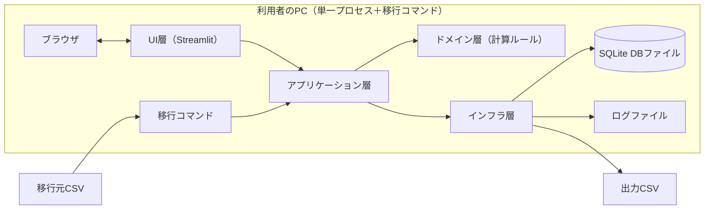
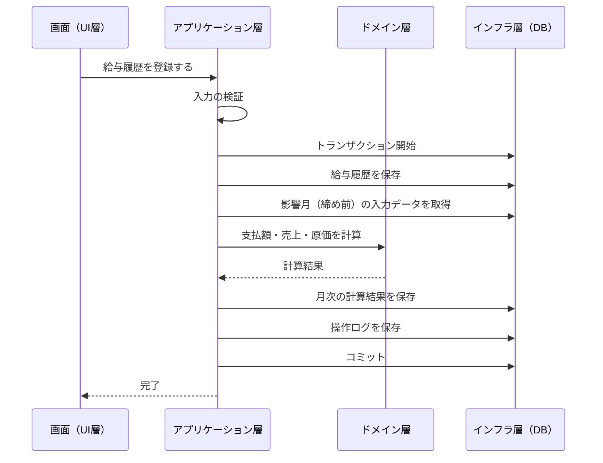

# グループG エンジニア管理CRM アーキテクチャ設計書 v0.6

> バージョン：v0.6
> 更新日：2026-10-22
> 目的：要件定義書の技術要件を、層構成・データ保存・セキュリティ・配布の設計に落とし込み、後続の設計書と実装の前提を定める
> 対象読者：本システムの設計・実装・テスト・運用に関わる担当者
> 対象範囲：システム全体の構成と共通方針。テーブル定義・画面項目・計算の詳細は、それぞれの設計書で定める
> 前提：[要件定義書_v0.6.md](./要件定義書_v0.6.md)（DB は SQLite、画面は Streamlit、配布は exe 化）、[用語集_v0.5.md](./用語集_v0.5.md)、[実装計画書_v0.4.md](./実装計画書_v0.4.md)（Python の版・対応 OS・PoC・CI の決定事項）

## 目次
1. 設計方針
2. 全体構成
3. 層構成
4. 技術選定
5. データ保存
6. 処理方式
7. セキュリティ
8. ログ・エラー処理
9. 配布・更新・バックアップ
10. 非機能目標
11. 要件トレーサビリティ
12. 未決事項
13. 変更履歴

## 1. 設計方針
- 設計項目に ID（`ARC-xxx`）を付け、要件 ID（`REQ-xxx`）と対応づける（11章）
- 事実と未決事項を区別する。確認できていない内容は `TBD:` とする
- 依存ライブラリは、標準ライブラリで代替できない場合だけ追加する（リポジトリルール）
- 業務ルールの計算は、画面やDBに依存しない純粋な関数に集約し、固定値でテストできるようにする

## 2. 全体構成 `ARC-001`
- 1台のPCで、Streamlit のローカルWebサーバーと SQLite のDBファイルを動かす。単独利用とする
- 利用者はブラウザで画面を操作する。外部のDBサーバーやネットワークサービスは使わない
- 移行ツールは、アプリとは別のコマンドとして CSV を読み込み、同じDBファイルへ投入する

## 3. 層構成

### 3.1 層と責務 `ARC-002`
| 層 | 責務 | 依存してよい層 |
|---|---|---|
| UI層 | 画面の表示、入力の受け取り、一時的なUI状態の保持、起動時のパスコード認証の関門（7.1）。業務ルールは持たない | アプリケーション層 |
| アプリケーション層 | ユースケースの実行、トランザクション境界、操作ログの記録、入力の検証、パスコードの検証 | ドメイン層、インフラ層（インターフェース経由） |
| ドメイン層 | 期・半期の判定、日割り、支払額・減額、売上、原価、賞与、昇給の計算。入出力（DB・ファイル・時刻）を持たない | なし |
| インフラ層 | DBアクセス、マイグレーション、CSV入出力、祝日取得、ログ出力、設定の読み込み、多重起動の防止 | ドメイン層（型のみ） |

- 依存は、UI層 → アプリケーション層 → ドメイン層の向きに限る。逆向きの参照を禁止する
- アプリケーション層は、DBアクセスのインターフェース（`Protocol`）だけに依存する。実装はインフラ層が持つ
- 移行コマンドはアプリケーション層を呼び出す。UI層には依存しない
- 外部入力（画面・CSV・設定）の検証は、アプリケーション層の境界で行う

### 3.2 ステートレス制約の適用層 `ARC-003`
リポジトリルール（コーディング規約）に基づき、層ごとに次のとおり適用する。

| 層 | 保持してよいもの | 保持してはいけないもの |
|---|---|---|
| UI層 | 選択中の対象月、未確定の入力、表示・並び順などの一時的なUI状態 | 確定した業務データ、業務データのキャッシュ |
| アプリケーション層・ドメイン層・インフラ層 | なし（設定の読み込み結果などの不変値を除く） | 業務データ、キャッシュ、セッション、グローバル変数 |

- 業務データの正は常にDBとする。画面は表示のたびにアプリケーション層経由でDBから読む
- Streamlit のキャッシュ機能（`st.cache_data` など）を業務データに使わない。月次締めや再計算の結果と食い違うことを防ぐため
- 確定した業務データは、必ずアプリケーション層経由でDBへ保存する

## 4. 技術選定 `ARC-004`

### 4.1 実行時の依存
| 項目 | 採用 | 版・ライセンス・最終公開日（PyPI、2026-10-21 確認） | 根拠 |
|---|---|---|---|
| 言語 | Python 3.13（要件は 3.11以上） | 開発環境は 3.13.9。`requires-python` を 3.13 系に固定する（実装計画書 `IPD-001`、ユーザー回答 2026-10-22） | `REQ-TEC-001` |
| 画面 | Streamlit | 1.66.0／Apache-2.0／2026-10-14。Python 3.11以上が必要 | `REQ-TEC-003` |
| 祝日 | jpholiday | 1.0.3／MIT／2025-12-26 | `REQ-TEC-004` |
| DBアクセス | 標準 `sqlite3` | 標準ライブラリ | `REQ-TEC-002` |
| CSV入出力 | 標準 `csv` | 標準ライブラリ | `REQ-TEC-005`、`REQ-FUN-011` |
| 設定 | 標準 `tomllib`（読み込み専用） | 標準ライブラリ（3.11以上） | 本書 |
| ログ | 標準 `logging` | 標準ライブラリ | 本書 |

- 版は、直接の依存を `pyproject.toml` で `==` 固定し、間接の依存を OS ごとの `pip freeze` の出力（`locks/`）で固定する（リポジトリルール、実装計画書 `IPD-003`）。Streamlit は OS により導入されるパッケージが異なるため（`watchdog` は macOS では入らない）、OS ごとに分ける
- Streamlit の必須依存には、numpy、pandas、pyarrow、pillow などが含まれる（PyPI の依存情報）。配布サイズが増えるため、サイズは実測して 10章の目標と比較する
- 上記以外の実行時依存は追加しない。追加する場合は、必要性・ライセンス・更新日を確認し、ユーザーの承認を得る

### 4.2 開発時の依存
配布物には含めない。ユーザーが 2026-10-21 に承認済み（テスト計画書 3.1）。

| 用途 | 採用 | 版・ライセンス・最終公開日（PyPI、2026-10-21 確認） |
|---|---|---|
| テスト | pytest | 9.1.1／MIT／2026-06-19 |
| モック | pytest-mock | 3.17.0／MIT／2026-10-17 |
| リント・整形 | ruff | 0.17.1／MIT／2026-10-15 |
| 型チェック | mypy（strict） | 2.4.0／MIT／2026-10-01 |
| カバレッジ | pytest-cov | 7.1.0／MIT／2026-03-21 |
| （pytest-cov の依存） | coverage.py | 7.16.2／Apache-2.0／2026-09-27 |

- 型チェッカーは、Python 実装ルールが `mypy` または `pyright` を認めている。pyright は PyPI 上のライセンス表記が空欄のため、候補から外した

### 4.3 採用しないもの
| 項目 | 理由 |
|---|---|
| SQLAlchemy、Alembic | 要件定義書 v0.4 で不採用に確定 |
| Excel 出力ライブラリ（openpyxl、XlsxWriter） | Excel 出力を要件から外したため |
| gspread | 移行を CSV 読み込みのみにしたため |
| PySide6 | 画面を Streamlit に確定したため |

## 5. データ保存

### 5.1 DBファイル `ARC-005`
- DBは SQLite の単一ファイルとし、標準 `sqlite3` でアクセスする
- 接続ごとに外部キー制約を有効にする（SQLite は既定で無効のため、`PRAGMA foreign_keys = ON` を実行する）
- 更新は、1ユースケース1トランザクションとする。途中で失敗したらロールバックし、再実行しても結果が壊れないようにする
- 日時は、タイムゾーン付き（UTC）で保存する。日付は ISO 8601 形式の文字列で保存する。具体的な型は、データ設計書で定める
- 接続は、使用後に確実に閉じる（`contextlib.closing` または `try` / `finally`）
- 接続の生成と破棄はインフラ層だけが行う

### 5.2 保存場所と設定 `ARC-006`
- 設定ファイル・DBファイル・ログファイルは、OS標準のユーザーデータ領域に置く。インストール先には書き込まない（リポジトリルール）
- パスは設定モジュールで一元管理し、コードにハードコードしない
- 設定ファイルは TOML とし、秘密情報を平文で置かない
- 対応 OS は Windows と macOS（ユーザー回答 2026-10-22）。データ領域は、Windows が `%LOCALAPPDATA%` の下の `crm-g`、macOS が `~/Library/Application Support` の下の `crm-g` とする案（実装計画書 `IPD-009`。実機で確認する）
- OS ごとの処理（データ領域のパス・ロック・アクセス権）は、インフラ層の 1 か所に閉じ込める（実装計画書 `IPL-025`）

### 5.3 多重起動の防止 `ARC-007`
- 起動時に、データ領域のロックファイルを排他的に取得する。取得できなければ、起動中の旨を表示して終了する
- ロックはプロセス終了時に解放する。方式は、OS の排他ロック（Windows は `msvcrt.locking`、macOS は `fcntl.flock`）とする案（実装計画書 `IPD-007`）。ロックファイルの存在だけで判定すると、異常終了後に残るため
- PoC（実装計画書 `POC-06`）で、Windows の `msvcrt.locking` について、次を確認した。2 つ目のプロセスの取得は失敗する。1 つ目を強制終了した後は、再び取得できる。PyInstaller（onedir）と cx_Freeze の exe の中でも、同じ結果だった。PyInstaller の onefile では、親プロセス（ブートローダー）だけを強制終了すると、子プロセスが残ってロックを保持し続けた（実装計画書 4.4 の PoC の結果）
- `TBD:` macOS の `fcntl.flock` は、未確認である。`POC-06` の合格基準（Windows と macOS の両方で成立する）は、未達である
- Streamlit は、1つのプロセスが複数のブラウザタブからの接続を受け付ける。タブ間の更新競合は、トランザクションの分離で防ぐ（更新時は `BEGIN IMMEDIATE`）

### 5.4 マイグレーション `ARC-008`
- スキーマの変更は、`DDL/` 配下の連番SQL（例：`001_create_employee.sql`）で管理する（成果物ルール）
- 適用済みの版を、DB内の管理テーブル（版番号・適用日時・SQLのチェックサム）に記録する。チェックサムは、改行を `\n` に正規化してから計算する（OS・Git の設定による改行の違いで、書き換えと誤検知しないため。実装計画書 `IPD-005`）
- 起動時に、未適用の連番SQLを順に実行する。適用済みSQLのチェックサムが変わっていたら、起動を中止してエラーを出す（書き換えの検知）
- 連番SQLは配布物に同梱する。適用前に、DBをバックアップする（9.3）
- DBのスキーマ版が、アプリの対応版より新しい場合は、起動を中止する（古いアプリで新しいDBを壊さないため）

## 6. 処理方式

### 6.1 再計算 `ARC-009`
- 給与履歴・稼働期間・稼働状態マスタ・営業日カレンダーを更新するユースケースは、同じトランザクション内で、影響する「締め前の月」を再計算して保存する（`REQ-CAL-008`）
- 手動の一括再計算も、同じアプリケーション層の関数を呼び出す
- 再計算は、同期処理とする。`TBD:` 想定の社員数・データ量は要件定義書にない。性能が不足する場合は、方式を見直す
- 支払額・売上・原価は、ドメイン層の計算関数で求める。原価の計算は、同じ支払額を使う（`REQ-CAL-009`）

### 6.2 月次締め `ARC-010`
- 締めは、その月の給与・売上・原価を確定値として保存し、`is_closed` を立てる。1つのトランザクションで行う
- 締め済みの月は、再計算の対象から除外する
- 締めの解除ができる。解除の操作は操作ログに残す（`REQ-FUN-014`）

### 6.3 CSV出力 `ARC-011`
- 人事連携用の出力と各一覧の出力は、標準 `csv` で書き出す。項目は、画面設計書とデータ設計書で定める
- 文字コードと改行コードは、出力先（人事連携の受け取り側）の要件に合わせる。`TBD:` 受け取り側の要件は要件定義書にない
- 出力は、操作ログに記録する（給与・賞与を含む出力。詳細は[権限・セキュリティ設計書](./権限・セキュリティ設計書_v0.5.md)）

### 6.4 祝日と営業日 `ARC-012`
- 祝日は jpholiday から取得し、営業日カレンダー（`business_calendar`）に取り込む。会社休日は画面から登録する
- 営業日数の計算は、ドメイン層が営業日カレンダーの内容を受け取って行う。ドメイン層は jpholiday を直接呼ばない

### 6.5 移行ツール `ARC-013`
- 移行元のCSV（①②③を書き出したもの）を、標準 `csv` で読み込む
- 処理順は、名寄せ → 整形 → 検証 → 一括投入とする。名寄せできなかった人と検証エラーは、レポートに出す（`REQ-MIG-001`、`REQ-MIG-002`）
- 取り込まないもの（支払額、パスワード列など）は、読み込み時に除外する（`REQ-MIG-004`〜`REQ-MIG-006`）
- 投入は、アプリケーション層を通して行い、1回の取り込みを1トランザクションとする。失敗時は全件ロールバックする
- 実行後は、取り込み件数・エラー件数をログとレポートに残す

## 7. セキュリティ

### 7.1 認証 `ARC-014`
- ロールは設けない（要件定義書 v0.6）。起動時にパスコードを入力した起動者が、マスター権限（すべての情報の閲覧とすべての操作）を持つ（`REQ-SEC-005`）
- パスコードの検証は、アプリケーション層が行う。認証を通過するまで、UI層はどの画面も表示しない（認証の関門）
- 認証の通過状態は、UI層の一時的なUI状態として保持する（`ARC-003`）。アプリケーション層以下は、認証状態を保持しない
- 方式の詳細（ハッシュ方式、保存、失敗時の扱い、初回設定）は、[権限・セキュリティ設計書](./権限・セキュリティ設計書_v0.5.md)で定める

### 7.2 操作ログ `ARC-015`
- 給与・賞与を見た・変えた記録と、月次締めの解除を、操作ログとして保存する（`REQ-SEC-002`）。変更前後の値も保存する
- 操作ログは、業務データと同じDBに保存する。記録は、操作と同じトランザクションで行う
- 操作ログのテーブル定義は、データ設計書で定める。要件定義書のデータモデルにはない
- ログに保存する項目に、パスコードなどの認証情報を含めない
- 操作ログは給与額を含むため、機微情報として扱う（権限・セキュリティ設計書）

### 7.3 ローカルWebサーバーの保護 `ARC-016`
Streamlit の設定ファイル（公式ドキュメントの `config.toml`）で、次を設定する。設定名は 2026-10-21 時点の公式ドキュメントで確認した。

| 設定 | 値 | 理由 |
|---|---|---|
| `server.address` | `127.0.0.1` | 公式ドキュメントでは、未設定が既定。ローカルPCからだけ接続できるように、明示的に指定する |
| `server.allowedHosts` | `["localhost", "127.0.0.1"]` | 既定は空で、任意の Host ヘッダを受け付ける。DNSリバインディング対策として制限する |
| `server.enableXsrfProtection` | `true` | 既定値。無効化しない |
| `server.enableCORS` | `true` | 既定値。無効化しない |
| `browser.gatherUsageStats` | `false` | 既定は `true`（Streamlit への利用統計の送信）。外部への送信を止める |
| `server.headless` | `true` | ブラウザの自動起動は、`launcher` が標準ライブラリ `webbrowser` で行う（実装計画書 4.5）。PoC（実装計画書 `POC-08`）では、`true` で起動できることを確認した |

- 上記以外の `config.toml` の設定は、実装時に公式ドキュメントで確認してから使う
- PoC（実装計画書 `POC-07`）で、`browser.gatherUsageStats=false`、`server.address=127.0.0.1` のとき、Windows で `127.0.0.1` だけを待ち受け、プロセスの接続に外部アドレスがないことを、OS 標準のコマンドで確認した。exe（PyInstaller の onedir、cx_Freeze）でも同じ結果だった。1 時点の接続の確認であり、通信が無いことの証明ではない
- ポートは固定とし、使用中の場合は、エラーを表示して終了する（実装計画書 4.5。ユーザー承認 2026-10-22）。番号は、実装時に決める（`TBD:`）
- `TBD:` `gatherUsageStats=true` との比較、`server.allowedHosts` による別のホストの拒否は、未確認である

### 7.4 DBファイルの保護 `ARC-017`
- DBファイルは、利用者のユーザーデータ領域に置き、OSのアクセス権で他のユーザーから読めないようにする（`REQ-SEC-003`）
- 標準 `sqlite3` には、暗号化の機能がない。DBファイルは暗号化しない。OSのアクセス権とディスク暗号化に任せる（要件定義書 v0.6 で確定）
- 移行元の他システムのパスワードは保存しない。本アプリのパスコードは、ハッシュだけを DB に保存する（`REQ-SEC-004`、`REQ-SEC-005`）

## 8. ログ・エラー処理 `ARC-018`
- アプリケーションのログは、標準 `logging` でローカルのファイルに出力する。容量の上限とローテーションを設ける（`RotatingFileHandler` を使う）
- ログレベル（ERROR / WARN / INFO / DEBUG）を使い分ける。個人情報・給与額・認証情報は出力しない。必要な場合はマスクする
- 例外は、握りつぶさない。意味のある単位で捕捉し、独自例外で原因を保持して再送出する。画面には、原因を特定できない一般的なメッセージを出す
- Streamlit の画面にスタックトレースを表示しない。`client.showErrorDetails` の値は `TBD:`（PoC（実装計画書 `POC-08`）では、画面での効果を確認できていない。実装時に確認して決める）
- 操作ログ（7.2）とアプリケーションのログは、目的が異なるため分けて管理する

## 9. 配布・更新・バックアップ

### 9.1 exe化の方式 `ARC-019`
要件定義書 v0.4 で、exe 化して配布することが確定している。次の候補を比較した。ユーザー回答（2026-10-22）により、PoC で試す候補は PyInstaller と cx_Freeze の 2 つである（実装計画書 `IPL-010`）。Nuitka は PoC の対象外とし、AGPLv3以降の確認は不要になった。py2exe は、回答の候補に含まれない。

| 候補 | 版 | 最終公開日 | ライセンス（PyPI） | 対応 Python（PyPI） |
|---|---|---|---|---|
| PyInstaller | 6.22.3 | 2026-09-12 | GPLv2（公式ドキュメントでは、生成した実行ファイルを任意のライセンスで配布できる例外がある） | 3.8以上、3.16未満 |
| Nuitka | 4.3.1 | 2026-10-17 | AGPLv3以降 | PyPI 上の表記なし |
| cx_Freeze | 8.7.2 | 2026-10-14 | PSF-2.0 | 3.10以上、3.16未満 |
| py2exe | 0.14.2.0 | 2026-06-21 | MIT／MPL 2.0 | 3.10以上、3.15未満 |

- PoC（実装計画書 `POC-01`）で、Windows において、Streamlit を含む最小のアプリ（`st.navigation` で 2 ページ、`sqlite3`、`jpholiday`、同梱の SQL ファイル）を、PyInstaller（onedir・onefile）と cx_Freeze のいずれでも exe 化でき、起動してブラウザから操作できることを確認した。同梱の SQL の読み込み、`jpholiday`（祝日名「元日」）の呼び出しも動作した。実測値は、実装計画書 4.4 に記録した
- `TBD:` macOS での exe 化は、未確認である。macOS は、必要になった時点で再検討する（実装計画書 11章-14）
- ライセンス一覧（配布物に含まれる全ライブラリ）は、`importlib.metadata` で実行時に集めると、PyInstaller は同梱された 11 件だけになり、`License` 欄の内容にもばらつきがある。cx_Freeze は、開発用ツール（`mypy`、`pytest` など）が混入した 92 件になる。いずれも、そのままでは配布物に添付する一覧にならない。ビルド時に、同梱するライブラリを限定して生成する設計が必要である（実装計画書 4.4.3、`PH-16`）
- 選定は、実装計画書の最初のフェーズ（`PH-00`）で、小さな試作（PoC）により行う。評価項目は次のとおり
  - Streamlit のアプリが起動し、ブラウザから操作できる
  - 配布物のサイズと、起動時間
  - 同梱するデータファイル（連番SQL、設定ファイル）の扱い
  - ライセンス（配布物に含まれる全ライブラリのライセンス一覧を作れる）
- PyInstaller の出力は、動かした OS と Python の版に固有である。Windows と macOS は、それぞれの OS でビルドする（実装計画書 `IPL-011`）
- 採用するツールは、PyInstaller とし、配布の形式は Windows の onedir とする（実装計画書 4.5。ユーザー承認 2026-10-22）。onefile は、起動に約 3 秒かかり、親だけを終了すると子がロックを保持し続けるため、採用しない（`POC-06`）。macOS は、必要になった時点で再検討する

### 9.2 署名と改ざん検知 `ARC-020`
- 実行ファイルには、コード署名を行わない。ユーザーが、リポジトリルール（コード署名を行う）の例外として承認した（2026-10-22。数人に配布する個人利用のため）。配布の手順書に、Windows の SmartScreen の警告が出ることと、その扱いを書く（実装計画書 `PH-16`）
- 改ざんの検知（リポジトリルールは、ハッシュ値等での検知を求めている）の方法は、`TBD:` `PH-16` の前に、ユーザーに確認する

### 9.3 更新とバックアップ `ARC-021`
- 更新は、新しい版の配布物に置き換える方式とする。配布方法の詳細は `TBD:`
- 更新後の初回起動で、DBのバックアップを作成してから、マイグレーション（5.4）を実行する。失敗したときは、バックアップから復元できるようにする
- バックアップは、標準 `sqlite3` の接続が持つバックアップ機能（`Connection.backup`）で作成する。作成時点の整合性を保つため
- 利用者が手動でバックアップ・復元できる機能を、画面に用意する。具体的な画面は、画面設計書で定める
- データのエクスポートは CSV で行う（6.3）。インポートは、移行ツールの CSV 読み込みとは別に、`TBD:` 要否を確認する
- 配布物には、同梱する全ライブラリのライセンス一覧を添付する（リポジトリルール）

## 10. 非機能目標 `ARC-022`
リポジトリルールは、起動時間と常駐メモリの目標値を決めることを求めている。要件定義書には値がない。本システムは、数人に配布する個人利用で、機能設計どおりに動くことを重視するため、ユーザーが、数値の目標を設けないことを、リポジトリルールの例外として承認した（2026-10-22。実装計画書 4.5）。PoC の実測値（Windows、PyInstaller の onedir）を、参考値として記載する。

| 項目 | 目標値 | 参考値（PoC の実測。実装計画書 4.4.1） |
|---|---|---|
| 起動時間 | 設けない | `serve` の起動から応答まで 1.05〜1.14 秒 |
| 常駐メモリ | 設けない | 約 72 MiB（ブラウザ未接続）。認証の scrypt の計算は、約 128 MiB を一時的に使う（権限・セキュリティ設計書 3.1） |
| 配布物のサイズ | 設けない | 202.9 MiB |
| 月次再計算の所要時間 | `TBD:`（想定の社員数・データ量とあわせて決める。実装計画書 11章-1） | — |
| ログの容量上限 | `TBD:`（同上） | — |

## 11. 要件トレーサビリティ
| 設計 ID | 設計項目 | 対応する要件 |
|---|---|---|
| `ARC-001` | 全体構成 | `REQ-TEC-003`、`REQ-TEC-006` |
| `ARC-002` | 層と責務 | `REQ-CAL-001`〜`REQ-CAL-021`、`REQ-FUN-001`〜`REQ-FUN-014` |
| `ARC-003` | ステートレス制約の適用層 | `REQ-CAL-008`、`REQ-FUN-013` |
| `ARC-004` | 技術選定 | `REQ-TEC-001`〜`REQ-TEC-005` |
| `ARC-005` | DBファイル | `REQ-TEC-002` |
| `ARC-006` | 保存場所と設定 | `REQ-SEC-003` |
| `ARC-007` | 多重起動の防止 | `REQ-TEC-002` |
| `ARC-008` | マイグレーション | `REQ-TEC-002` |
| `ARC-009` | 再計算 | `REQ-CAL-003`〜`REQ-CAL-009`、`REQ-CAL-012` |
| `ARC-010` | 月次締め | `REQ-FUN-005`、`REQ-FUN-013`、`REQ-FUN-014` |
| `ARC-011` | CSV出力 | `REQ-FUN-011`、`REQ-FUN-012` |
| `ARC-012` | 祝日と営業日 | `REQ-DAT-002`、`REQ-CAL-001`、`REQ-TEC-004` |
| `ARC-013` | 移行ツール | `REQ-MIG-001`〜`REQ-MIG-006`、`REQ-FUN-010`、`REQ-TEC-005` |
| `ARC-014` | 認証 | `REQ-SEC-005` |
| `ARC-015` | 操作ログ | `REQ-SEC-002`、`REQ-FUN-014` |
| `ARC-016` | ローカルWebサーバーの保護 | `REQ-TEC-003`、`REQ-SEC-003` |
| `ARC-017` | DBファイルの保護 | `REQ-SEC-003`、`REQ-SEC-004` |
| `ARC-018` | ログ・エラー処理 | `REQ-SEC-002` |
| `ARC-019` | exe化の方式 | `REQ-TEC-006` |
| `ARC-020` | 署名と改ざん検知 | `REQ-TEC-006` |
| `ARC-021` | 更新とバックアップ | `REQ-TEC-002`、`REQ-TEC-006` |
| `ARC-022` | 非機能目標 | `REQ-TEC-006` |

## 12. 未決事項
| # | 未決事項 | 関連する設計 | 決める文書 |
|---|---|---|---|
| 1 | （案あり）対応OSは Windows と macOS に決定。データ領域のパスは案（実装計画書 `IPD-009`）で、実機で確認する | `ARC-006` | 実装計画書 `PH-03` |
| 2 | （解決済み）Python は 3.13 系に固定する（実装計画書 `IPD-001`） | `ARC-004` | 実装計画書 `IPL-010` |
| 3 | （解決済み）ロールを廃止し、起動時のパスコード認証に確定した | `ARC-014` | 要件定義書 v0.6 11章 |
| 4 | （解決済み）DBファイルは暗号化しない | `ARC-017` | 要件定義書 v0.6 11章 |
| 5 | （解決済み・一部未確認）exe 化のツールは PyInstaller、形式は Windows の onedir に決定（実装計画書 4.5）。macOS は未確認で、必要になった時点で再検討する | `ARC-019` | 実装計画書 11章-14 |
| 6 | （解決済み）コード署名は行わない（リポジトリルールの例外。ユーザー承認 2026-10-22）。改ざんの検知の方法は `TBD:` | `ARC-020` | 実装計画書 4.5 |
| 7 | 更新の配布方法とロールバックの詳細 | `ARC-021` | 実装計画書 11章-7 |
| 8 | （一部解決）起動時間・常駐メモリ・サイズは、数値の目標を設けない。想定の社員数・データ量と、再計算の所要時間・ログの容量上限は未決 | `ARC-009`、`ARC-022` | 実装計画書 11章-1 |
| 9 | （解決済み）開発時の依存（pytest、pytest-mock、ruff、mypy、pytest-cov、coverage.py）は、2026-10-21 に承認済み | `ARC-004` | テスト計画書 3.1 |
| 10 | CSV 出力の文字コード・改行コード（人事連携の受け取り側の要件） | `ARC-011` | 画面設計書 |
| 11 | （一部解決）異常終了で残ったロックの扱い。OS の排他ロックとする案（実装計画書 `IPD-007`）は、Windows で成立した。macOS は未確認 | `ARC-007` | 実装計画書 4.4 の PoC の結果（`POC-06`） |
| 12 | （解決済み）Streamlit の起動方式は `server.headless=true` と `webbrowser`、ポートは固定（実装計画書 4.5）。`showErrorDetails` の値は、実装時に確認して決める（`TBD:`） | `ARC-016`、`ARC-018` | 実装計画書 4.5（`POC-08`） |

## 13. 変更履歴
| 版 | 日付 | 変更内容 |
|---|---|---|
| v0.1 | 2026-10-21 | 新規作成 |
| v0.2 | 2026-10-21 | 要件定義書 v0.5、用語集 v0.3 に合わせて、前提の参照先を更新（設計内容の変更なし） |
| v0.3 | 2026-10-21 | 要件定義書 v0.6 に合わせ、ロールを廃止し、起動時のパスコード認証に変更（`ARC-014`）。`ARC-002`、`ARC-010`、`ARC-011`、`ARC-015`、`ARC-017` の記述と、12章-3・4 を更新。トレーサビリティの `ARC-014` を `REQ-SEC-005` に変更 |
| v0.4 | 2026-10-22 | 実装計画書 v0.1 に合わせて更新。4.1 の Python を 3.13 系に固定、間接依存の固定方式。4.2 の開発時の依存を承認済みにし、`pytest-cov`・`coverage.py` を追加。5.2 の対応 OS とデータ領域（案）。5.3 のロック方式（案）。5.4 のチェックサムの正規化。7.3・8 の `TBD:` の確認方法（PoC）。9.1 の PoC 候補（PyInstaller と cx_Freeze、Nuitka は対象外）。9.2・10章の決定時期。12章の更新。案は、実装計画書 9章の差異としてユーザーの確認待ち |
| v0.5 | 2026-10-22 | 実装計画書 v0.3 の PoC の結果（Windows）に合わせて更新。5.3 のロックの確認結果（macOS は未確認）。7.3 の利用統計・待ち受けの確認結果。8 章の `showErrorDetails` の状況。9.1 の exe 化の確認結果とライセンス一覧の制約。10 章の実測値の参照先。12章-5・11・12 の更新。ツールの採用、非機能目標の値、起動方式は、実装計画書 v0.3 の案をユーザーが承認した後に反映する |
| v0.6 | 2026-10-22 | 実装計画書 v0.4 の確定事項（4.5）を反映。7.3 の `server.headless=true` と固定ポート。9.1 の PyInstaller・Windows の onedir。9.2 のコード署名を行わない（リポジトリルールの例外）。10章の数値の目標を設けず、参考値を記載。12章-5・6・8・12 の更新 |