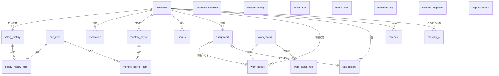

# グループG エンジニア管理CRM データ設計書 v0.4

> バージョン：v0.4
> 更新日：2026-10-22
> 目的：要件定義書のデータモデル（5章）を、SQLite のテーブル・列・制約として具体化し、DDL と実装の前提を定める
> 対象読者：本システムの設計・実装・テスト・運用に関わる担当者
> 対象範囲：テーブル定義、型・制約の方針、整合性ルール、初期データ。DDL そのものは対象外（実装計画書 `PH-04` で作成する）
> 前提：[要件定義書_v0.6.md](./要件定義書_v0.6.md)、[アーキテクチャ設計書_v0.6.md](./アーキテクチャ設計書_v0.6.md)、[用語集_v0.5.md](./用語集_v0.5.md)、[権限・セキュリティ設計書_v0.5.md](./権限・セキュリティ設計書_v0.5.md)（認証・操作ログの設計）、[実装計画書_v0.5.md](./実装計画書_v0.5.md)（フェーズ計画・DDL の作成時期）

## 目次
1. 設計方針
2. ER図
3. テーブル一覧
4. テーブル定義（マスタ）
5. テーブル定義（給与）
6. テーブル定義（賞与）
7. テーブル定義（稼働・売上）
8. テーブル定義（システム）
9. インデックス
10. 整合性ルール
11. 初期データ
12. 要件定義書との差異
13. 未決事項
14. 変更履歴

## 1. 設計方針
設計判断には ID（`DBD-xxx`）を付ける。

| ID | 方針 | 内容 | 根拠 |
|---|---|---|---|
| `DBD-001` | 命名 | テーブル名・列名は英語の `snake_case`、テーブル名は単数形に統一する | コーディング規約、要件定義書 5章 |
| `DBD-002` | 型 | すべてのテーブルを `STRICT` で作成し、型は `INTEGER` と `TEXT` だけを使う（`REAL` は使わない）。`STRICT` は SQLite 3.37.0 以降の機能。確認した開発環境の SQLite は 3.50.4。起動時に版を検査し、3.37.0 未満なら起動を中止する | SQLite 公式ドキュメント、`ARC-005` |
| `DBD-003` | 金額 | 円単位の `INTEGER` で保存する。円未満は、計算仕様書（`CLC-001`）に従って切り上げてから保存する | 要件定義書 11章（端数処理は円未満切り上げ） |
| `DBD-004` | 率・係数 | 万分率の `INTEGER` で保存し、列名の末尾を `_bp` とする（1.0 ＝ 10000、60% ＝ 6000、原価係数 1.2 ＝ 12000）。ドメイン層では `Decimal` として扱い、変換はインフラ層だけが行う | 浮動小数点の誤差を避けるため |
| `DBD-005` | 日付・年月・日時 | 日付は `TEXT` の `YYYY-MM-DD`、年月は `TEXT` の `YYYY-MM`、日時は `TEXT` の ISO 8601 形式（UTC、末尾 `Z`）で保存する。形式は `CHECK` で検査する | `ARC-005` |
| `DBD-006` | 半期 | `TEXT` の `YYYY-H1` / `YYYY-H2` で表す。`YYYY` は期が始まる年（20期上期 ＝ `2026-H1`、20期下期 ＝ `2026-H2`）。期は年月から計算し、保存しない | `REQ-CAL-002` |
| `DBD-007` | 真偽値 | `INTEGER` の 0 / 1 とし、`CHECK (列 IN (0, 1))` を付ける | 本書 |
| `DBD-008` | 固定値の区分 | 要件定義書に列挙された区分は、要件定義書の日本語表記をそのまま保存し、`CHECK (列 IN (...))` で制限する。稼働状態のコードは要件定義書の英字コードを使う | 英訳による意味のずれを避けるため |
| `DBD-009` | 主キー | 代理キーは `INTEGER PRIMARY KEY AUTOINCREMENT` とする。複合キーが自然なテーブルは複合主キーとする | `REQ-DAT-001` |
| `DBD-010` | 外部キー・削除 | すべての外部キーを `ON DELETE RESTRICT` とする。業務データは物理削除せず、退職などは区分で管理する | `REQ-DAT-001`（退職者はフラグで管理） |
| `DBD-011` | 共通列 | `created_at` と `updated_at`（`NOT NULL`、UTC）を、`operation_log` と `schema_migration` 以外のすべてのテーブルに持つ。各テーブルの定義では省略する | 変更の追跡 |
| `DBD-012` | コメント | SQLite には `COMMENT` 文がないため、DDL の SQL コメント（`--`）と、本書の定義を一次情報とする | コーディング規約 |
| `DBD-013` | 制約の分担 | 単一テーブルで判定できる制約は DB の制約で守る。複数行・複数テーブルにまたがる制約（期間の重なりなど）は、アプリケーション層で守る（10章） | `ARC-002` |
| `DBD-014` | 個人情報 | 生年月日・性別・居住エリア・給与・評価は個人情報または機微情報とする。操作ログは、変更前後の値に給与額などを含むため、機微情報とする。サンプルデータと試験データには架空のデータだけを使う | 成果物ルール、`REQ-SEC-002` |

## 2. ER図
主キー・外部キーだけを示す。列の詳細は 4〜8章で定める。

## 3. テーブル一覧
| ID | テーブル | 内容 | 要件 ID |
|---|---|---|---|
| `TBL-001` | `employee` | 社員 | `REQ-DAT-001` |
| `TBL-002` | `business_calendar` | 営業日カレンダー | `REQ-DAT-002` |
| `TBL-003` | `work_status` | 稼働状態マスタ | `REQ-DAT-003` |
| `TBL-004` | `work_status_rate` | 稼働状態の給与支給率（有効期間付き） | `REQ-DAT-003`（設計判断 `DBD-015`） |
| `TBL-005` | `pay_item` | 給与項目・手当マスタ | `REQ-DAT-004` |
| `TBL-006` | `system_setting` | 計算設定 | `REQ-DAT-005` |
| `TBL-007` | `bonus_rule` | 賞与ルール | `REQ-DAT-006` |
| `TBL-008` | `bonus_rate` | 評価ランクの掛け率 | `REQ-DAT-007` |
| `TBL-009` | `salary_history` | 給与履歴 | `REQ-DAT-008` |
| `TBL-010` | `salary_history_item` | 給与の内訳 | `REQ-DAT-009` |
| `TBL-011` | `evaluation` | 評価 | `REQ-DAT-010` |
| `TBL-012` | `monthly_payroll` | 月次の給与計算結果 | `REQ-DAT-011` |
| `TBL-013` | `monthly_payroll_item` | 月次の給与計算結果の内訳 | `REQ-DAT-012` |
| `TBL-014` | `bonus` | 賞与 | `REQ-DAT-013` |
| `TBL-015` | `assignment` | 参画 | `REQ-DAT-014` |
| `TBL-016` | `work_period` | 稼働期間 | `REQ-DAT-015` |
| `TBL-017` | `rate_history` | 単価履歴 | `REQ-DAT-016` |
| `TBL-018` | `forecast` | 見込み | `REQ-DAT-017` |
| `TBL-019` | `monthly_pl` | 月次の売上・原価 | `REQ-DAT-018` |
| `TBL-020` | `operation_log` | 操作ログ | `REQ-SEC-002`、`REQ-FUN-014` |
| `TBL-021` | `schema_migration` | マイグレーションの適用履歴 | `ARC-008` |
| `TBL-022` | `app_credential` | 起動時のパスコードの認証情報（ハッシュ） | `REQ-SEC-004`、`REQ-SEC-005` |

表の列の意味は次のとおり。「必須」は `NOT NULL`。「備考」の「主キー」「外部キー」「一意」「検査」は、DB の制約を示す。

## 4. テーブル定義（マスタ）

### 4.1 `employee`（社員） `TBL-001`
| 列 | 型 | 必須 | 備考 |
|---|---|---|---|
| `id` | INTEGER | ○ | 主キー（自動採番） |
| `email` | TEXT | ○ | 業務キー。一意（`COLLATE NOCASE`）。小文字に正規化して保存し、`CHECK (email = lower(email) COLLATE BINARY)` で検査する。`COLLATE BINARY` がないと、列の照合順序（`NOCASE`）で比較され、大文字を拒否できない（SQLite 3.50.4 で確認） |
| `employee_no` | TEXT | － | 社員番号。一意にするかは `TBD:` |
| `name` | TEXT | ○ | 氏名 |
| `name_kana` | TEXT | － | 氏名（カナ） |
| `employment_type` | TEXT | － | 検査：`正社員`／`契約社員` |
| `birth_date` | TEXT | － | 日付形式 |
| `gender` | TEXT | － | 値の区分は要件定義書にない（`TBD:`） |
| `join_date` | TEXT | － | 入社日 |
| `nearest_station` | TEXT | － | 最寄駅 |
| `residence_area` | TEXT | － | 居住エリア |
| `job_type` | TEXT | － | 職種（PG／SE／PMO など）。一覧が固定かは `TBD:` のため、検査しない |
| `enrollment_status` | TEXT | ○ | 検査：`在籍`／`退職予定`／`退職`／`契約満了`／`移管` |
| `retire_date` | TEXT | － | 退職日 |

- 氏名と在籍ステータス以外を必須にするかは、要件定義書にない。必須項目は画面設計書で定める（`TBD:`）
- 検査：`retire_date` と `join_date` が両方あるとき、`retire_date` が `join_date` 以後であること

### 4.2 `business_calendar`（営業日カレンダー） `TBL-002`
| 列 | 型 | 必須 | 備考 |
|---|---|---|---|
| `calendar_date` | TEXT | ○ | 主キー。日付形式 |
| `is_business_day` | INTEGER | ○ | 土日・祝日・会社休日を除く日が 1 |
| `source` | TEXT | ○ | 検査：`自動取込`／`手動登録`。設計追加（`DBD-016`） |
| `note` | TEXT | － | 例：年末年始 |

### 4.3 `work_status`（稼働状態マスタ） `TBL-003`
| 列 | 型 | 必須 | 備考 |
|---|---|---|---|
| `code` | TEXT | ○ | 主キー。`DEV`、`EDU` など |
| `name` | TEXT | ○ | 名称 |
| `is_billable` | INTEGER | ○ | 売上計上（○が 1） |
| `is_cost_target` | INTEGER | ○ | 原価計上（○が 1） |
| `legacy_name` | TEXT | － | ③の旧名称（移行の読み替え用） |
| `sort_order` | INTEGER | ○ | 表示順 |

### 4.4 `work_status_rate`（稼働状態の給与支給率） `TBL-004`
| 列 | 型 | 必須 | 備考 |
|---|---|---|---|
| `work_status_code` | TEXT | ○ | 主キーの一部。外部キー：`work_status.code` |
| `valid_from` | TEXT | ○ | 主キーの一部。有効期間の開始日 |
| `valid_to` | TEXT | － | 有効期間の終了日。NULL は継続中 |
| `payroll_rate_bp` | INTEGER | ○ | 給与支給率（万分率）。検査：0 以上 |

- 検査：`valid_to` があるとき `valid_from` 以後であること

### 4.5 `pay_item`（給与項目・手当マスタ） `TBL-005`
| 列 | 型 | 必須 | 備考 |
|---|---|---|---|
| `code` | TEXT | ○ | 主キー |
| `name` | TEXT | ○ | 名称 |
| `category` | TEXT | ○ | 検査：`基本給`／`固定支給`／`一時手当` |
| `in_monthly_salary` | INTEGER | ○ | 月給に含めるか（原価係数の対象） |
| `cost_direct` | INTEGER | ○ | 月給の外で、原価にそのまま加算する手当か |
| `deduction_order` | INTEGER | － | 減額順。NULL は減額の対象外。1 以上、一意（NULL を除く） |
| `sort_order` | INTEGER | ○ | 表示順 |
| `valid_from` | TEXT | ○ | 有効期間の開始日 |
| `valid_to` | TEXT | － | 有効期間の終了日 |

- 検査：`in_monthly_salary` と `cost_direct` が同時に 1 にならないこと（月給に含む手当は、原価係数の対象であり、そのまま加算しない）
- 要件定義書に、この検査の記載はない。`REQ-DAT-004` の説明からの解釈であり、確認が必要（`TBD:`）

### 4.6 `system_setting`（計算設定） `TBL-006`
| 列 | 型 | 必須 | 備考 |
|---|---|---|---|
| `setting_key` | TEXT | ○ | 主キーの一部。検査：`原価係数`／`端数処理` |
| `valid_from` | TEXT | ○ | 主キーの一部。有効期間の開始日 |
| `valid_to` | TEXT | － | 有効期間の終了日 |
| `value_integer` | INTEGER | － | 数値の設定値（原価係数は万分率） |
| `value_text` | TEXT | － | 文字列の設定値 |

- 検査：`value_integer` と `value_text` のどちらか一方だけが NULL でないこと
- `端数処理` の値は `切り上げ` だけとする（`value_text`）。初期データで登録する（11.3）

### 4.7 `bonus_rule`（賞与ルール） `TBL-007`
| 列 | 型 | 必須 | 備考 |
|---|---|---|---|
| `id` | INTEGER | ○ | 主キー（自動採番） |
| `valid_from` | TEXT | ○ | 有効期間の開始日（支給月を判定する） |
| `valid_to` | TEXT | － | 有効期間の終了日 |
| `base_type` | TEXT | ○ | 検査：`基本給`／`月給合計` |
| `target_pay_system` | TEXT | ○ | 検査：`通常評価制度`／`年俸制`／`単価連動`。初期値は `通常評価制度` |

### 4.8 `bonus_rate`（評価ランクの掛け率） `TBL-008`
| 列 | 型 | 必須 | 備考 |
|---|---|---|---|
| `eval_half` | TEXT | ○ | 主キーの一部。半期形式 |
| `eval_rank` | TEXT | ○ | 主キーの一部。評価ランク。検査：`S`／`A`／`B`／`C`／`D` |
| `rate_bp` | INTEGER | ○ | 掛け率（万分率）。検査：0 以上 |

## 5. テーブル定義（給与）

### 5.1 `salary_history`（給与履歴） `TBL-009`
| 列 | 型 | 必須 | 備考 |
|---|---|---|---|
| `id` | INTEGER | ○ | 主キー（自動採番） |
| `employee_id` | INTEGER | ○ | 外部キー：`employee.id` |
| `effective_from` | TEXT | ○ | 有効期間の開始日。`employee_id` と合わせて一意 |
| `effective_to` | TEXT | － | 有効期間の終了日。NULL は継続中 |
| `pay_system` | TEXT | ○ | 検査：`通常評価制度`／`年俸制`／`単価連動` |
| `employment_type` | TEXT | ○ | 検査：`正社員`／`契約社員` |
| `grade` | TEXT | － | 等級（新制度のみ。例：P5-15） |
| `annual_salary` | INTEGER | － | 年俸年収。検査：`pay_system` が `年俸制` のときだけ NULL でない |
| `revision_type` | TEXT | ○ | 検査：`定期（4月）`／`定期（10月）`／`年俸改定（4月）`／`制度移行`／`入社`／`その他` |
| `note` | TEXT | － | 備考 |

- 検査：`effective_to` があるとき `effective_from` 以後であること
- 月給合計は保存しない。`salary_history_item` の合計から計算する（`REQ-DAT-009`）

### 5.2 `salary_history_item`（給与の内訳） `TBL-010`
| 列 | 型 | 必須 | 備考 |
|---|---|---|---|
| `salary_history_id` | INTEGER | ○ | 主キーの一部。外部キー：`salary_history.id` |
| `pay_item_code` | TEXT | ○ | 主キーの一部。外部キー：`pay_item.code` |
| `amount` | INTEGER | ○ | 金額（円）。検査：0 以上 |

### 5.3 `evaluation`（評価） `TBL-011`
| 列 | 型 | 必須 | 備考 |
|---|---|---|---|
| `employee_id` | INTEGER | ○ | 主キーの一部。外部キー：`employee.id` |
| `eval_half` | TEXT | ○ | 主キーの一部。半期形式。20期上期（`2026-H1`）以降 |
| `eval_rank` | TEXT | ○ | 評価ランク。検査：`S`／`A`／`B`／`C`／`D` |
| `evaluator` | TEXT | － | 評価者。社員への紐づけの要否は `TBD:` |
| `comment` | TEXT | － | コメント |

- 評価は賞与の元になるが、掛け率の登録（`bonus_rate`）より先に入力できるため、外部キーは張らない

### 5.4 `monthly_payroll`（月次の給与計算結果） `TBL-012`
| 列 | 型 | 必須 | 備考 |
|---|---|---|---|
| `employee_id` | INTEGER | ○ | 主キーの一部。外部キー：`employee.id` |
| `year_month` | TEXT | ○ | 主キーの一部。年月形式 |
| `monthly_salary` | INTEGER | ○ | その月に有効な月給合計（円） |
| `paid_amount` | INTEGER | ○ | 減額・日割り後の支払額（円） |
| `deduction` | INTEGER | ○ | 減額（円） |
| `work_status_summary` | TEXT | － | 稼働状態の要約（人事連携の出力に使う） |
| `hr_target` | TEXT | ○ | 検査：`対象`／`対象外`。既定値は未決（`TBD:`） |
| `hr_note` | TEXT | － | 人事連携の備考 |
| `check_result` | TEXT | ○ | 検査：`OK`／`要確認` |
| `calculated_at` | TEXT | ○ | 最後に計算した日時 |
| `is_closed` | INTEGER | ○ | 月次締め済みか。既定値 0 |
| `closed_at` | TEXT | － | 締めた日時。設計追加（`DBD-017`）。検査：`is_closed` が 1 のときだけ NULL でない |

- `monthly_salary = paid_amount + deduction` は、`CHECK` にしない。成り立たない場合を `check_result = '要確認'` として保存するため（`REQ-CAL-007`）

### 5.5 `monthly_payroll_item`（月次の給与計算結果の内訳） `TBL-013`
| 列 | 型 | 必須 | 備考 |
|---|---|---|---|
| `employee_id` | INTEGER | ○ | 主キーの一部。外部キー：`monthly_payroll` |
| `year_month` | TEXT | ○ | 主キーの一部。外部キー：`monthly_payroll`（`employee_id` と複合） |
| `pay_item_code` | TEXT | ○ | 主キーの一部。外部キー：`pay_item.code` |
| `paid_amount` | INTEGER | ○ | 項目ごとの支給額（円）。検査：0 以上 |
| `deduction_amount` | INTEGER | ○ | 項目ごとの減額（円）。検査：0 以上 |

- 項目の列構成は、要件定義書に「項目ごとの支給額と減額」としかない。上記は、その解釈である（`TBD:`）
- 整合性：項目の `paid_amount` の合計は、`monthly_payroll.paid_amount` と一致する（10章）

## 6. テーブル定義（賞与）

### 6.1 `bonus`（賞与） `TBL-014`
| 列 | 型 | 必須 | 備考 |
|---|---|---|---|
| `employee_id` | INTEGER | ○ | 主キーの一部。外部キー：`employee.id` |
| `eval_half` | TEXT | ○ | 主キーの一部。査定対象の半期 |
| `pay_month` | TEXT | ○ | 支給月（年月形式）。検査：月が `04` または `10` |
| `base_type` | TEXT | ○ | 検査：`基本給`／`月給合計` |
| `base_amount` | INTEGER | ○ | 基準額（円）。検査：0 以上 |
| `eval_rank` | TEXT | － | 評価ランク。検査：NULL または `S`／`A`／`B`／`C`／`D` |
| `rate_bp` | INTEGER | － | 掛け率（万分率）。計算時点の値を複写して保存する |
| `bonus_amount` | INTEGER | ○ | 賞与額（円）。検査：0 以上 |
| `source` | TEXT | ○ | 検査：`取込`／`手入力`／`アプリ計算` |
| `is_closed` | INTEGER | ○ | 確定済みか。既定値 0 |

- `bonus_rate` への外部キーは張らない。19期の評価は取り込まないため、取込の賞与に対応する掛け率がないため
- 検査：`source` が `取込` でないとき、`eval_rank` と `rate_bp` が NULL でないこと
- 支給月と半期の対応（上期 → 同年 10 月、下期 → 翌年 4 月）は、アプリケーション層で検査する（10章）

## 7. テーブル定義（稼働・売上）

### 7.1 `assignment`（参画） `TBL-015`
| 列 | 型 | 必須 | 備考 |
|---|---|---|---|
| `id` | INTEGER | ○ | 主キー（自動採番） |
| `employee_id` | INTEGER | ○ | 外部キー：`employee.id` |
| `customer_name` | TEXT | ○ | 顧客名 |
| `project_name` | TEXT | － | 案件名 |
| `category` | TEXT | ○ | 検査：`SES`／`受託`／`既存アカプラ`／`教育原価` |
| `start_date` | TEXT | ○ | 開始日 |
| `end_date` | TEXT | － | 終了日。NULL は継続中 |

- 検査：`end_date` があるとき `start_date` 以後であること

### 7.2 `work_period`（稼働期間） `TBL-016`
| 列 | 型 | 必須 | 備考 |
|---|---|---|---|
| `id` | INTEGER | ○ | 主キー（自動採番） |
| `employee_id` | INTEGER | ○ | 外部キー：`employee.id` |
| `start_date` | TEXT | ○ | 開始日 |
| `end_date` | TEXT | － | 終了日。NULL は継続中 |
| `work_status_code` | TEXT | ○ | 外部キー：`work_status.code` |
| `assignment_id` | INTEGER | － | 外部キー：`assignment.id`。稼働中のときのみ |
| `billing_ratio_bp` | INTEGER | ○ | 稼働率（万分率）。既定値 10000。検査：0 以上 10000 以下 |
| `note` | TEXT | － | 自由記述 |

- 検査：`end_date` があるとき `start_date` 以後であること
- `assignment_id` を必須にする状態（稼働中）の判定は、アプリケーション層で行う（10章）
- 稼働率の上限を 10000（1.0）とするのは設計上の仮定であり、確認が必要（`TBD:`）

### 7.3 `rate_history`（単価履歴） `TBL-017`
| 列 | 型 | 必須 | 備考 |
|---|---|---|---|
| `id` | INTEGER | ○ | 主キー（自動採番） |
| `employee_id` | INTEGER | ○ | 外部キー：`employee.id` |
| `assignment_id` | INTEGER | － | 外部キー：`assignment.id`。案件単位の単価のときだけ設定する |
| `effective_from` | TEXT | ○ | 有効期間の開始日 |
| `unit_price` | INTEGER | ○ | 単価（円）。検査：0 以上 |
| `revision_basis` | TEXT | － | 改定の根拠 |
| `note` | TEXT | － | 備考 |

- 要件定義書の「assignment_id（または employee_id）」を、`employee_id` を必須とし、`assignment_id` を任意とする形にした（`DBD-018`）
- 一意：`employee_id`、`assignment_id`、`effective_from` の組。SQLite の一意制約は NULL を別の値として扱うため、`COALESCE(assignment_id, 0)` を使った式インデックスで一意にする

### 7.4 `forecast`（見込み） `TBL-018`
| 列 | 型 | 必須 | 備考 |
|---|---|---|---|
| `employee_id` | INTEGER | ○ | 主キーの一部。外部キー：`employee.id` |
| `year_month` | TEXT | ○ | 主キーの一部。年月形式 |
| `confidence` | TEXT | ○ | 確度。検査：`確定`／`高`／`低`／`待機` |
| `forecast_unit_price` | INTEGER | － | 見込み単価（円） |
| `forecast_billing_ratio_bp` | INTEGER | － | 見込み稼働率（万分率）。検査：0 以上 10000 以下 |

### 7.5 `monthly_pl`（月次の売上・原価） `TBL-019`
| 列 | 型 | 必須 | 備考 |
|---|---|---|---|
| `employee_id` | INTEGER | ○ | 主キーの一部。外部キー：`employee.id` |
| `year_month` | TEXT | ○ | 主キーの一部。年月形式 |
| `category` | TEXT | － | 参画の区分。検査：`SES`／`受託`／`既存アカプラ`／`教育原価` |
| `sales` | INTEGER | ○ | 売上（円） |
| `cost_salary` | INTEGER | ○ | 月給部分の原価（円） |
| `cost_allowance` | INTEGER | ○ | 月給の外の手当（円） |
| `cost_bonus` | INTEGER | ○ | 賞与（円） |
| `cost_total` | INTEGER | ○ | 原価合計（円） |
| `gross_profit` | INTEGER | ○ | 粗利（円）。負の値を取り得る |
| `source` | TEXT | ○ | 検査：`取込`／`再計算`／`アプリ計算` |
| `is_closed` | INTEGER | ○ | 月次締め済みか。既定値 0 |

- 検査：`cost_total = cost_salary + cost_allowance + cost_bonus`、`gross_profit = sales - cost_total`
- 主キーが社員と年月だけのため、1 か月に複数の区分の参画がある社員の `category` は 1 つしか持てない。扱いは未決（`TBD:`）

## 8. テーブル定義（システム）

### 8.1 `operation_log`（操作ログ） `TBL-020`
| 列 | 型 | 必須 | 備考 |
|---|---|---|---|
| `id` | INTEGER | ○ | 主キー（自動採番） |
| `occurred_at` | TEXT | ○ | 操作日時（UTC） |
| `operation` | TEXT | ○ | 検査：`閲覧`／`出力`／`登録`／`更新`／`削除`／`月次締め`／`月次締め解除`／`取込`／`認証成功`／`認証失敗`／`パスコード設定` |
| `target_table` | TEXT | ○ | 対象テーブル名。`認証成功`・`認証失敗`・`パスコード設定` は `app_credential` |
| `target_key` | TEXT | － | 対象の主キー（文字列化） |
| `detail` | TEXT | － | 変更した列名などの要約。金額・認証情報は含めない |
| `before_value` | TEXT | － | 変更前の値。`更新`・`削除` で記録する。列名と値の JSON 文字列。検査：`json_valid` |
| `after_value` | TEXT | － | 変更後の値。`登録`・`更新` で記録する。形式は `before_value` と同じ |

- 追記専用とする。`UPDATE` と `DELETE` は、トリガーで拒否する（`DBD-019`）
- 操作した利用者の列は持たない。ロールを廃止し、利用者を区別しないため（要件定義書 v0.6）
- `before_value`・`after_value` に、給与額などの機微情報を含む。認証情報（パスコード、ハッシュ、ソルト）は含めない
- 記録する操作の対象と条件は、[権限・セキュリティ設計書](./権限・セキュリティ設計書_v0.5.md)で定める

### 8.2 `schema_migration`（マイグレーションの適用履歴） `TBL-021`
| 列 | 型 | 必須 | 備考 |
|---|---|---|---|
| `version` | INTEGER | ○ | 主キー。`DDL/` の連番 |
| `name` | TEXT | ○ | ファイル名 |
| `checksum` | TEXT | ○ | SQL のチェックサム（書き換えの検知） |
| `applied_at` | TEXT | ○ | 適用日時（UTC） |

### 8.3 `app_credential`（パスコードの認証情報） `TBL-022`
| 列 | 型 | 必須 | 備考 |
|---|---|---|---|
| `id` | INTEGER | ○ | 主キー。検査：`id = 1`（1行だけ持つ） |
| `algorithm` | TEXT | ○ | ハッシュ方式。検査：`scrypt` |
| `scrypt_n` | INTEGER | ○ | scrypt の CPU／メモリコスト N。検査：1 より大きい |
| `scrypt_r` | INTEGER | ○ | ブロックサイズ r。検査：1 以上 |
| `scrypt_p` | INTEGER | ○ | 並列化 p。検査：1 以上 |
| `salt` | TEXT | ○ | ソルト（16 バイトを 16 進数にした 32 文字） |
| `hash` | TEXT | ○ | ハッシュ（32 バイトを 16 進数にした 64 文字） |
| `failed_count` | INTEGER | ○ | 連続した認証失敗の回数。既定 0。検査：0 以上 |
| `locked_until` | TEXT | － | この日時（UTC）まで認証を受け付けない |

- 行がない状態を「パスコード未設定」とする。初回起動でパスコードを設定する
- 値の意味・検証手順・失敗時の扱いは、権限・セキュリティ設計書で定める
- パスコードそのものは保存しない

## 9. インデックス
主キーと一意制約で作られるもの以外に、次を作成する。

| テーブル | 列 | 目的 |
|---|---|---|
| `salary_history` | `employee_id`、`effective_from` | 月に有効な給与履歴の取得（一意制約が兼ねる） |
| `work_period` | `employee_id`、`start_date` | 月に重なる稼働期間の取得 |
| `assignment` | `employee_id` | 社員ごとの参画の取得 |
| `rate_history` | `employee_id`、`effective_from` | 有効な単価の取得 |
| `monthly_payroll` | `year_month` | 月ごとの一覧・締め処理 |
| `monthly_pl` | `year_month` | 月ごとの集計 |
| `bonus` | `pay_month` | 支給月ごとの集計 |
| `operation_log` | `occurred_at` | 期間での検索 |
| `operation_log` | `target_table`、`target_key` | 対象ごとの検索 |

- 実データ量の想定がないため、インデックスは最小限にした。性能は実装後に測定して見直す（`TBD:`。実装計画書 `PH-16`）

## 10. 整合性ルール
`DBD-013` に従い、DB の制約で守れないものをアプリケーション層で守る。

| # | ルール | 守る場所 | 関連する要件 |
|---|---|---|---|
| 1 | 同じ社員の `salary_history` の期間が重ならない。新しい履歴の追加時に、前の履歴の終了日を自動で設定する | アプリケーション層 | `REQ-CAL-015` |
| 2 | 同じ社員の `work_period` の期間が重ならない | アプリケーション層 | `REQ-DAT-015` |
| 3 | 稼働中の状態（売上計上が 1）の `work_period` は、`assignment_id` を持つ | アプリケーション層 | `REQ-DAT-015` |
| 4 | 改定月以外に `salary_history` を登録するときは警告する。登録は拒否しない | アプリケーション層 | `REQ-CAL-016` |
| 5 | 締め済み（`is_closed = 1`）の `monthly_payroll`・`monthly_pl` は更新しない。締めの解除は操作ログに残す | アプリケーション層 | `REQ-FUN-013`、`REQ-FUN-014` |
| 6 | `monthly_payroll_item` の `paid_amount` の合計が、`monthly_payroll.paid_amount` と一致する | アプリケーション層（同一トランザクションで保存） | `REQ-DAT-012` |
| 7 | 賞与の支給月が、半期と対応する（上期は同年10月、下期は翌年4月） | アプリケーション層 | `REQ-CAL-019` |
| 8 | 賞与の対象者は、通常評価制度の在籍者だけにする | アプリケーション層 | `REQ-CAL-018` |
| 9 | 有効期間付きのテーブル（`work_status_rate`、`pay_item`、`system_setting`、`bonus_rule`）の期間が、同じキーで重ならない | アプリケーション層 | `REQ-DAT-003`〜`REQ-DAT-006` |
| 10 | 業務データを物理削除しない | DB（`ON DELETE RESTRICT`）とアプリケーション層 | `REQ-DAT-001` |

- 5 は、アプリケーション層だけで守る案とし、DB のトリガーは設けない（実装計画書 `IPD-010`）。トリガーを設けると、締めの解除の更新を例外にする必要があるため。操作ログの追記専用（`DBD-019`）のトリガーは、この案の対象外である

## 11. 初期データ
初期データは、DDL とは別のマイグレーションで投入する。値は要件定義書に基づく。

### 11.1 `work_status` と `work_status_rate`
要件定義書 5.1 の稼働状態マスタの 9 行を投入する。

- 売上計上と原価計上は、要件定義書の表のとおり（○＝1、×＝0）
- 給与支給率は、100%＝10000、60%＝6000、0%＝0
- 支給率の `valid_from` は、19期の開始日 `2025-04-01` とする。要件定義書に開始日の記載がないため、仮置きである（`TBD:`）

### 11.2 `pay_item`
要件定義書 5.1 の 9 項目を投入する。

| 項目 | コード（案） | 区分 | 減額順 | 表示順 |
|---|---|---|---|---|
| 基本給 | `BASE_SALARY` | 基本給 | NULL | 1 |
| 勤務手当（職務給） | `DUTY_ALLOWANCE` | 固定支給 | NULL | 2 |
| 固定残業手当 | `FIXED_OVERTIME` | 固定支給 | 7 | 3 |
| 住宅手当 | `HOUSING` | 固定支給 | 6 | 4 |
| 役職手当 | `POSITION` | 固定支給 | 5 | 5 |
| 一時手当（毎月） | `TEMP_MONTHLY` | 固定支給 | 4 | 6 |
| リーダー手当 | `LEADER` | 一時手当 | 1 | 7 |
| 資格手当 | `QUALIFICATION` | 一時手当 | 2 | 8 |
| その他手当 | `OTHER` | 一時手当 | 3 | 9 |

- コードと表示順は、要件定義書にないため、設計での案である（`TBD:`）
- `in_monthly_salary` は 9 項目とも 1、`cost_direct` は 0 とする。要件定義書 11章「今の手当は月給に含む」に基づく
- 有効期間の開始日は `2025-04-01`（仮置き）とする

### 11.3 `system_setting`
| setting_key | value | valid_from |
|---|---|---|
| `原価係数` | 12000（1.2） | `2025-04-01`（仮置き） |
| `端数処理` | `切り上げ`（`value_text`） | `2025-04-01`（仮置き） |

- `端数処理` の有効期間の開始日も、他の初期データと同じく仮置きである（`TBD:`）

### 11.4 `bonus_rule`
| valid_from | valid_to | base_type |
|---|---|---|
| `2025-04-01`（仮置き） | `2026-03-31` | 基本給 |
| `2026-04-01` | NULL | 月給合計 |

- 要件定義書は「実装時に再確認」としている（`TBD:`）

### 11.5 `business_calendar`
初期データは投入しない。必要な年月の行を、アプリケーションが自動生成する（祝日は `ARC-012` のとおり取り込む）。

## 12. 要件定義書との差異
要件定義書 5章からの追加・解釈を、すべて明示する。

| ID | 内容 | 理由 |
|---|---|---|
| `DBD-015` | `work_status` の給与支給率を、別テーブル `work_status_rate` に分けた | 支給率は「有効期間付き」で変更できるため。1行に持つと、過去の支給率が残らない |
| `DBD-016` | `business_calendar` に `source`（`自動取込`／`手動登録`）を追加した | 祝日の再取込で、手動登録の会社休日を上書きしないため |
| `DBD-017` | `monthly_payroll` に `closed_at` を追加した | 月次締めの日時を確定値として残すため |
| `DBD-018` | `rate_history` を、`employee_id` 必須・`assignment_id` 任意の形にした | 要件定義書の「assignment_id（または employee_id）」が曖昧なため。売上は「すべて社員に紐づく」（11章）に合わせた |
| `DBD-019` | `operation_log` を追記専用とし、`UPDATE`・`DELETE` をトリガーで拒否する | 操作ログの改ざん・誤削除を防ぐため |
| `DBD-020` | `bonus` から `bonus_rate` への外部キーを張らない | 19期の評価は取り込まないため、取込の賞与に対応する掛け率がない |
| `DBD-021` | `operation_log` と `schema_migration` を追加した | `REQ-SEC-002` と `ARC-008` の実現のため |
| `DBD-022` | `app_credential` を追加し、パスコードのハッシュ・ソルト・ハッシュ方式とパラメータ・認証失敗の記録を 1 行で持つ | `REQ-SEC-005`（要件定義書 v0.6）の実現のため。パラメータを列に持つのは、後からコストを上げても既存のハッシュを検証できるようにするため |
| `DBD-023` | `operation_log` を、操作者の列を持たない形にし、変更前後の値（`before_value`・`after_value`）と操作の種類（`出力`・`認証成功`・`認証失敗`・`パスコード設定`）を追加した | ロールの廃止（利用者を区別しない）と、`REQ-SEC-002`（変更前後の値を残す）に合わせるため |

## 13. 未決事項
| # | 未決事項 | 関連する箇所 | 決める文書 |
|---|---|---|---|
| 1 | （解決済み）端数処理は円未満切り上げに確定。金額は円単位の整数で持つ | `DBD-003`、4.6 | 要件定義書 v0.5 11章 |
| 2 | 率・係数の必要な桁数（万分率で足りるか） | `DBD-004` | 計算仕様書 |
| 3 | `employee_no` を一意にするか。氏名・在籍ステータス以外の必須項目 | 4.1 | 画面設計書 |
| 4 | 性別・職種の値の区分 | 4.1 | 画面設計書 |
| 5 | `in_monthly_salary` と `cost_direct` の同時指定の禁止（解釈の確認） | 4.5 | 要件の確認 |
| 6 | 評価者の紐づけ（評価ランクの値は `S`／`A`／`B`／`C`／`D` に確定） | 5.3 | 画面設計書 |
| 7 | `hr_target` の既定値 | 5.4 | 画面設計書 |
| 8 | `monthly_payroll_item` の列構成 | 5.5 | 計算仕様書 |
| 9 | 稼働率の上限（1.0 を超える場合の有無） | 7.2 | 要件の確認 |
| 10 | 1か月に複数の区分の参画がある社員の `monthly_pl.category` の扱い | 7.5 | 要件の確認 |
| 11 | （解決済み）操作ログは操作者の列を持たず、変更前後の値を保存する | 8.1 | 要件定義書 v0.6 11章 |
| 12 | （案あり）締め済みデータの更新禁止は、アプリケーション層だけで守り、トリガーは設けない（実装計画書 `IPD-010`。ユーザーの確認待ち） | 10章 | 実装計画書 9章 |
| 13 | 初期データの有効期間の開始日、`pay_item` のコードと表示順 | 11章 | 要件の確認 |
| 14 | 賞与ルールの初期データ（基準額の詳細） | 11.4 | 要件の確認（要件定義書 12章-1） |
| 15 | 想定のデータ量に基づくインデックスの見直し。実装後に測定する | 9章 | 実装計画書 `PH-16` |

## 14. 変更履歴
| 版 | 日付 | 変更内容 |
|---|---|---|
| v0.1 | 2026-10-21 | 新規作成 |
| v0.2 | 2026-10-21 | 端数処理を切り上げに確定し、`DBD-003`、4.6、11.3 に反映（`system_setting` の `端数処理` を初期データに追加）。評価ランクの値を `S`／`A`／`B`／`C`／`D` に確定し、`bonus_rate`・`evaluation`・`bonus` の検査に反映。13章-1・6 を更新。前提の参照先を更新 |
| v0.3 | 2026-10-21 | 要件定義書 v0.6 に合わせ、ロールを廃止。`operation_log` から `actor`・`actor_role` を削除し、`before_value`・`after_value` を追加（`DBD-023`）。`app_credential`（`TBL-022`）を追加（`DBD-022`）。`DBD-014`、10章-5、13章-11 を更新。前提の参照先を更新 |
| v0.4 | 2026-10-22 | 実装計画書 v0.1 に合わせて更新。10章-5 と 13章-12 を、トリガーを設けない案（`IPD-010`）に更新。13章-15 の測定時期（`PH-16`）。DDL の作成時期（`PH-04`）。案は、実装計画書 9章の差異としてユーザーの確認待ち |
