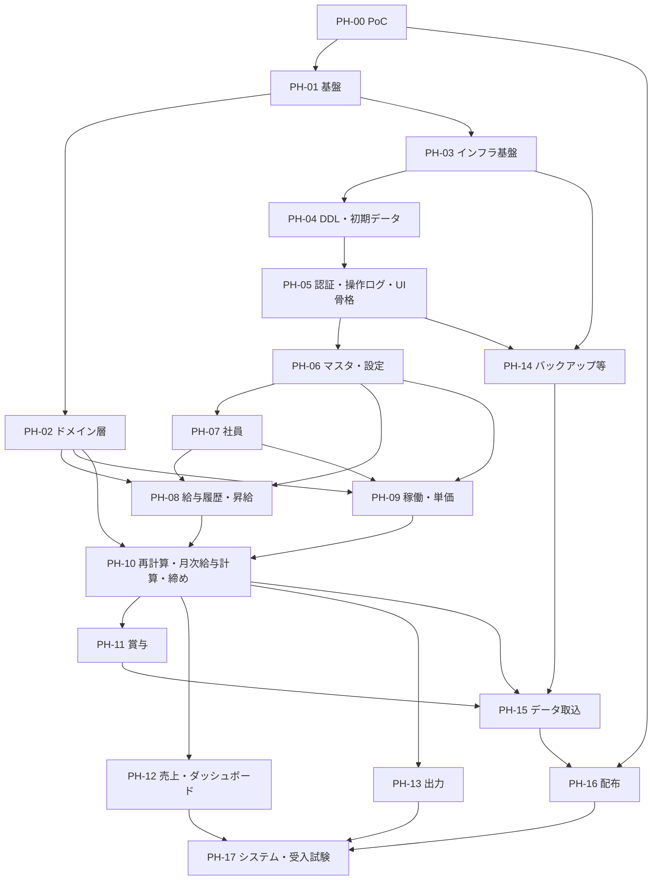

# グループG エンジニア管理CRM 実装計画書 v0.7

> バージョン：v0.7
> 更新日：2026-10-25
> 目的：実装に入る前の前提（技術の確認事項・構成）と、実装の順序（フェーズ）・各フェーズの完了条件を定める。各設計書が「実装計画書で決める」とした事項を、解決する（決定・案・PoC・保留のいずれか）
> 対象読者：本システムの実装・テスト・レビューに関わる担当者
> 対象範囲：実装の進め方と構成。コードの詳細は含めない。要件・設計・試験の内容は、それぞれの文書を正とする
> 前提：[要件定義書_v0.7.md](./要件定義書_v0.7.md)、[用語集_v0.6.md](./用語集_v0.6.md)、[アーキテクチャ設計書_v0.8.md](./アーキテクチャ設計書_v0.8.md)、[データ設計書_v0.7.md](./データ設計書_v0.7.md)、[計算仕様書_v0.5.md](./計算仕様書_v0.5.md)、[権限・セキュリティ設計書_v0.7.md](./権限・セキュリティ設計書_v0.7.md)、[画面設計書_v0.9.md](./画面設計書_v0.9.md)、[移行設計書_v0.6.md](./移行設計書_v0.6.md)、[テスト計画書_v0.7.md](./テスト計画書_v0.7.md)

## 目次
1. 計画の方針
2. 決定事項と確認した事実
3. 実装の構成
4. PoC（フェーズ0）
5. フェーズ計画
6. 共通の完了の定義
7. 設計書の未決事項の割り当て
8. 要件トレーサビリティ
9. 差異
10. 他の設計書への影響
11. 未決事項
12. 変更履歴

## 1. 計画の方針
- 計画項目に ID（`IPL-xxx`）を付ける。事実・決定事項・案・未決事項（`TBD:`）を区別する
- 設計書を正とする。実装は、要件 ID・設計 ID・試験 ID に紐づける。根拠のない機能を追加しない（`IPL-001`）
- 実装中に、設計書と食い違う点が見つかったら、実装を進めずユーザーに確認する。設計書の改版を先に行う（`IPL-001`）
- 実行できるかが不明な前提（exe 化、認証の関門、`hashlib.scrypt`、`AppTest` の限界など）は、最初に小さな試作（PoC）で確かめる（`IPL-002`）
- 依存の向き（`ARC-002`）に沿って、下の層から作る。基盤 → ドメイン層 → インフラ層 → DDL → 画面の機能ごとの縦割り（アプリケーション層と UI 層）の順とする（`IPL-003`）
- 各フェーズの着手前に、方針（変更するファイル・影響範囲）をユーザーへ提示し、承認を得る。1 PR 1 目的とし、大きいフェーズは、承認を得て分ける（`IPL-004`。リポジトリルール）
- 試験は、実装と同じ PR で実装する。設計書の試験ケース（`TC-xxx`）は、フェーズに割り当てる（5.3）（`IPL-005`）

## 2. 決定事項と確認した事実

### 2.1 ユーザーの回答 `IPL-010`
2026-10-22 の回答である。開発時の依存（pytest、pytest-mock、ruff、mypy、pytest-cov、coverage.py）は、2026-10-21 に承認済みである（テスト計画書 3.1）。

| 項目 | 決定 | 影響 |
|---|---|---|
| 固定する Python の版 | 3.13（開発環境は 3.13.9） | `requires-python` を 3.13 系に固定する（`IPD-001`）。要件定義書 `REQ-TEC-001`（3.11以上）を満たす |
| 対応 OS | Windows と macOS | データ領域・多重起動の防止・アクセス権・配布・署名が、OS ごとになる（3.6）。CI は Windows のみで実行する（3.5。ユーザー承認 2026-10-22） |
| ロックファイルの管理 | 追加のツールを入れず、`pip freeze` で固定する | OS ごとに作る（`IPD-003`） |
| exe 化の PoC で試す候補 | PyInstaller と cx_Freeze の両方を試して比較する | Nuitka は、PoC の対象外（`ARC-019` の AGPLv3以降の確認は不要になる）。py2exe は、回答の候補に含まれない |
| 継続的な自動実行（CI） | 設ける（push と PR で、pytest・ruff・mypy を実行） | 3.5 |
| 利用の規模と、PoC の結果を踏まえた配布の方針（4.5） | 数人に配布する個人利用であり、機能設計どおりに動くことを重視する。大規模なアプリの観点（性能・メモリの厳密な目標と測定）は求めない。exe 化は PyInstaller の onedir（Windows のみ）。起動方式は `headless=true` と `webbrowser`、ポートは固定。コード署名は行わない。`download_button` は、CSV を先に生成して検証する（2026-10-22） | 4.5。`ARC-019`・`ARC-020`・`ARC-022`、`SCD-030`、`SCN-080` に反映する（10章）。macOS は必要になった時点で再検討する（11章-14） |
| 9章の差異（`IPD-001`〜`IPD-014`） | すべて、案のとおり承認する | `IPD-007`・`IPD-009` の macOS の方式は、macOS を対象にする時点で確定する（macOS の PoC は実施していない。`POC-06`、`POC-01`、11章-14） |
| macOS の実機 | ない。PoC は CI の `macos-latest` だけで行う（その後、PoC は実施しないことになった。11章-14） | 4.1。実機がないと確認できないもの（署名、ブラウザの操作など）は、11章-14、11章-16 |
| `jpholiday` と、リポジトリルール（直近 1 年以内に更新のないライブラリは使用しない） | 2026-12-26 以降に新しい版が出ない場合は、ルールの例外として、使用を許可する | 3.3 |
| 移行コマンド（`crm-g import`）の認証 | パスコードを求めない | `DB` ファイルの保護は、OS のアクセス権（`REQ-SEC-003`）。移行設計書 14章-6 |
| GitHub 公式アクションの版の固定 | コミットの SHA で固定する | 3.5 |
| 計算の内部表現（2026-10-22。D1） | `Fraction` に統一する。計算仕様書を正とする | データ設計書・画面設計書・移行設計書の `Decimal` を `Fraction` に直す（10章） |
| 画面設計書 10章の 14 項目（2026-10-22。D2） | 他の設計書へ反映する。ユーザーが回答済みの 3 件以外は、暫定とする | アーキテクチャ設計書・データ設計書・計算仕様書・権限・セキュリティ設計書に反映する（10章） |
| ダッシュボードの「稼働率」の名称（2026-10-22。D3） | 「稼働人日率」に改称する | 用語集に追加する（10章） |
| 給与履歴の月給合計（確認用）の表示時期（2026-10-22。D4） | 送信後（登録時）に表示する | 画面設計書に反映する（10章） |
| 手動バックアップの保存先（2026-10-22。D5） | 利用者が指定できる。権限・セキュリティ設計書 `SCD-040` を正とする | 画面設計書に反映する（10章） |
| 要件定義書の「実装時に再確認」の箇所（2026-10-22。D6） | `TBD:` を付け、v0.7 に改版する | 要件定義書 v0.7（10章） |

### 2.2 確認した事実 `IPL-011`
2026-10-22 に、公式の情報で確認した。

| 項目 | 内容 | 出典 |
|---|---|---|
| PyInstaller 6.22.3 の対応 | Windows 8 以降と macOS 10.15 以降で動く。macOS では、`x86_64`・`arm64`・`universal2` を作れる。対応 Python は 3.8以上 3.16未満 | PyInstaller 公式ドキュメント（Requirements）、PyPI |
| PyInstaller の出力の性質 | 出力は、動かした OS と Python の版に固有である。別の OS 向けには、その OS で実行する | PyInstaller 公式ドキュメント（Operating Mode） |
| cx_Freeze 8.7.2 の対応 | Python 3.10 から 3.15。クロスプラットフォーム。8.5 から、`freeze-core`（0.8.0、MIT、Python 3.11以上）に分かれた。`bdist_mac`・`bdist_dmg`・`bdist_msi` がある | cx_Freeze 公式ドキュメント、PyPI |
| Streamlit 1.66.0 | Python 3.11以上。`watchdog` は `platform_system != "Darwin"` のときだけ依存に入る（Windows と macOS で、導入されるパッケージが違う） | PyPI（依存情報） |
| `coverage report` | `--include`（パターン指定）、`--fail-under=MIN`（下回ると終了コード 2）、`--precision=N` がある | coverage.py 7.16.2 公式ドキュメント |
| ruff の整形 | `format.line-ending` に `auto`・`lf`・`cr-lf`・`native` を指定できる | ruff 公式ドキュメント（Settings） |
| 本リポジトリの改行 | `.gitattributes` がない。この開発環境は `core.autocrlf=true` で、インデックスは LF、作業ツリーは CRLF である | `git ls-files --eol`、`git config` |
| GitHub Actions | このリポジトリは公開（public）。公開リポジトリの標準ランナーは、無料で無制限。ラベルは、`windows-latest`（Windows）、`macos-latest`（arm64）など | GitHub 公式ドキュメント（GitHub-hosted runners） |
| GitHub 公式アクションの最新版 | `actions/checkout` v7.0.1、`actions/setup-python` v7.0.0、`actions/upload-artifact` v7.0.2 | GitHub のリリース情報 |
| ファイルのロック | 標準ライブラリに、Windows 用の `msvcrt.locking`、Unix 系（macOS を含む）用の `fcntl.flock` がある。プロセスの終了時にロックが解放されることは、Python の公式ドキュメントでは確認できなかった | Python 3.13 公式ドキュメント |
| `hashlib.scrypt` | 開発環境（Windows、Python 3.13.9）で使える。N＝2^17 には、`maxmem` の指定が必要 | 権限・セキュリティ設計書 `SCD-006` |

## 3. 実装の構成

### 3.1 リポジトリの構成案 `IPL-020`
構成は案である（`IPD-002`）。成果物ルールの配置表に、新しい種別を追加する（`IPD-002`、10章）。

```text
crm-g/
├─ pyproject.toml        依存・ruff・mypy・pytest・coverage の設定
├─ .gitattributes        改行コードの固定（3.7）
├─ locks/                pip freeze の結果（OS ごと、3.3）
├─ DDL/                  連番 SQL（成果物ルール。配布物に同梱する）
├─ Docs/                 文書
├─ src/crm_g/            アプリ本体（3.2）
├─ tests/                unit・integration・system・data・manual（テスト計画書 `TPL-021`）
├─ tools/                ビルド・ライセンス一覧の作成スクリプト
├─ poc/                  PoC のコード（4章。不要になったら削除する）
└─ .github/              ルール、workflows/（CI）
```

### 3.2 層とモジュール `IPL-021`
パッケージ名は `crm_g` とする（案）。ドメイン層は、`sqlite3`・`streamlit`・`jpholiday`・`csv` を import しない（`TC-ARC-001`）。

| パッケージ | 層 | 主な内容 | 設計 |
|---|---|---|---|
| `crm_g.domain` | ドメイン層 | 端数処理、期・半期、営業日、在籍営業日、月給合計、日割り・減額、売上、原価、粗利、昇給、賞与 | `CLC-001`〜`CLC-022` |
| `crm_g.application` | アプリケーション層 | ユースケース、`Protocol`（DB アクセスのインターフェース）、入力の検証、認証、操作ログ、再計算、月次締め | `ARC-002`、`ARC-009`、`ARC-010`、`SCD-006`〜`SCD-024` |
| `crm_g.infrastructure` | インフラ層 | 設定、データ領域のパス、ログ、多重起動の防止、DB 接続、マイグレーション、バックアップ、CSV 入出力、祝日の取得 | `ARC-005`〜`ARC-008`、`ARC-011`、`ARC-012`、`ARC-018` |
| `crm_g.ui` | UI 層 | エントリポイント、`st.navigation`、画面、UI 共通部品 | `UID-020`〜`UID-091`、`SCN-001`〜`SCN-080` |
| `crm_g.cli` | （入口） | 起動と移行コマンドの入口。アプリケーション層を呼ぶ。UI 層には依存しない | `MIG-070` |

- 層の依存の禁止は、`ruff` の `banned-api`（`TID251`）で検査する。禁止するモジュールをプロジェクト全体で設定し、禁止の対象でない層だけ `per-file-ignores` で除く。方式は、`PH-01` で、公式ドキュメントと実機で確認する（テスト計画書 3.1）

### 3.3 依存と版 `IPL-022`
| 区分 | 名称 | 版 | ライセンス | 最終公開日（PyPI） | 状態 |
|---|---|---|---|---|---|
| 実行時 | Streamlit | 1.66.0 | Apache-2.0 | 2026-10-14 | 承認済み（アーキテクチャ設計書 4.1） |
| 実行時 | jpholiday | 1.0.3 | MIT | 2025-12-26 | 承認済み（同上）。2026-12-26 以降に新しい版が出ない場合は、ルールの例外として許可する（2.1） |
| 開発時 | pytest、pytest-mock、ruff、mypy、pytest-cov、coverage.py | テスト計画書 3.1 のとおり | MIT、Apache-2.0 | テスト計画書 3.1 のとおり | 承認済み（2026-10-21） |
| ビルド時 | PyInstaller | 6.22.3 | GPLv2（生成物を任意のライセンスで配布できる例外がある。`ARC-019`） | 2026-09-12 | PoC の比較に使った（4.4）。採用は、4.5 のとおり確定した（ユーザー承認 2026-10-22） |
| ビルド時 | cx_Freeze（と `freeze-core`） | 8.7.2（0.8.0） | PSF-2.0（MIT） | 2026-10-14 | PoC の比較に使った（4.4）。採用しない（4.5） |

- 直接の依存は、`pyproject.toml` に `==` で版を固定する。間接の依存は、`locks/` の `pip freeze` の出力で固定する（`IPD-003`）
- `locks/` は、OS ごと・用途ごとに作る。当面は Windows のみ（`runtime-windows.txt`、`dev-windows.txt`。名称は案）。macOS を対象にする時点で、`runtime-macos.txt`、`dev-macos.txt` を追加する。Streamlit は、OS により導入されるパッケージが違うため（2.2）、1 つのファイルにまとめない
- 開発時とビルド時の依存は、配布物に含めない（リポジトリルール）
- 依存の追加は、必要性・ライセンス・更新日を確認し、ユーザーの承認を得る（リポジトリルール）。上の表にないものは追加しない
- 配布物のライセンス一覧は、標準ライブラリ `importlib.metadata` で、導入済みパッケージのメタデータから作る（追加の依存を入れない）。`tools/` に置く。`POC-01` で確認した結果、実行時にそのまま集めるだけでは、同梱の一覧にならない（4.4.3）。ビルド時に、同梱するパッケージを限定して生成する方式にする

### 3.4 品質ゲート `IPL-023`
各フェーズの完了の前に、次をすべて通す（6章）。設定は、`pyproject.toml` に置く。

```text
ruff check .
ruff format --check .
mypy --strict src tests
pytest --cov=src/crm_g --cov-branch
coverage report --include="src/crm_g/domain/*" --precision=2 --fail-under=100
coverage report --include="src/crm_g/application/*" --precision=2 --fail-under=80
```

- カバレッジの基準は、テスト計画書 `TPL-062` のとおり（ドメイン層 100%、アプリケーション層 80% 以上。分岐を含める）。層ごとの集計は、`coverage report --include` と `--fail-under` で行う（`IPD-011`）
- `PH-01` で、次を確認する
  - 小数を含めて、基準を厳密に判定できること（例：99.99% を 100% として通さないこと）
  - `ruff format` の `line-ending` を `cr-lf` にして、macOS でも整形の検査が通ること（`IPD-004`）
- 警告を、無視コメントや設定の変更で黙らせない（リポジトリルール）

### 3.5 CI `IPL-024`
ユーザーの回答（2.1）に基づく。構成は案である（`IPD-012`）。

| 項目 | 内容 |
|---|---|
| ファイル | `.github/workflows/ci.yml` |
| きっかけ | `push` と `pull_request` |
| 環境 | `windows-latest`。Python は 3.13。`macos-latest` は、macOS を対象にする時点で、matrix に追加する（11章-14） |
| 手順 | チェックアウト → Python の設定 → `locks/` の該当 OS のファイルで導入 → 3.4 のコマンドを実行 |
| 使うアクション | `actions/checkout`、`actions/setup-python`（GitHub 公式）。版は、実装時にリリース情報で確認して固定する（2.2 の最新版は、v7.0.1、v7.0.0）。固定の方式は、コミットの SHA（2.1） |
| 秘密情報 | 使わない。署名は行わない（2.1）。鍵は存在しない |

- CI が落ちている間は、フェーズを完了としない（6章）
- 手動試験（`TC-SCN-002`、`TC-SCD-007` など）は、CI に含めない

### 3.6 OS ごとの実装方針 `IPL-025`
| 項目 | Windows | macOS | 確認 |
|---|---|---|---|
| データ領域（設定・DB・ログ・バックアップ） | `%LOCALAPPDATA%` の下の `crm-g` | `~/Library/Application Support` の下の `crm-g` | 案（`IPD-009`）。`TC-ARC-023` |
| 多重起動の防止（`ARC-007`） | `msvcrt.locking`（OS の排他ロック） | `fcntl.flock`（OS の排他ロック） | 案（`IPD-007`）。`POC-06` |
| アクセス権（`SCD-040`） | 既定の ACL を、実機で確認する。`TBD:` | 所有者のみ（ディレクトリ 0o700、ファイル 0o600）にする案 | 11章-6。`TC-ARC-023` |
| 配布の形式（`REQ-TEC-006`） | 実行ファイル（`.exe`） | 実行ファイルまたは `.app`。`TBD:` macOS は、必要になった時点で再検討する（11章-14） | `POC-01`。11章-5 |
| ビルド | Windows で実行する（出力が OS に固有のため） | macOS で実行する（同上）。CPU の種類（`arm64`・`x86_64`・`universal2`）は `TBD:` | 2.2。11章-4 |
| コード署名（`ARC-020`） | 行わない（Windows の SmartScreen の警告を、手順書に書く） | 必要になった時点で再検討する | 2.1、4.5。11章-2 |

- OS 固有の処理は、`crm_g.infrastructure` の 1 か所に閉じ込める。ドメイン層・アプリケーション層は、OS を意識しない
- `os.name`・`sys.platform` による分岐は、インフラ層だけに置く
- 要件定義書の「exe」は、Windows の呼称である。macOS では、実行ファイルまたは `.app` と読み替える（`IPD-009`）

### 3.7 改行コードとチェックサム `IPL-026`
リポジトリルールは、コード・ドキュメントの改行コードを CRLF に統一する。本リポジトリには `.gitattributes` がなく、改行は各環境の Git の設定に依存する（2.2）。

- `PH-01` で、`.gitattributes` を追加し、テキストファイルを CRLF で作業ツリーに展開する（`IPD-004`）。Windows と macOS で、同じ改行になるようにする
- `ruff format` の `line-ending` を `cr-lf` にする（`IPD-004`）
- マイグレーションの連番 SQL のチェックサム（`ARC-008`）は、改行を `\n` に正規化してから計算する（`IPD-005`）。改行の違い（CRLF と LF）で、チェックサムが変わり、起動が中止されることを防ぐため

## 4. PoC（フェーズ0）

### 4.1 方針 `IPL-030`
- 目的は、設計書が「PoC で確認する」とした事項（表 4.2）に答えを出すことである。製品のコードではない
- コードは、`poc/` に置く（`IPD-006`）。PoC の結果は、本書の次の版に反映する（4.3）
- 実行する環境は、Windows（この開発環境）である。macOS の PoC は、実施しなかった（4.4、11章-14）。macOS の実機はない（2.1）
- 試験データは、架空のデータだけを使う

### 4.2 確認する項目 `IPL-031`
| ID | 確認する事項 | 方法 | 合格の基準 | 関連（未決事項の出典） |
|---|---|---|---|---|
| `POC-01` | Streamlit を含む exe 化。PyInstaller と cx_Freeze を、Windows と macOS で比較する | 最小のアプリ（`st.navigation` で 2 ページ、`sqlite3`、`jpholiday`、同梱の SQL ファイル）を、各ツールでビルドする | 起動して、ブラウザから操作できる。同梱の SQL ファイルを読める。ライセンス一覧を作れる（3.3）。サイズ・起動時間を測定して、記録する。`TC-ARC-024` | アーキテクチャ設計書 12章-5、`ARC-019` |
| `POC-02` | 同梱した Python で、`hashlib.scrypt`（N＝2^17、r＝8、p＝1、`maxmem` 指定）が使える | `POC-01` のビルドの中で、`SCD-006` の条件でハッシュを計算する | 計算が成功する。所要時間とメモリを記録する | 権限・セキュリティ設計書 12章-13 |
| `POC-03` | 認証前に、別のページの URL へ直接アクセスしても、内容が出ない | `st.navigation` に、認証前は 1 ページだけを渡す構成で、ブラウザで URL を直接開く。新しいタブも試す | 機微情報が出ない。`TC-SCD-007`、`TC-SCN-002`、`TC-SCN-003` | 権限・セキュリティ設計書 12章-8、`UID-030` |
| `POC-04` | `st.download_button` に関数を渡したとき、関数が失敗した場合の挙動 | 失敗する関数を渡して、押下を試す | 失敗時の画面の挙動を記録する。`SCN-080` の設計に合うか判断する | 画面設計書 14章-10 |
| `POC-05` | `AppTest` で扱えない画面の挙動の範囲 | `st.navigation`、`st.dialog`、`st.file_uploader`、`st.download_button`、`st.data_editor`、`st.date_input`（`value=None`）を、`AppTest` で操作する | 扱えるものと扱えないものの一覧を作る。扱えないものは、手動の試験にする | テスト計画書 11章-3、`TPL-011` |
| `POC-06` | 多重起動の防止の方式（OS の排他ロック） | 2 つ目のプロセスの取得が失敗すること。1 つ目を強制終了した後に、再び取得できること。`POC-01` のビルドの中でも動くこと | 3 つとも、Windows と macOS で成立する。成立しない場合は、代替を提案する | アーキテクチャ設計書 12章-11、`ARC-007` |
| `POC-07` | 利用統計の送信停止（`browser.gatherUsageStats=false`）と、`server.address`・`server.allowedHosts` の効果 | 起動中の外部への接続を、OS 標準のコマンドで観測する。別のホストからの接続を試す | 外部への通信がない。許可していないホストの接続が拒否される。`TC-ARC-021`、`TC-SCD-017` | アーキテクチャ設計書 7.3 |
| `POC-08` | 起動の方式 | `server.headless` の値、ポート（固定か空きか）、ブラウザの起動方法（標準ライブラリ `webbrowser`）、`client.showErrorDetails` の値を試す | 起動から画面の表示までが、利用者の操作 1 回で成立する。選択肢ごとの長所・短所を記録する | アーキテクチャ設計書 12章-12、権限・セキュリティ設計書 12章-12 |

### 4.3 結果の扱い `IPL-032`
- PoC の結果は、v0.3 で 4.4 に記録した。次は、4.5 で確定した（v0.4 でユーザーが承認した）
  - exe 化のツール（PyInstaller か cx_Freeze）と、配布の形式
  - 非機能目標（起動時間・常駐メモリ・配布物のサイズ。`ARC-022`）
  - 起動の方式とポート
  - コード署名の方式（11章-2）
- どの候補でも、Streamlit を含む exe 化が成立しない場合は、フェーズを進めず、ユーザーに報告して、方針を相談する
- PoC の結果が設計書の記述と異なる場合は、設計書の改版を先に行う（`IPL-001`）。v0.3 の改版は、アーキテクチャ設計書 v0.5、権限・セキュリティ設計書 v0.4、画面設計書 v0.3、テスト計画書 v0.3、移行設計書 v0.4 である。v0.4 の改版は、アーキテクチャ設計書 v0.6、権限・セキュリティ設計書 v0.5、画面設計書 v0.4、テスト計画書 v0.4 である（10章）

### 4.4 PoC の結果 `IPL-033`
2026-10-22 に、Windows（開発環境。Python 3.13.9、Streamlit 1.66.0、PyInstaller 6.22.3、cx_Freeze 8.7.2）で実施した。コードは `poc/` にある（`IPD-006`）。

macOS は、ユーザーの指示（2026-10-22）により、今回は実施しなかった。macOS を前提とする合格基準（`POC-01`・`POC-06` の「Windows と macOS」）は、未達である。確認の時期は、未決である（11章-14）。

判定は、「成立」（合格基準を、確認した範囲で満たした）、「一部」（確認できていない部分がある）、「設計の見直しが必要」のいずれかである。

| ID | 判定 | 確認した事実 | 確認できていないこと |
|---|---|---|---|
| `POC-01` | 一部 | Windows で、PyInstaller（onedir・onefile）と cx_Freeze のいずれでも、Streamlit を含む最小のアプリを exe 化でき、起動して、ブラウザから 2 ページ（`st.navigation`）を操作できた。同梱の SQL、`sqlite3`、`jpholiday`（「元日」）も動作した。実測は 4.4.1。1 つの実行ファイルが、サブコマンド（`serve`・`probe`・`scrypt`・`lock`）を切り替えられた（`IPD-008` の前提） | macOS。コード署名と、ウイルス対策ソフトの影響。`import` サブコマンドそのもの。ライセンス一覧は、4.4.3 のとおり、そのままでは配布物に添付できない |
| `POC-02` | 成立（Windows） | 通常の Python で 0.38 秒・ピーク約 146 MiB（開始前は約 18 MiB）。PyInstaller の exe で 0.42 秒・ピーク約 185 MiB。cx_Freeze の exe で 0.52 秒・ピーク約 180 MiB。exe のピークは、起動直後のメモリを含み、scrypt の分の差し引きは整理していない。PyInstaller の onedir と onefile のどちらの値かは、記録が残っていない | macOS。PyInstaller の onedir と onefile の別の計測 |
| `POC-03` | 成立（Windows） | 認証前は `st.navigation` にログインだけを渡す構成で、保護されたページの URL を直接開く（同じタブ、新しいタブ）と、「Page not found」の後にログイン画面になり、内容は出なかった。`AppTest` で、認証前に保護されたページへ `switch_page` すると、`ValueError` になった | 認証後のページ切り替えなど、他の構成。Streamlit の公式ドキュメントでの確認 |
| `POC-04` | 設計の見直しが必要 | 失敗する関数を `st.download_button` に渡すと、サーバーのログに `MediaFileStorageError` が出て、画面ではボタンが無効になった。エラーは、画面に出なかった。他のボタンは使えた。`SCN-080`（記録の失敗を画面に出す）には合わない（11章-15） | ダウンロード自体の挙動 |
| `POC-05` | 成立（Windows） | `AppTest` で扱えたもの：`switch_page`、`file_uploader`、`download_button`（要素の存在のみ）、`data_editor`（`dataframe`）、`date_input(value=None)`、`dialog`（開いた後の内容）。扱えないものは、ダウンロードされる内容と、ブラウザの実際の挙動（手動の試験にする。テスト計画書 2章） | ブラウザの画面での `date_input(value=None)` の扱い |
| `POC-06` | 一部 | Windows の `msvcrt.locking` で、2 つ目のプロセスの取得は失敗し（終了コード 3）、1 つ目の強制終了の後は再び取得できた。PyInstaller（onedir）と cx_Freeze の exe の中でも、同じだった。PyInstaller の onefile では、ロックの取得と、2 つ目の失敗は動作した。ただし、親（ブートローダー）だけを強制終了すると、子が残ってロックを保持し続けた（子も終了させた後に、再取得できた） | macOS の `fcntl.flock` |
| `POC-07` | 一部 | `gatherUsageStats=false`・`address=127.0.0.1` で、`127.0.0.1` だけを待ち受け、プロセスの接続に外部アドレスはなかった（OS 標準のコマンド。通常の Python、PyInstaller の onedir、cx_Freeze）。1 時点の確認であり、通信が無いことの証明ではない | `gatherUsageStats=true` との比較。`allowedHosts` による別のホストの拒否。別のホストからの接続の試験 |
| `POC-08` | 一部 | `server.headless=true`・`address=127.0.0.1` で起動でき、`127.0.0.1` の指定したポートだけを待ち受けた。`streamlit run` を使わずに、`bootstrap` から起動できた。exe（frozen）では、`global.developmentMode=false` の指定が必要だった | `webbrowser` による自動起動と、利用者の操作 1 回での表示。`client.showErrorDetails` の画面での効果。ポートの選定 |

**4.4.1 exe 化の比較（`POC-01`）**

同じ条件で 3 回ずつ計測した。メモリは、ブラウザが未接続のときの値である。「`serve` が応答するまで」の列は、起動から `/_stcore/health` が応答するまでの時間である。

| 構成 | サイズ | `probe`（秒） | `serve` が応答するまで（秒） | `serve` のメモリ | ビルド時間 |
|---|---|---|---|---|---|
| PyInstaller onedir | 202.9 MiB | 0.53〜0.95 | 1.05〜1.14 | 約 72 MiB | 約 50〜60 秒 |
| PyInstaller onefile | 83.2 MiB | 3.3〜4.0 | 2.7〜3.2 | 約 81 MiB（親と子の合計） | 約 60 秒 |
| cx_Freeze | 257.9 MiB | 0.54〜0.61 | 0.63〜1.07 | 約 68 MiB | 約 40 秒 |

- `probe` の時間には、Streamlit の import が含まれる（`launcher` が先頭で import するため）
- ブラウザの初回の接続の後の作業セットは、PyInstaller の onedir が約 117 MiB、cx_Freeze が約 110 MiB だった（作業中の計測値。PR #27 の本文には無く、再現用の記録も残していない）
- 計測は、この開発機で、起動を繰り返した値である。初回の起動と、ウイルス対策ソフトの影響は、計測していない
- 再現の手順は、`poc/packaging/` にある

**4.4.2 判明した注意点**

- Streamlit は、エントリースクリプトの隣に `pages/` があると、`st.navigation` の登録とは別に、スクリプト名のページを自動で検出して、サイドバーに出す。`views/` に変えると、登録した 2 ページだけになった。実装では、`pages/` の名前を避ける
- PyInstaller の onedir の exe は、標準出力が cp932 になり、日本語が文字化けする（データは正しい）。`PYTHONUTF8` などの環境変数では変わらなかった。cx_Freeze の exe は、正常に出力した。標準出力の UTF-8 化を、明示的に行う設計が必要である
- 既定のページ以外の URL を直接開くと、「Page not found」の後に既定のページになる
- ブラウザの画面をリロードすると、`st.session_state` が失われ、再びパスコードの入力が必要になる
- 画面に、`Deploy` のボタンとメニューが表示された（`toolbarMode` は未設定）
- PyInstaller の onefile は、起動のたびに展開が必要で、起動に約 3 秒かかった。親だけを終了すると、子が残る（`POC-06`）

**4.4.3 ライセンス一覧（`POC-01`）**

`importlib.metadata` で、実行時に集めた結果である（3.3 の方式の確認）。

| 構成 | 結果 |
|---|---|
| PyInstaller | 同梱された 11 件だけ（`--collect-all streamlit` の範囲）。`License` 欄にばらつきがある（altair は全文、itsdangerous は `UNKNOWN`、numpy は複合の式） |
| cx_Freeze | 92 件を返した。`library.zip` の中の `dist-info` は 46 件で、開発用ツール（`mypy`、`pytest` など）が混入した。除外の設定が必要 |

- どちらも、そのままでは、配布物に添付する一覧にならない。ビルド時に、同梱するパッケージを限定して生成し、`License` 欄が空・`UNKNOWN` のものは、別に確認する設計が必要である（`PH-16`）。3.3 の「`importlib.metadata` で作る」は、この制約を前提にする

### 4.5 確定事項 `IPL-034`
4.4 の結果に基づき、2026-10-22 にユーザーが承認した（11章-9）。利用の規模は、数人に配布する個人利用であり、機能設計どおりに動くことを重視する。大規模なアプリの観点（性能・メモリの厳密な目標と測定）は求めない（2.1）。

| 項目 | 決定 | 根拠 | 確認できていないこと |
|---|---|---|---|
| exe 化のツール | PyInstaller | Windows の実測では、cx_Freeze と起動時間・メモリに大きな差がない（表 4.4.1）。サイズは、onedir が cx_Freeze より小さい。ライセンス一覧は、同梱された 11 件に限られた（4.4.3）。ライセンスは、GPLv2 に、生成物を任意のライセンスで配布できる例外がある（`ARC-019`） | macOS での動作（11章-14） |
| 配布の形式 | Windows の onedir（フォルダーを配布する）。macOS は、必要になった時点で再検討する | onefile は、起動に約 3 秒かかり、親だけを終了すると子がロックを保持し続ける（`POC-06`。多重起動の防止に影響する）。サイズは、onefile が 83.2 MiB、onedir が 202.9 MiB | macOS の配布の形式（11章-5、-14） |
| 非機能目標（起動時間・常駐メモリ・配布物のサイズ） | 数値の目標と測定を設けない。PoC の実測（表 4.4.1）を、参考値として記載する（`ARC-022`） | 利用の規模（数人に配布する個人利用）。実測は、起動が約 1 秒、常駐メモリが約 72 MiB（ブラウザ未接続）、サイズが約 203 MiB（onedir）である | 実データを使った操作中のメモリ。必要になった場合に、改めて決める |
| 起動の方式 | `launcher` が `bootstrap` から `server.headless=true` で Streamlit を起動し、標準ライブラリ `webbrowser` でブラウザを開く。`webbrowser` の動作は、実装時（`PH-05`）に確認し、開かない場合は、利用者へ URL を表示する | `bootstrap` からの起動と、`headless=true` は確認した（`POC-08`） | `webbrowser` による自動起動。`showErrorDetails` の値 |
| ポート | 固定ポート（決まった URL を使う）。使用中の場合は、エラーを表示して終了する。ポートの番号は、実装時（`PH-05`）に決める（`TBD:`） | 実装が簡単で、利用者が URL を覚えられる。多重起動は、ポートではなく OS のロックで防ぐ（`POC-06`） | ポートの番号。他のアプリとの衝突 |
| コード署名 | 行わない。配布の手順書に、Windows の SmartScreen の警告が出ることと、その扱いを書く（`PH-16`） | 数人に配布する個人利用。PoC では、署名を試していない | SmartScreen の警告の実際の出方 |
| `st.download_button` の失敗（11章-15） | CSV を先に生成して検証し、失敗する場合は、ボタンを出さずにエラーを表示する（`SCN-080`） | `POC-04`：関数が失敗しても、画面にエラーが出ない | `UID-031` との関係（画面設計書 v0.4 で整理） |

- 数値の目標を設けないことと、コード署名を行わないことは、リポジトリルール（`standalone.instructions.md`：起動時間・常駐メモリの目標値を決める、コード署名を行う）の例外として、ユーザーが承認した（2026-10-22）。ルールの文面は、今回は変更していない
- 非機能の測定（`PH-16`）は、参考値の記録とする。再計算の所要時間など、機能に関わるもの（`TC-NFR-004`）は、残す
- アーキテクチャ設計書 `ARC-019`・`ARC-020`・`ARC-022`、権限・セキュリティ設計書 `SCD-030`、画面設計書 `SCN-080`、テスト計画書 5.8 に反映した（`IPL-001`。10章）

## 5. フェーズ計画

### 5.1 フェーズ一覧 `IPL-040`
| ID | フェーズ | 作るもの | 設計 | 前提 |
|---|---|---|---|---|
| `PH-00` | PoC | 4章のとおり。`poc/` のコードと、結果の記録 | `ARC-019`、`SCD-006`、`SCD-010` | なし |
| `PH-01` | 基盤 | `pyproject.toml`、`locks/`、`.gitattributes`、`.gitignore`、`src/crm_g/` と `tests/` の骨格、ruff・mypy・pytest・coverage の設定、層の依存の検査（`TID251`）、CI、成果物ルールの配置表の更新 | `ARC-002`、`ARC-004`、`ARC-012` | `PH-00` |
| `PH-02` | ドメイン層 | 計算の純関数と、frozen な `dataclass`。金額は円単位の整数。営業日などは入力として受け取る | `CLC-001`〜`CLC-022`、`DBD-003`、`DBD-004` | `PH-01` |
| `PH-03` | インフラ基盤 | 設定の読み込み、データ領域のパス、ログ（ローテーション）、多重起動の防止、DB 接続（外部キーの有効化）、トランザクションの補助、日時の保存、SQLite の版の検査、マイグレーション、バックアップ・復元 | `ARC-005`〜`ARC-008`、`ARC-018`、`ARC-021`、`SCD-042` | `PH-01` |
| `PH-04` | DDL・初期データ | `DDL/` の連番 SQL（22 テーブル）。`STRICT`・`CHECK`・外部キー・トリガー（操作ログの追記専用）。初期データ | `TBL-001`〜`TBL-022`、`DBD-001`〜`DBD-023`、データ設計書 10章-10・11章 | `PH-03` |
| `PH-05` | 認証・操作ログ・UI の骨格 | パスコードの設定と認証、操作ログ、エントリポイント、`st.navigation`、UI 共通部品（検証、メッセージ、確認ダイアログ、2段階の登録、閲覧ログの粒度）、Streamlit の設定、エラー表示 | `SCD-006`〜`SCD-024`、`UID-020`〜`UID-063`、`ARC-014`〜`ARC-016`、`SCN-001`、`SCN-002` | `PH-04` |
| `PH-06` | マスタ・設定 | 営業日カレンダー（祝日の取り込みと会社休日）、稼働状態と給与支給率、給与項目、計算設定、賞与ルールと掛け率 | `SCN-060`〜`SCN-064`、`ARC-012`、データ設計書 10章-9 | `PH-05` |
| `PH-07` | 社員 | 社員一覧・詳細・登録・編集 | `SCN-020`〜`SCN-022` | `PH-06` |
| `PH-08` | 給与履歴・昇給 | 給与履歴の登録（警告の確認）、昇給一覧 | `SCN-030`、`SCN-031`、`CLC-016`〜`CLC-018`、データ設計書 10章-1 | `PH-02`、`PH-06`、`PH-07` |
| `PH-09` | 稼働・単価 | 稼働期間、参画、単価履歴、状態の切り替え | `SCN-050`、`UID-079`、`CLC-011`、データ設計書 10章-2・10章-3 | `PH-02`、`PH-06`、`PH-07` |
| `PH-10` | 再計算・月次給与計算・締め | 再計算（同一トランザクション）、手動の一括再計算、月次給与計算の画面、月次締めと解除。`PH-06`・`PH-07`・`PH-08`・`PH-09` の更新ユースケースに、再計算を接続する | `SCN-032`、`ARC-009`、`ARC-010`、`CLC-006`〜`CLC-015`、`CLC-022`、データ設計書 10章-5・10章-6 | `PH-02`、`PH-08`、`PH-09` |
| `PH-11` | 賞与 | 賞与の対象者・評価・計算・確定。確定から、再計算を呼ぶ | `SCN-040`、`CLC-019`〜`CLC-021`、`CLC-022`、データ設計書 10章-7・10章-8 | `PH-10` |
| `PH-12` | 売上・ダッシュボード | 売上の集計、ダッシュボード | `SCN-051`、`SCN-010`、`CLC-012`〜`CLC-015` | `PH-10` |
| `PH-13` | 出力 | 人事連携用の CSV、各一覧の CSV、数式インジェクションの対策、出力の操作ログ | `SCN-080`、`UID-090`、`UID-091`、`ARC-011` | `PH-10` |
| `PH-14` | バックアップ・パスコード変更・操作ログ画面 | バックアップ・復元の画面、パスコードの変更、操作ログの閲覧 | `SCN-065`〜`SCN-067`、`ARC-021`、`SCD-011` | `PH-05`、`PH-03` |
| `PH-15` | データ取込 | 取込の画面と移行コマンド。取込の種類 `IMP-01`〜`IMP-06`、名寄せ、レポート、取込前のバックアップ | `SCN-070`、`MIG-001`〜`MIG-082` | `PH-10`、`PH-11`、`PH-14` |
| `PH-16` | 配布 | Windows のビルド手順、同梱データ、ライセンス一覧、SmartScreen の警告を含む配布の手順書、更新の手順、アクセス権の設定、非機能の参考値の記録（数値の目標は設けない） | `ARC-019`〜`ARC-022`、`SCD-040` | `PH-00`、`PH-15` |
| `PH-17` | システム・受入試験 | 業務シナリオの試験、手動試験の実施、テスト結果報告書 | テスト計画書 7章 | `PH-12`、`PH-13`、`PH-16` |

### 5.2 フェーズの依存関係 `IPL-041`


### 5.3 フェーズに割り当てる試験ケース `IPL-042`
テスト計画書のすべてのケース（198 件）を、1 つのフェーズに割り当てる。割り当てたフェーズで、実装と同じ PR で試験を実装する。DB の制約・初期データの試験（`TC-DBD-001`〜`TC-DBD-008`、`TC-DBD-017`、`TC-DBD-018`）は、DDL・DB 接続のフェーズに置く。アプリケーション層で守る整合性の試験（`TC-DBD-009`〜`TC-DBD-016`。データ設計書 10章-1〜10章-9）は、検証する関数を作るフェーズに置く（テスト計画書 5.5）。

| フェーズ | 試験ケース |
|---|---|
| `PH-00` | `TC-ARC-024` |
| `PH-01` | `TC-ARC-001`、`TC-ARC-002`、`TC-ARC-003`（以降のすべてのフェーズのセルフレビューで確認する） |
| `PH-02` | `TC-CLC-001`〜`TC-CLC-015`、`TC-CLC-017`、`TC-CLC-020`、`TC-CAL-001`、`TC-CAL-002`、`TC-CAL-006`、`TC-CAL-008`、`TC-CAL-009`、`TC-CAL-010` |
| `PH-03` | `TC-ARC-004`〜`TC-ARC-014`、`TC-ARC-022`、`TC-DBD-018`、`TC-SCD-015` |
| `PH-04` | `TC-DBD-001`〜`TC-DBD-008`、`TC-DBD-017` |
| `PH-05` | `TC-SCD-001`〜`TC-SCD-013`、`TC-SCD-016`、`TC-SCN-001`〜`TC-SCN-007`、`TC-SCN-023`、`TC-SCN-024`、`TC-ARC-020` |
| `PH-06` | `TC-FUN-015`、`TC-SCN-016`、`TC-ARC-019`、`TC-DBD-016` |
| `PH-07` | `TC-FUN-005`〜`TC-FUN-008` |
| `PH-08` | `TC-FUN-010`、`TC-SCN-008`、`TC-DBD-009` |
| `PH-09` | `TC-SCN-013`〜`TC-SCN-015`、`TC-DBD-010`、`TC-DBD-011` |
| `PH-10` | `TC-FUN-009`、`TC-FUN-011`、`TC-FUN-014`、`TC-SCN-009`、`TC-SCN-010`〜`TC-SCN-012`、`TC-ARC-015`〜`TC-ARC-018`、`TC-CAL-003`、`TC-CAL-004`、`TC-CLC-016`、`TC-CLC-018`、`TC-DBD-012`、`TC-DBD-013` |
| `PH-11` | `TC-FUN-016`、`TC-FUN-017`、`TC-SCN-017`、`TC-CAL-005`、`TC-CAL-007`、`TC-CLC-019`、`TC-DBD-014`、`TC-DBD-015` |
| `PH-12` | `TC-FUN-001`〜`TC-FUN-004`、`TC-FUN-012`、`TC-FUN-013`、`TC-SCN-025` |
| `PH-13` | `TC-FUN-019`、`TC-FUN-020`、`TC-FUN-021`、`TC-SCN-018`〜`TC-SCN-020`、`TC-SCD-014` |
| `PH-14` | `TC-FUN-018`、`TC-SCN-021`、`TC-SCN-022` |
| `PH-15` | `TC-MIG-001`〜`TC-MIG-049` |
| `PH-16` | `TC-ARC-021`、`TC-ARC-023`、`TC-ARC-025`、`TC-ARC-026`、`TC-SCD-017`、`TC-NFR-001`〜`TC-NFR-005` |
| `PH-17` | `TC-E2E-001`〜`TC-E2E-007` |

- `TC-SCD-007`・`TC-SCN-002`・`TC-SCN-003`（手動）は、`PH-05` で、`POC-03` の方法で実施する
- `TC-ARC-024` は、`PH-00` で実施した後、`PH-16` の配布物でもう一度実施する
- `TC-ARC-009`〜`TC-ARC-014` は、`PH-03` では試験用の連番 SQL で実施し、`PH-04` 以降は、実際の `DDL/` でも通ることを確認する

### 5.4 フェーズの補足 `IPL-043`
- `PH-02`：暫定の期待値（計算仕様書 12章）は、変更されうる。暫定の扱いを、コードの定数やコメントで明示し、確定後に更新する（テスト計画書 `TPD-010`）
- `PH-04`：DDL は、成果物ルールに従い、連番の名称にする（例：`001_create_master.sql`）。適用済みの連番 SQL は、書き換えない。テーブル・列にコメントを付ける（コーディング規約）。アプリケーション層で守る整合性（データ設計書 10章-1〜10章-9。10章-5 は `IPD-010`）は、DDL では守らない。その試験（`TC-DBD-009`〜`TC-DBD-016`）は、検証する関数を作るフェーズで実施する（5.3）
- `PH-05`：認証の関門は、`POC-03` の結果に従う。`AppTest` で扱えない画面の挙動は、`POC-05` の一覧に従い、手動の試験にする
- `PH-10`：再計算のきっかけ（`TC-CAL-007`）は、`PH-06`・`PH-07`・`PH-08`・`PH-09` の更新ユースケースから、同じトランザクションで再計算を呼ぶ。この接続は、`PH-10` で行い、`PH-06`〜`PH-09` の試験を、再計算を含めて更新する。`PH-07` の社員の編集（入社日・退職日・在籍ステータスの変更。画面設計書 `SCN-022`）の再計算は `TC-FUN-009` で、`PH-06` の会社休日の登録の再計算は `TC-FUN-014` で、`PH-08` の給与履歴の登録の再計算は `TC-SCN-009` で確かめる。再計算の機能は `PH-10` で作るため、この 3 件は `PH-10` に置く。再計算のきっかけ（`TC-CAL-007`。試験は `PH-11`）の接続は、上のとおり `PH-10` で行う。
- `PH-11`：賞与の確定から、同じトランザクションで再計算を呼ぶ（画面設計書 `SCN-040`、`CLC-022`）。`TC-CAL-007` は、8 つの変更（賞与の確定を含む）がすべて接続された後に実施できるため、`PH-11` に置く
- `PH-15`：移行コマンドは、アプリと同じ入口から呼ぶ（`IPD-008`）。取込用 CSV の列は、移行設計書のとおり。移行元シートの見出しが入手できた場合は、先に移行設計書を改版する（移行設計書 14章-1）
- `PH-16`：署名は行わない（4.5）。改ざん検知の方法は `TBD:`（11章-17）。配布の手順書に、SmartScreen の警告を書く。配布物には、全ライブラリのライセンス一覧を添付する（`TC-ARC-026`）

## 6. 共通の完了の定義

### 6.1 フェーズの完了 `IPL-050`
次をすべて満たしたとき、フェーズを完了とする。

1. 3.4 のコマンドが、すべて通っている（`ruff`・`mypy` は警告ゼロ。`pytest` は全件合格。カバレッジは基準を満たす）
2. CI が、Windows（`windows-latest`）で通っている。macOS は、対象にする時点で matrix に追加する（3.5、11章-14）
3. 割り当てた試験ケース（5.3）が、すべて合格している。`TBD:` により判定できないものは「保留」とし、理由をテスト結果報告書に書いて、ユーザーの承認を得る（テスト計画書 `TPL-061`）
4. 実装した後、完了を報告する前に、サブエージェントでセルフレビューを行い、指摘に対応している。報告に、修正した点と、修正しなかった点とその理由を含める（リポジトリルール、`TPL-063`）
5. 設計書と食い違う実装がない。ある場合は、設計書の改版を先に行っている（`IPL-001`）
6. 試験の削除・弱体化・期待値の書き換えをしていない。型エラーや警告を、無視コメントや設定の変更で黙らせていない（リポジトリルール）

### 6.2 ブランチと PR `IPL-051`
- 作業は、`feature` を `git pull` してから、`feature` から子ブランチを切って行う。`feature` に向けて PR を作る。レビュアーは指定しない（リポジトリルール）
- PR の本文に、実施したこと、未実施のこと、設計との差異、ユーザー確認待ちの事項を、事実のみで書く
- Copilot のレビュー指摘の採否と反映は、ユーザーが行う（リポジトリルール）
- DB のデータ削除、`DROP` などの破壊的な操作は、実行前にユーザーへ確認する（コーディング規約）

## 7. 設計書の未決事項の割り当て `IPL-060`
各設計書が「実装計画書で決める」とした事項の、本書での扱いである。「案」のうち、9章の差異（`IPD`）は、ユーザーが承認した（2026-10-22）。

| 出典 | 未決事項 | 本書での扱い | フェーズ |
|---|---|---|---|
| アーキテクチャ設計書 12章-1 | 対応 OS とデータ領域のパス | 対応 OS は決定（Windows と macOS）。パスは案（`IPD-009`） | `PH-03` |
| 同 12章-2 | Python の固定版 | 決定（3.13） | `PH-01` |
| 同 12章-5 | exe 化ツールの選定と、可否 | 決定（PyInstaller・Windows の onedir。4.5）。macOS は未確認（11章-14） | `PH-00` |
| 同 12章-6 | コード署名の証明書と実施者 | 一部解決：コード署名は行わない（4.5。11章-2）。ただし、改ざん検知の方法は `TBD:`（リポジトリルール `standalone.instructions.md` は、ハッシュ等での検知を求めている。11章-17） | `PH-16` |
| 同 12章-7 | 更新の配布方法とロールバック | `TBD:`（11章-7） | `PH-16` |
| 同 12章-8 | 想定の社員数・データ量と、非機能目標 | 起動時間・常駐メモリ・サイズは、目標を設けない（4.5）。データ量・再計算の所要時間は `TBD:`（確認は `PH-10` の前、測定は `PH-16`。11章-1） | `PH-10`、`PH-16` |
| 同 12章-9 | 開発時の依存の承認 | 解決済み（2026-10-21。テスト計画書 3.1） | — |
| 同 12章-11 | 異常終了で残ったロックファイル | 案（`IPD-007`）。PoC の結果（4.4）：Windows で成立。macOS は未確認 | `PH-03` |
| 同 12章-12 | Streamlit の起動方式とエラー表示 | 決定（4.5）。`webbrowser`・`showErrorDetails` は、実装時に確認する | `PH-05` |
| 権限・セキュリティ設計書 12章-4 | パスコードを忘れた場合の復旧手順 | `TBD:`（11章-8） | `PH-16` |
| 同 12章-8 | 認証前の URL 直接アクセス | PoC の結果（4.4）：PoC の構成で、内容が出ない。他の構成は実装時に確認する | `PH-00`、`PH-05` |
| 同 12章-9 | アクセス権の具体的な設定 | 案（3.6）。Windows は実機で確認する（11章-6） | `PH-16` |
| 同 12章-12 | Streamlit のポート | 決定：固定ポート（4.5）。番号は、実装時に決める | `PH-05` |
| 同 12章-13 | `hashlib.scrypt` が同梱の Python で使えること | PoC の結果（4.4）：Windows の exe で成立。macOS は未確認 | `PH-00` |
| データ設計書 13章-12 | 締め済みデータの更新禁止を、トリガーでも守るか | 解決済み（承認 2026-10-22。`IPD-010`）：アプリケーション層だけで守る | `PH-04`、`PH-10` |
| 同 13章-15 | 想定のデータ量に基づくインデックスの見直し | 実装後に測定して見直す | `PH-16` |
| 画面設計書 14章-10 | `st.download_button` の関数の失敗時の挙動 | PoC の結果（4.4）：エラーが画面に出ない。一部解決：CSV を先に生成して検証する（4.5。11章-15）。ダウンロード自体の挙動は未確認 | `PH-13` |
| 同 14章-12 | 操作ログの保持期間と、肥大化したときの扱い | 案（`IPD-013`）：保持期間を設けず、削除しない | `PH-14`、`PH-16` |
| 同 14章-14 | 未入力の日付（`value=None`）の扱い | PoC の結果（4.4）：`AppTest` で操作できた。ブラウザの画面は、実機で確認する | `PH-07` |
| 移行設計書 14章-7 | 移行コマンドの名称・配布の方式 | 案（`IPD-008`） | `PH-15` |
| 同 14章-8 | 取込用 CSV の大きさの上限と、取り込みの所要時間 | 上限は設けない（移行設計書の暫定のまま）。実装後に測定する | `PH-16` |
| 同 14章-9 | 取込前のバックアップの保持数 | 保持の制限を設けない（移行設計書の暫定のまま） | `PH-15` |
| テスト計画書 11章-1 | 非機能の目標値 | 起動時間・常駐メモリ・サイズは、目標を設けない（4.5）。残り（再計算の所要時間・ログの容量上限）は `TBD:`（確認は `PH-10` の前、測定は `PH-16`。11章-1） | `PH-10`、`PH-16` |
| 同 11章-2 | カバレッジの層ごとの集計 | 一部解決：`--include` と `--fail-under` を使う方法は承認済み（`IPD-011`）。小数を含めた厳密な判定は `PH-01` で確認する | `PH-01` |
| 同 11章-3 | `AppTest` で扱えない挙動の範囲 | PoC の結果（4.4）：扱えた範囲を記録した | `PH-00` |
| 同 11章-4 | CI の要否 | 決定（設ける。3.5） | `PH-01` |
| 同 11章-5 | 異常終了で残ったロックファイル | 案（`IPD-007`）。PoC の結果（4.4）：Windows で成立。macOS は未確認 | `PH-03` |
| 同 11章-6 | 対応 OS | 決定（Windows と macOS） | `PH-01` |

## 8. 要件トレーサビリティ
`REQ-SEC-001` は廃止（欠番）のため、含めない。主に実装するフェーズを示す。

| 要件 | 主なフェーズ |
|---|---|
| `REQ-DAT-001`、`REQ-DAT-002`、`REQ-DAT-003`、`REQ-DAT-004`、`REQ-DAT-005`、`REQ-DAT-006`、`REQ-DAT-007`、`REQ-DAT-008`、`REQ-DAT-009`、`REQ-DAT-010`、`REQ-DAT-011`、`REQ-DAT-012`、`REQ-DAT-013`、`REQ-DAT-014`、`REQ-DAT-015`、`REQ-DAT-016`、`REQ-DAT-017`、`REQ-DAT-018` | `PH-04` |
| `REQ-CAL-001`、`REQ-CAL-002`、`REQ-CAL-003`、`REQ-CAL-004`、`REQ-CAL-005`、`REQ-CAL-006`、`REQ-CAL-007`、`REQ-CAL-009`、`REQ-CAL-010`、`REQ-CAL-011`、`REQ-CAL-012`、`REQ-CAL-013` | `PH-02`（ドメイン層）、`PH-10`（再計算への接続） |
| `REQ-CAL-008` | `PH-10` |
| `REQ-CAL-014`、`REQ-CAL-015`、`REQ-CAL-016` | `PH-02`、`PH-08` |
| `REQ-CAL-017`、`REQ-CAL-018`、`REQ-CAL-019`、`REQ-CAL-020`、`REQ-CAL-021` | `PH-02`、`PH-11` |
| `REQ-FUN-001`、`REQ-FUN-008` | `PH-12` |
| `REQ-FUN-002` | `PH-07` |
| `REQ-FUN-003`、`REQ-FUN-004` | `PH-08` |
| `REQ-FUN-005`、`REQ-FUN-013`、`REQ-FUN-014` | `PH-10` |
| `REQ-FUN-006` | `PH-11` |
| `REQ-FUN-007` | `PH-09` |
| `REQ-FUN-009` | `PH-06` |
| `REQ-FUN-010` | `PH-15` |
| `REQ-FUN-011`、`REQ-FUN-012` | `PH-13` |
| `REQ-MIG-001`、`REQ-MIG-002`、`REQ-MIG-003`、`REQ-MIG-004`、`REQ-MIG-005`、`REQ-MIG-006` | `PH-15` |
| `REQ-SEC-002` | `PH-05`（操作ログの基盤）、`PH-08`〜`PH-15`（各操作の記録） |
| `REQ-SEC-003` | `PH-03`、`PH-16`（アクセス権） |
| `REQ-SEC-004`、`REQ-SEC-005` | `PH-05`、`PH-14` |
| `REQ-TEC-001`、`REQ-TEC-006` | `PH-00`、`PH-01`、`PH-16` |
| `REQ-TEC-002` | `PH-03`、`PH-04` |
| `REQ-TEC-003` | `PH-05` |
| `REQ-TEC-004` | `PH-06` |
| `REQ-TEC-005` | `PH-15` |

- `REQ-CAL-008`（再計算）は、`PH-02` のドメイン層の計算と、`PH-10` の再計算のユースケースの両方が必要である。ここでは、接続を行う `PH-10` を主なフェーズとした。賞与の確定からの再計算の接続は、`PH-11` で行う（5.4）
- `REQ-DAT-001`〜`REQ-DAT-018` の `PH-04` は、テーブル・制約・初期データ（DDL）である。アプリケーション層で守る整合性（データ設計書 10章-1〜10章-9）は、検証する関数を作るフェーズで実装し、試験する（`REQ-DAT-003`〜`REQ-DAT-006` は `PH-06`、`REQ-CAL-015` は `PH-08`、`REQ-DAT-014`・`REQ-DAT-015` は `PH-09`、`REQ-DAT-012` は `PH-10`、`REQ-CAL-018`・`REQ-CAL-019` は `PH-11`。5.3）

## 9. 差異
要件定義書・各設計書にない、または設計書で未決だった点について、本書で追加した判断である。すべて、ユーザーが案のとおり承認した（2026-10-22）。ただし、`IPD-007`・`IPD-009` の macOS の方式は、macOS を対象にする時点で確定する（11章-14）。不要になったものは削除する。

| ID | 内容 | 理由 |
|---|---|---|
| `IPD-001` | `requires-python` を 3.13 系に固定する（例：`>=3.13,<3.14`）。具体的な指定は、実装時に確定する | ユーザーの回答（3.13）。要件定義書 `REQ-TEC-001`（3.11以上）より狭い |
| `IPD-002` | リポジトリの構成（3.1）とパッケージ名 `crm_g`・層のモジュール（3.2）を案として定めた。成果物ルールの配置表に、`src/`・`tests/`・`tools/`・`locks/`・`poc/`・`.github/workflows/` を追加する | 設計書に、コードの配置の定めがないため。成果物ルールは、新しい種別の追加時に表の更新を求めている |
| `IPD-003` | 直接の依存を `pyproject.toml` で `==` 固定し、間接の依存を OS ごとの `pip freeze` の出力（`locks/`）で固定する | ユーザーの回答（`pip freeze`）。Streamlit の依存が OS で異なる（2.2）ため、OS ごとに分ける。`pip freeze` の出力には、ハッシュが含まれない |
| `IPD-004` | `.gitattributes` でテキストの改行を CRLF にし、`ruff format` の `line-ending` を `cr-lf` にする | リポジトリルール（CRLF に統一）を、macOS でも守るため（3.7） |
| `IPD-005` | マイグレーションの SQL のチェックサムを、改行を `\n` に正規化してから計算する | OS・Git の設定で改行が違っても、チェックサムが変わらないようにするため。アーキテクチャ設計書 `ARC-008` の補足 |
| `IPD-006` | PoC のコードを `poc/` に置き、結果を本書の次の版に記録する。PoC の後に、`poc/` を削除するかは、ユーザーが決める | PoC の再現と、結果のレビューのため。新しい種類の文書（PoC 結果報告書）を作らない |
| `IPD-007` | 多重起動の防止を、OS の排他ロック（Windows は `msvcrt.locking`、macOS は `fcntl.flock`）で実現する案とする。異常終了後の扱いは、`POC-06` で確認した（Windows は成立。macOS は未確認で、macOS を対象にする時点で確認する。4.4） | ロックファイルの存在だけで判定すると、異常終了後に残るため。ただし、プロセスの終了時の解放は、公式ドキュメントで確認できていない（2.2） |
| `IPD-008` | 実行ファイルを 1 つにし、`crm-g`（引数なし）が画面を起動し、`crm-g import <取込の種類> <CSV のパス> [--check]` が移行コマンドになる案とする | 移行コマンドの名称・配布の方式が未決だったため（移行設計書 14章-7）。ビルドを 1 つにして、配布物のサイズの増加を避けられるかは、`POC-01` で確認する（Windows は、1 つの実行ファイルでサブコマンドを切り替えられた。macOS と `import` そのものは未確認。4.4） |
| `IPD-009` | データ領域を、Windows は `%LOCALAPPDATA%` の下、macOS は `~/Library/Application Support` の下とする案。macOS の配布の形式は、実行ファイルまたは `.app` とし、macOS を対象にする時点で決める（11章-5） | ユーザーの回答（Windows と macOS）。各 OS の標準のユーザーデータ領域を使う（`ARC-006`）。実機で確認する（`TC-ARC-023`） |
| `IPD-010` | 締め済みデータの更新禁止は、アプリケーション層だけで守る。DB のトリガーは設けない（操作ログの追記専用を除く） | データ設計書 10章-5 の担当が、アプリケーション層のため。トリガーを設けると、締めの解除の更新を例外にする必要があるため |
| `IPD-011` | カバレッジの層ごとの集計を、`coverage report --include` と `--fail-under` で行う（3.4） | テスト計画書 11章-2 の解決のため。コマンドの仕様は、公式ドキュメントで確認した（2.2） |
| `IPD-012` | CI の構成（3.5）：`windows-latest`、Python 3.13、`push` と `pull_request`。`macos-latest` は、macOS を対象にする時点で追加する | ユーザーの回答（CI を設ける。macOS の PoC を実施せず、配布は当面 Windows のみ。2026-10-22） |
| `IPD-013` | 操作ログの保持期間を設けず、削除しない。肥大化は、実装後に測定する | 操作ログを追記専用とする設計（`SCD-024`、`DBD-019`）のため |
| `IPD-014` | フェーズ分割（`PH-00`〜`PH-17`）と、試験ケースの割り当て（5.3）を、案として定めた | 設計書に、実装の順序の定めがないため。依存の向き（`ARC-002`）と、画面の機能の単位（画面設計書 2.1）に合わせた |

## 10. 他の設計書への影響
本書の確定後に、次の改版が必要になる。v0.1 の内容は、各文書の同期用の PR で反映済みである。v0.2 の確定事項（移行コマンドの認証）は、移行設計書 v0.3 と権限・セキュリティ設計書 v0.3 で反映した。

| 文書 | 内容 |
|---|---|
| アーキテクチャ設計書 | 12章の未決事項の更新（1、2、9、11 など）。4.1 の言語の固定版。5.2 の対応 OS とデータ領域。5.4 のチェックサムの正規化（`IPD-005`）。9.1 の PoC の候補（Nuitka を対象外に）。4.2 に `pytest-cov`・`coverage.py` を追加（テスト計画書 10章と同じ） |
| 権限・セキュリティ設計書 | 6.1 のアクセス権（macOS と Windows）。12章の更新。移行コマンドの認証の要否（認証を求めない。v0.3） |
| テスト計画書 | 3.3 の OS・Python の版。3.2 の配置の確定。6.3 のカバレッジの集計方法。11章の更新（CI を設ける、対応 OS） |
| 移行設計書 | 8.1 のコマンドの名称（`IPD-008`）。14章-6 の移行コマンドの認証の要否（認証を求めない。v0.3） |
| 画面設計書 | 14章の更新（10、12、14） |
| データ設計書 | 13章-12 の更新（`IPD-010`） |
| 成果物ルール（`.github/instructions/deliverables.instructions.md`） | 配置表への追加（`IPD-002`）。`PH-01` で行う |
| 用語集 | PoC、ロックファイル（`locks/`）、多重起動の防止の方式 |

- v0.4 で、確定事項（4.5）を、アーキテクチャ設計書 v0.6（`ARC-019`・`ARC-020`・`ARC-022`）、権限・セキュリティ設計書 v0.5（`SCD-030`）、画面設計書 v0.4（`SCN-080`）、テスト計画書 v0.4（5.8、11章-1）に反映した
- v0.6 で、全文書を改版した（2026-10-22）。版は、要件定義書 v0.7、用語集 v0.6、アーキテクチャ設計書 v0.7、データ設計書 v0.5、計算仕様書 v0.4、権限・セキュリティ設計書 v0.6、画面設計書 v0.5、移行設計書 v0.5、実装計画書 v0.6、テスト計画書 v0.6 である。2.1 の決定の反映先は、次のとおり
  - `Fraction` への統一：データ設計書 v0.5、画面設計書 v0.5、移行設計書 v0.5（計算仕様書 v0.4 が正）
  - 画面設計書 10章の 14 項目：アーキテクチャ設計書 v0.7、データ設計書 v0.5、計算仕様書 v0.4、権限・セキュリティ設計書 v0.6
  - 稼働人日率への改称：用語集 v0.6
  - 給与履歴の月給合計（確認用）の表示時期、手動バックアップの保存先：画面設計書 v0.5（保存先は、権限・セキュリティ設計書 `SCD-040` が正）
  - 要件定義書の `TBD:`：要件定義書 v0.7
  - 5.3 の試験ケースの割り当ての変更（`TC-DBD-009`〜`TC-DBD-016`、`TC-CAL-007`、`TC-CLC-019`、`TC-FUN-009`）：テスト計画書 v0.6 には、フェーズごとの割り当てがないため、他の文書の変更は不要（本書 5.3 が正）

## 11. 未決事項
| # | 未決事項 | 関連する箇所 | 決める文書・方法 |
|---|---|---|---|
| 1 | （一部解決）非機能目標のうち、再計算の所要時間・ログの容量上限と、想定の社員数・データ量。（起動時間・常駐メモリ・配布物のサイズは、数値の目標を設けない。4.5。ユーザー承認 2026-10-22） | 2.1、4.5、`ARC-022`、テスト計画書 11章-1、7章 | 数値の確認（想定のデータ量・再計算の所要時間・ログの容量）は、`PH-10` の前に、ユーザーに確認する（数人の個人利用のため、上限を設けず、実装後に測定する案もある）。測定は、`PH-16` |
| 2 | （解決済み）コード署名は行わない。SmartScreen の警告を、手順書に書く（ユーザー承認 2026-10-22。`standalone.instructions.md` の例外） | 2.1、4.5、`ARC-020` | — |
| 3 | （解決済み）macOS の実機はない（ユーザー回答 2026-10-22）。PoC は CI の `macos-latest` だけで行う予定だったが、実施しないことになった（11章-14）。実機がないことによる制約は、4.1 と 11章-14、11章-16 | 4.1 | — |
| 4 | macOS の CPU の種類（`arm64`・`x86_64`・`universal2`） | 3.6 | ユーザーの確認 |
| 5 | macOS の配布の形式（実行ファイルまたは `.app`） | 3.6、`IPD-009` | macOS を対象にする時点で決める（11章-14） |
| 6 | Windows の既定のアクセス権（ACL）の確認と、必要な設定 | 3.6、`SCD-040` | `PH-16`（実機で確認） |
| 7 | 更新の配布方法とロールバックの詳細 | `ARC-021` | `PH-16` の前に、ユーザーの確認 |
| 8 | パスコードを忘れた場合の復旧手順を、配布物の文書に書くか（`app_credential` の行の削除。権限・セキュリティ設計書 `SCD-011`） | 7章 | `PH-16` の前に、ユーザーの確認 |
| 9 | （解決済み）exe 化のツールは PyInstaller、形式は Windows の onedir（ユーザー承認 2026-10-22） | 3.3、4.5 | — |
| 10 | （解決済み）`jpholiday` の最終公開日が 2025-12-26 で、2026-12-26 に、リポジトリルール（直近 1 年以内に更新のないライブラリは使用しない）に抵触する。新しい版が出ない場合は、ルールの例外として使用を許可する（ユーザー回答 2026-10-22） | 3.3 | — |
| 11 | （解決済み）移行コマンドは、パスコードの認証を求めない（ユーザー回答 2026-10-22） | 移行設計書 14章-6 | 移行設計書 v0.3、権限・セキュリティ設計書 v0.3 |
| 12 | （解決済み）PoC で、どの候補でも exe 化が成立しなかった場合の方針。Windows では 3 構成とも成立したため、該当しない（4.4）。macOS は、11章-14 | 4.3 | — |
| 13 | （解決済み）GitHub 公式アクションの版は、コミットの SHA で固定する（ユーザー回答 2026-10-22） | 3.5 | — |
| 14 | （解決済み）macOS の PoC（`POC-01`・`02`・`06`、CI の `macos-latest`）を、ユーザーの指示（2026-10-22）により、今回は実施しなかった。配布は、当面 Windows のみとし、macOS は必要になった時点で再検討する（ユーザー承認 2026-10-22）。CI の matrix は、`windows-latest` のみとする。`macos-latest` は、macOS を対象にする時点で追加する（ユーザー承認 2026-10-22）。macOS 固有の処理（`fcntl.flock`、アクセス権 0o700／0o600）は、CI では検証されない | 3.5、4.1、4.4、4.5 | macOS を対象にする時点で、再検討する |
| 15 | （解決済み）`st.download_button` は、CSV を先に生成して検証し、失敗する場合はボタンを出さずにエラーを表示する（ユーザー承認 2026-10-22）。`UID-031` との関係は、画面設計書 v0.4 で整理した | 4.5、画面設計書 14章-10 | 画面設計書 v0.4 |
| 16 | PoC で未確認の項目：`POC-07` の `gatherUsageStats=true` との比較と `allowedHosts` の拒否、`POC-08` の `webbrowser` の自動起動と `showErrorDetails`、コード署名・ウイルス対策ソフトの影響、ブラウザでの `date_input(value=None)` | 4.4 | 実施の時期を、ユーザーに確認する |
| 17 | 改ざんの検知の方法（ハッシュ値の照合など）。コード署名を行わない（11章-2）ため、リポジトリルール（`standalone.instructions.md`：ハッシュ等で改ざんを検知できるようにする）を満たす方法が未決である | 7章（アーキテクチャ設計書 12章-6）、アーキテクチャ設計書 9.2（`ARC-020`）、テスト計画書 `TC-ARC-025` | `PH-16` の前に、ユーザーに確認する |

## 12. 変更履歴
| 版 | 日付 | 変更内容 |
|---|---|---|
| v0.1 | 2026-10-22 | 新規作成 |
| v0.2 | 2026-10-22 | ユーザーの回答を反映。9章の `IPD-001`〜`IPD-014` を承認済みに更新（`IPD-007`・`IPD-009` の方式は PoC で確定）。11章：-3（macOS の実機なし）、-10（`jpholiday` はルールの例外として許可）、-11（移行コマンドは認証を求めない）、-13（コミットの SHA で固定）を解決済みに。-4、-8 は保留のまま。2.1・3.3・3.5・4.1・7章・10章を更新 |
| v0.3 | 2026-10-22 | PoC（`PH-00`）の Windows での結果を反映。4.4 に結果（`POC-01`〜`08`、exe 化の比較、注意点、ライセンス一覧）、4.5 に確定案（承認待ち）を追加。4.3 の記述を更新。3.3 のライセンス一覧の方式、9章 `IPD-007`・`IPD-008`、7章、10章を更新。11章：-1、-2、-5、-9 を更新、-12 を解決済みに、-14〜16 を追加。macOS の PoC は、ユーザーの指示により実施していない。確定案は、ユーザーの承認が必要 |
| v0.4 | 2026-10-22 | 4.5 の確定案を、ユーザーが承認した（利用の規模：数人に配布する個人利用）。4.5 を「確定事項」に変更。PyInstaller・Windows の onedir、数値の非機能目標を設けない、起動方式（`headless=true`・`webbrowser`）、固定ポート、コード署名を行わない（リポジトリルールの例外）、`download_button` は CSV を先に検証。2.1、3.5、3.6、4.3、`PH-16`、7章、10章を更新。11章：-2、-9、-15 を解決済みに、-1 を一部解決に、-5、-14 を更新 |
| v0.5 | 2026-10-22 | CI の matrix を `windows-latest` のみにした（ユーザー承認）。macOS は、対象にする時点で追加する。2.1、3.3（`locks/`）、3.5、4.1、`IPD-012`、11章-14（解決済み）を更新 |
| v0.6 | 2026-10-22 | レビュー指摘の反映。2.1 にユーザーの決定 6 件を追加（`Fraction` への統一、画面設計書 10章の反映、稼働人日率、月給合計の表示時期、手動バックアップの保存先、要件定義書の `TBD:`）。5.3：`TC-DBD-009`〜`TC-DBD-016`、`TC-CAL-007`、`TC-CLC-019`、`TC-FUN-009` の割り当てを変更（198 件）。5.1・5.2：`PH-09`・`PH-17` の前提を追加し、`PH-08`・`PH-10` の前提と図の辺（`PH-06→08`、`PH-02→10`、`PH-03→14`、`PH-10→15`、`PH-00→16` など）を表に合わせた。5.3：`TC-FUN-014`・`TC-SCN-009` も `PH-10` へ移した（再計算を確かめるため）。6.1 の CI を Windows に修正。7章に改ざん検知の `TBD:` と 11章-1 の時期を追記。9章 `IPD-007`・`IPD-009` は、macOS を対象にする時点で確定。10章を更新。11章：-1、-3、-5 を修正し、-17 を追加。4.4.1〜4.4.3 の見出しを太字に変更 |
| v0.7 | 2026-10-25 | PH-09着手前の点検に基づく修正。5.3：`TC-CAL-003`（稼働期間の重なりがエラー一覧に出る）を `PH-09` から `PH-10` へ移した。期待値のエラー一覧（`SCN-032`）を `PH-10` で作るため（ユーザー承認 2026-10-25）。画面設計書 v0.8 への参照を更新 |
