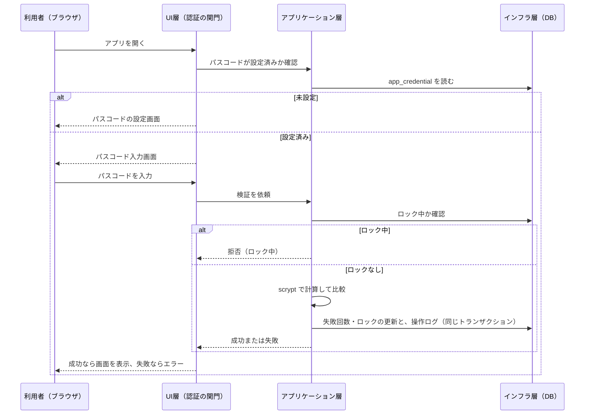

# グループG エンジニア管理CRM 権限・セキュリティ設計書 v0.10

> バージョン：v0.10
> 更新日：2026-10-28
> 目的：要件定義書 9章（権限・セキュリティ）を、認証・操作ログ・データ保護の設計に落とし込み、画面設計・実装・テストの前提を定める
> 対象読者：本システムの設計・実装・テスト・運用に関わる担当者
> 対象範囲：起動時のパスコード認証、操作ログ、データ・ログ・出力ファイルの保護、ローカルWebサーバーの保護。画面の項目・文言は対象外（画面設計書で定める）
> 前提：[要件定義書_v0.7.md](./要件定義書_v0.7.md)、[アーキテクチャ設計書_v0.11.md](./アーキテクチャ設計書_v0.11.md)、[データ設計書_v0.11.md](./データ設計書_v0.11.md)、[用語集_v0.7.md](./用語集_v0.7.md)、[実装計画書_v0.8.md](./実装計画書_v0.8.md)（対応 OS・PoC の決定事項）

## 目次
1. 設計方針
2. 守る対象と脅威
3. 認証
4. 権限
5. 操作ログ
6. データ・ログ・出力ファイルの保護
7. ローカルWebサーバーの保護
8. 秘密情報の取り扱い
9. 試験の観点
10. 要件トレーサビリティ
11. 要件定義書との差異
12. 未決事項
13. 変更履歴

## 1. 設計方針
設計判断には ID（`SCD-xxx`）を付ける。事実と未決事項を区別し、確認できていない内容は `TBD:` とする。

| ID | 方針 | 内容 | 根拠 |
|---|---|---|---|
| `SCD-001` | 単独利用・単一権限 | 1台のPCで1人が使う。ロールは設けず、パスコードを入力した起動者がマスター権限（すべての閲覧とすべての操作）を持つ | `REQ-SEC-005`、要件定義書 11章 |
| `SCD-002` | 認証の目的 | 認証は、パスコードを知らない人が、起動したアプリから機微情報を見たり変えたりすることを防ぐために行う。DBファイルそのものの保護は、OSのアクセス権とディスク暗号化に任せる | `REQ-SEC-003`、`REQ-SEC-005` |
| `SCD-003` | 依存を増やさない | 認証とログの実装は、標準ライブラリ（`hashlib`、`hmac`、`secrets`、`json`、`sqlite3`、`logging`）だけで行う | リポジトリルール、`ARC-004` |
| `SCD-004` | 認証情報は保存しても平文にしない | パスコードそのものは保存しない。元の値に戻せない形（ハッシュ）だけを DB に保存する | `REQ-SEC-004` |
| `SCD-005` | 失敗は安全側に倒す | 認証の判定や操作ログの記録に失敗したときは、機微情報を表示せず、操作も実行しない | 本書 |

## 2. 守る対象と脅威
### 2.1 守る対象
| 対象 | 内容 |
|---|---|
| 機微情報 | 給与・賞与・評価・退職リスク（要件定義書 4章 #7）、生年月日・性別・居住エリア（`DBD-014`） |
| 操作ログ | 変更前後の値に給与額を含むため、機微情報として扱う（`REQ-SEC-002`） |
| 認証情報 | パスコードのハッシュ・ソルト（`TBL-022`） |

### 2.2 脅威と対策
| # | 脅威 | 対策 | 設計 ID |
|---|---|---|---|
| 1 | 同じPCの別の利用者が、起動したアプリのURLに接続して機微情報を見る | 認証前は、どの画面も表示しない。ローカルPCからだけ接続できるように設定する | `SCD-010`、`SCD-030` |
| 2 | 他のPCや外部のネットワークから、アプリへ接続される | `server.address` を `127.0.0.1` にする（`ARC-016`） | `SCD-030` |
| 3 | パスコードを何度も試される | 連続失敗でロックする。ハッシュの計算を遅くする | `SCD-008`、`SCD-006` |
| 4 | DBファイルのコピーからパスコードを割り出される | ソルト付きのメモリ困難なハッシュ（scrypt）で保存する | `SCD-006` |
| 5 | 離席中に、他の人が画面を見る・操作する | 認証の通過状態を、ブラウザのタブ（セッション）ごとに持つ。無操作時の自動ロックは設けない（ユーザーの回答 2026-10-21。画面設計書 `UID-030`） | `SCD-010` |
| 6 | 給与の閲覧・変更の痕跡が残らない／後から書き換えられる | 操作ログを同じトランザクションで残し、追記専用にする | `SCD-020`、`SCD-024` |
| 7 | ログ・出力ファイル・バックアップから機微情報が漏れる | 保管場所とアクセス権を決め、アプリのログには機微情報を出さない | `SCD-040`〜`SCD-042` |
| 8 | 配布物・リポジトリに秘密情報が混入する | パスコードの初期値を持たない。サンプルデータは架空のものだけを使う | `SCD-050` |

### 2.3 守らないもの（前提）
- DBファイルを直接読める人（このPCのOSの管理者、同じOSアカウントでログインできる人、DBファイルのコピーを持つ人）から、機微情報を守ることはしない。DBファイルは暗号化しないため（要件定義書 11章）
- 同じOSアカウントで動く別のプログラムからの攻撃。標準 `sqlite3` と Streamlit のプロセスは、同じ権限で動く

## 3. 認証

### 3.1 方式 `SCD-006`
| 項目 | 内容 | 根拠 |
|---|---|---|
| 入力 | 起動後、最初に表示する画面でパスコードを入力する | `REQ-SEC-005` |
| ハッシュ方式 | scrypt（標準ライブラリ `hashlib.scrypt`） | 下記 |
| パラメータ | N＝2^17（131072）、r＝8、p＝1 | OWASP Password Storage Cheat Sheet の最小構成（N＝2^17、r＝8、p＝1）の一つ |
| ソルト | 16 バイト。`secrets.token_bytes` で生成し、パスコードの設定のたびに新しくする | 本書 |
| ハッシュの長さ | 32 バイト | 本書 |
| 文字コード | パスコードは UTF-8 のバイト列にして渡す | 本書 |
| 比較 | `hmac.compare_digest` で、一定時間で比較する | 標準ライブラリ |
| 保存 | `TBL-022` の 16 進数の文字列として保存する。パラメータも列に保存する | `DBD-022` |

- 実機（Python 3.13.9、2026-10-21）で確認した事実
  - 既定の `maxmem` では、N＝2^17 の計算が `memory limit exceeded` で失敗した。`maxmem` に 256 MiB を指定すると成功した
  - 計算の所要時間は 0.36 秒（この開発機）。OWASP の「1 秒未満」の目安に収まる
  - 計算には約 128 MiB のメモリを一時的に使う。常駐メモリの目標値（`ARC-022`）を決めるときに考慮する
- Argon2id は、OWASP が第一に挙げる方式だが、標準ライブラリにない。追加の依存が必要になるため採用しない。scrypt は、OWASP が「Argon2id が使えないときに使う」としている方式である
- PoC（実装計画書 `POC-02`）で、Windows の exe 内でも、同じ条件（N＝2^17、r＝8、p＝1、`maxmem`＝256 MiB）で scrypt の計算が成功することを確認した。実測は次のとおり。計算を含むプロセスの、最大のワーキングセットであり、起動直後のメモリを含む。普通の `python` で 0.38 秒・約 146 MiB（開始前は約 18 MiB）、PyInstaller の exe で 0.42 秒・約 185 MiB、cx_Freeze の exe で 0.52 秒・約 180 MiB。PyInstaller の onedir と onefile のどちらの値かは、記録が残っていない。exe のメモリ値は、PR #27 の本文に無く、再現用の記録も残していない
- `TBD:` macOS の exe（同梱の Python の `hashlib`）で scrypt が使えるかは、未確認である

### 3.2 パラメータの更新 `SCD-007`
- パラメータは、DB に保存した値で検証する。コードの定数を後から変えても、既存のハッシュを検証できる
- 認証に成功したとき、保存したパラメータが現在の推奨値より弱ければ、入力されたパスコードで、新しいソルトと現在のパラメータでハッシュを作り直して保存する

### 3.3 初回設定 `SCD-009`
- `TBL-022` に行がないとき（パスコード未設定）、起動後の最初の画面で、パスコードの設定を求める。設定するまで、他の画面は表示しない
- 確認のため、同じ値を2回入力させる。一致しなければ設定しない
- 設定の記録は、操作ログに残す（`パスコード設定`。値は残さない）
- 配布物にも、リポジトリにも、パスコードの初期値を持たせない（`SCD-050`）
- パスコードの文字種は、メールアドレス形式の文字列（例：`xxx@3sss.co.jp`）に限定する（ユーザー承認 2026-10-23）。具体的な検査は、形式がメールアドレスとして妥当であること（`employee.email` と同じ検査方法）とし、特定のドメインへの制限は設けない。利用者を区別しない単一のパスコードであることに変わりはなく、認証方式自体（ロールを廃止し、単一の起動時パスコードで認証する方針）は変更しない

### 3.4 起動時の認証 `SCD-010`

- UI層は、認証を通過するまで、他の画面・データを表示しない。Streamlit は、ブラウザのタブごとにセッションを作り、`st.session_state` をセッションごとに持つ（公式ドキュメントで確認、2026-10-21）。認証の通過状態は、これに保持する（UI層の一時的なUI状態。`ARC-003`）。タブを新しく開くたびに、パスコードの入力が必要になる
- アプリケーション層以下は、認証の通過状態を保持しない（`ARC-003`）。マスター権限は1つで、機能ごとの権限の検査がないため、認証の関門は UI層に置く
- PoC（実装計画書 `POC-03`）で、Streamlit 1.66.0（Windows）について、認証前は `st.navigation` にログインのページだけを渡す構成で、保護されたページの URL を直接開く（同じタブ、新しいタブ）と、「Page not found」の後にログイン画面になり、保護されたページの内容が出ないことを確認した。`AppTest` で、認証前に保護されたページへ `switch_page` すると、`ValueError` になった。この確認は実機によるもので、Streamlit の公式ドキュメントでの確認は行っていない。`TBD:` 認証後のページ切り替え、ページを直接開いた場合のセッションの扱いなど、他の構成での確認は、実装時（実装計画書 `PH-05`）に行う
- 画面をリロードすると、`st.session_state` が失われ、再びパスコードの入力が必要になることを確認した（`POC-03` の確認中に判明。実装計画書 4.4）
- 画面に出すエラーメッセージは、一般的なものにする。パスコードの一部が一致したかどうかなどの手がかりを出さない
- 移行コマンド（`crm-g import`。移行設計書 8.1）は、認証の関門を通らず、パスコードを求めない（11章 `SCD-063`）。コマンドは DB ファイルを直接開けるため、認証の関門は、コマンドには働かない。DB ファイルの保護は、OS のアクセス権で行う（`SCD-040`）

### 3.5 失敗時の扱い `SCD-008`
- 認証に失敗するたびに、`failed_count` を 1 増やす。成功したら 0 に戻す
- 連続して `N` 回失敗したら、`locked_until` に現在時刻（UTC）＋ `T` を設定する。ロック中は、パスコードを検証せずに拒否する（ハッシュの計算も行わない）
- `N`＝5 回、`T`＝5 分とする（ユーザー承認 2026-10-23。暫定案のとおり確定）
- 失敗回数とロックは、DB に保存する（プロセスの変数に持たない。`ARC-003`）。アプリを再起動しても、ロックは続く
- ロックは、パスコードを知っている利用者も、一時的に使えなくする（他者の連続入力で締め出される）。単独利用の構成では、この影響を許容する（ユーザー承認 2026-10-23）

### 3.6 パスコードの変更と再設定 `SCD-011`
- 変更は、現在のパスコードを入力してから、新しいパスコードを2回入力する。変更の記録は、操作ログに残す（`パスコード設定`）
- 新しいパスコードの検査（一致・形式）を、現在のパスコードの確認より先に行う。現在のパスコードの確認は、認証と同じく `SCD-008` の失敗回数・ロックの対象とし、`認証成功`・`認証失敗` を記録する（画面設計書 `SCN-066`）
- パスコードの入力値は、画面の一時的な状態（`st.session_state`）にも残さない。設定・認証・変更の画面（`SCN-001`、`SCN-002`、`SCN-066`）は、送信のたびに入力値を消す（画面設計書 `UID-050`）
- パスコードを忘れた場合の復旧手順は `TBD:`（12章-4）。DBファイルを暗号化しないため、OSの権限でDBを直接操作できる人は、`app_credential` の行を削除することで、再設定できる。この手順を運用手順書に書くかは、実装計画書 11章-8 でユーザーに確認する
- 無操作時の自動ロックは設けない（ユーザーの回答 2026-10-21。画面設計書 `UID-030`。12章-3）
- バックアップから復元すると、パスコードも復元した時点のものに戻る。復元したタブはログアウトし、画面の状態をすべて消す（他のタブは認証済みのまま残る）。パスコードが設定される前のバックアップは、復元しない（誰でも最初の設定ができてしまうため。画面設計書 `SCN-065`）

## 4. 権限 `SCD-012`
- 権限は、マスター権限の1つだけ。認証を通過した起動者は、すべての情報を見られ、すべての操作ができる（`REQ-SEC-005`）
- 閲覧・更新の可否を決める検査を、アプリケーション層に持たない。要件定義書 v0.5 のロール別の検査は、ロールの廃止とともに不要になった
- 月次締めの解除は、操作ログを残す（`REQ-FUN-014`）。操作者の区別はなくなったため、「管理者だけ」の制限はない

## 5. 操作ログ

### 5.1 記録する操作 `SCD-020`
`TBL-020`（`operation_log`）に記録する。値は、データ設計書 8.1 の `operation` の検査値である。

| 操作（`operation`） | 対象（`target_table`） | いつ | `before_value` | `after_value` |
|---|---|---|---|---|
| `閲覧` | `salary_history`、`salary_history_item`、`monthly_payroll`、`monthly_payroll_item`、`bonus` | 給与・賞与の情報を画面に表示するとき | なし | なし |
| `出力` | 同上 | 給与・賞与を含む CSV を出力するとき | なし | なし |
| `登録` | 業務データの全テーブル（`employee`・`evaluation` など、給与・賞与以外も含む） | 新しい行を保存するとき | なし | 登録した列と値 |
| `更新` | 同上 | 既存の行を変えるとき | 変えた列の変更前の値 | 変えた列の変更後の値 |
| `削除` | 同上 | 行を削除するとき（物理削除しない方針のため、例外的な操作） | 削除した行の列と値 | なし |
| `月次締め` | `monthly_payroll`、`monthly_pl` | 月次締めをするとき | なし | なし（`detail` に対象月） |
| `月次締め解除` | `monthly_payroll`、`monthly_pl` | 締めを解除するとき | なし | なし（`detail` に対象月） |
| `取込` | 取り込んだテーブル | 移行ツールで取り込むとき（1回の取り込みで1件）。行ごとの値は残さない | なし | なし（`detail` に件数） |
| `認証成功` | `app_credential` | 認証に成功したとき | なし | なし |
| `認証失敗` | `app_credential` | 認証に失敗したとき | なし | なし |
| `パスコード設定` | `app_credential` | パスコードを設定・変更したとき | なし | なし（ハッシュ・ソルトも残さない） |
| `バックアップ作成` | `database`（固定値） | 画面から手動でバックアップを作成したとき。`detail` はファイル名だけ（パスは入れない）。復元の前の自動のバックアップは記録しない | なし | なし |
| `復元` | `database`（固定値） | バックアップから復元したとき。復元とマイグレーションの後の DB に追記する。`detail` はファイル名だけ | なし | なし |

- 要件定義書 `REQ-SEC-002` は、「給与・賞与を見たり変えたりした記録」を求めている。`閲覧`・`出力` は、この要件のとおり給与・賞与の対象だけに限る。`登録`・`更新`・`削除` は、評価（`evaluation`）など給与・賞与以外の業務データの変更も、要件を超える設計判断として記録する（ユーザー承認 2026-10-23。12章-6は解決済み）
- `出力`、`認証成功`、`認証失敗`、`パスコード設定` は、要件定義書に明記がない。設計判断として追加する（11章 `SCD-061`）
- `閲覧` の記録は、対象（画面と、社員または年月・半期の組み合わせ）を新しく表示したときに 1 回とする（画面設計書 `UID-060`。ユーザー承認 2026-10-23。12章-5は解決済み）。Streamlit は、画面の操作のたびにスクリプトを再実行するため、再実行のたびに記録すると、大量の記録になる

### 5.2 記録の方式 `SCD-021`
- 記録は、操作と同じトランザクションで行う（`ARC-015`）。操作が失敗してロールバックしたときは、記録も残さない
- `閲覧` と `出力` は、記録に成功してから、データを返す。記録に失敗したときは、データを返さずに、エラーにする（`SCD-005`）
- `before_value` と `after_value` は、標準 `json` で作る JSON 文字列とする。キーは列名で、`更新` では、変えた列だけを入れる（`登録`・`削除` は 5.1 の表のとおり）。DB 側でも `json_valid` で検査する（`TBL-020`）。実機（SQLite 3.50.4）で、JSON として不正な値を拒否することを確認した
- 認証情報（パスコード、ハッシュ、ソルト）は、`before_value`・`after_value`・`detail` に入れない（`SCD-023`）
- 記録する時刻は UTC とする（`DBD-005`）

### 5.3 値の形式 `SCD-022`
- 例（給与の更新）：`{"base_salary": 300000}` → `{"base_salary": 310000}`。列名と値の組をそのまま記録する
- 金額は円の整数、率は万分率の整数（`DBD-003`、`DBD-004`）。画面に出すときの表示形式への変換は、画面設計書で定める

### 5.4 ログに入れてはいけないもの `SCD-023`
- パスコード、パスコードのハッシュ、ソルト
- `detail` に、金額を入れない（値は `before_value`・`after_value` に限る）。`detail` は、要約（列名・件数・対象月、画面の名称など）の用途に限る

### 5.5 追記専用と保護 `SCD-024`
- `UPDATE` と `DELETE` は、トリガーで拒否する（`DBD-019`）
- 操作ログは、業務データと同じDBに保存する。DBファイルと同じ保護（6.1）を受ける。バックアップにも含まれるため、バックアップファイルも機微情報として扱う
- アプリケーションのログ（`ARC-018`）には、`before_value`・`after_value` を出力しない
- 操作ログを画面で見る機能を設ける（ユーザーの回答 2026-10-21。画面設計書 `SCN-067`。12章-7）。操作ログの閲覧は、`閲覧` として記録しない（ユーザー承認 2026-10-27。画面設計書 `UID-060`）。操作ログの CSV 出力・編集・削除は、画面に設けない
- 操作ログの保持期間は定めず、削除もしない（承認済み 2026-10-22。画面設計書 `SCN-067`、実装計画書 `IPD-013`）。肥大化したときの扱いは `TBD:`（12章-7）

## 6. データ・ログ・出力ファイルの保護

### 6.1 DBファイルとバックアップ `SCD-040`
- DBファイル・バックアップ・設定ファイル・ログファイルは、OS標準のユーザーデータ領域に置く（`ARC-006`）。OSのアクセス権で、他のユーザーから読めないようにする（`REQ-SEC-003`）
- DBファイルは暗号化しない。ディスク全体の保護は、OSのディスク暗号化に任せる（要件定義書 11章）
- 対応 OS は Windows と macOS（ユーザー回答 2026-10-22）。アクセス権（所有者だけに読み書きを許す設定）は、OS ごとに次の案とする（実装計画書 `IPL-025`）
  - macOS：ディレクトリを 0o700、ファイルを 0o600 にする案
  - Windows：既定の ACL を実機で確認し、必要な設定を決める（`TBD:`。実装計画書 11章-6）
  - 確認の手順は、テスト計画書の `TC-ARC-023` で定める（12章-9）
- 手動バックアップの作成先は、利用者が指定できる（ユーザー回答 2026-10-27）。既定はデータ領域の backups フォルダ。指定は、既にあるフォルダの絶対パス（ドライブ名から始まるパス、または共有フォルダ `\\サーバー\共有`。共有フォルダはユーザー承認 2026-10-28）に限る。フォルダは作らない。NUL などの使えない文字は拒否する。エラーの文言・ログには、パスを出さない（`ARC-018`）。指定した場所に作ったバックアップのアクセス権は、利用者の管理とする
- 手動バックアップのファイルは、利用者が指定した場所に作られうる。バックアップ・復元の画面に、機微情報を含む旨を表示する（画面設計書 `UID-061`。暫定。12章-10）

### 6.2 出力ファイル `SCD-041`
- 人事連携用の出力と各一覧の CSV（`REQ-FUN-011`、`REQ-FUN-012`）は、給与・賞与を含みうる。出力は操作ログに記録する（`SCD-020`）
- 出力先の保護は、アプリの範囲外とする。出力画面に、機微情報を含む旨を表示する（画面設計書 `UID-061`。暫定。12章-10）
- CSV の数式インジェクション（セルの先頭が数式を示す文字のとき、表計算ソフトが数式として解釈する）への対策は、出力の設計で扱う。氏名・備考など、利用者が入力した文字列が対象になる。対象の列のセルが、`=`、`+`、`-`、`@`、タブ、キャリッジリターン、ラインフィード、または全角の `＝`、`＋`、`－`、`＠` で始まるとき、先頭に単一引用符 `'` を付ける（画面設計書 `UID-091`。暫定。12章-11）

### 6.3 ログファイル `SCD-042`
- アプリケーションのログに、個人情報・給与額・認証情報を出力しない（`ARC-018`）
- 例外のメッセージにも、これらを含めない。例外を一般的なメッセージに変換して、画面に出す（`ARC-018`）

## 7. ローカルWebサーバーの保護 `SCD-030`
- Streamlit の設定は、アーキテクチャ設計書 7.3（`ARC-016`）のとおり。`server.address`＝`127.0.0.1`、`server.allowedHosts`＝`["localhost", "127.0.0.1"]`、`server.enableXsrfProtection`＝`true`、`server.enableCORS`＝`true`、`browser.gatherUsageStats`＝`false`
- 通信は、同じPC内の HTTP である。外部のネットワークには出ない。暗号化（TLS）は設定しない
- 同じPCの別のOSアカウントは、ローカルのポートへ接続できる。この接続に対しても、認証の関門（`SCD-010`）が働く。ただし、`SCD-008` のロックで、パスコードを知っている利用者が一時的に使えなくなる影響がある
- 使用するポートは、固定とする（実装計画書 4.5。ユーザー承認 2026-10-22）。使用中の場合は、エラーを表示して終了する。番号は `8501`（Streamlit の既定ポート。ユーザー承認 2026-10-23。アーキテクチャ設計書 7.3、`ARC-016`）とする。PoC（実装計画書 `POC-08`）では、固定のポートで起動できることを確認した。他のアプリとのポートの衝突がありうるが、衝突時は上記のとおり、利用者にエラーを示す

## 8. 秘密情報の取り扱い `SCD-050`
- リポジトリと配布物に、パスコード、ハッシュ、実データの給与・個人情報を含めない
- サンプルデータと試験データには、架空のデータだけを使う（`DBD-014`）
- `.env` などの秘密情報を、ログ・コミット・出力に含めない（リポジトリルール）
- 認証の実装は、パスコードを、検証に必要な間だけ変数に持つ。Python では、メモリ上の文字列を確実に消去できないため、これを超える対策はしない

## 9. 試験の観点
テスト計画書で、具体的な試験ケースに展開する。

| ID | 観点 | 期待する結果 | 設計 ID |
|---|---|---|---|
| `TC-SCD-001` | パスコード未設定で起動する | 設定画面だけが表示される。他の画面は表示されない | `SCD-009` |
| `TC-SCD-002` | 2回の入力が一致しない | 設定されない | `SCD-009` |
| `TC-SCD-003` | 正しいパスコードを入力する | 認証を通過し、画面が表示される。`認証成功` が記録される | `SCD-010` |
| `TC-SCD-004` | 誤ったパスコードを入力する | 画面は表示されない。`failed_count` が増え、`認証失敗` が記録される | `SCD-008` |
| `TC-SCD-005` | 連続失敗が上限に達する | `locked_until` が設定され、ロック中は正しいパスコードでも拒否される | `SCD-008` |
| `TC-SCD-006` | ロックの後でアプリを再起動する | ロックが続く | `SCD-008` |
| `TC-SCD-007` | 認証前に、画面のURLへ直接アクセスする | 機微情報が表示されない | `SCD-010` |
| `TC-SCD-008` | `app_credential` に、パスコードそのものが保存されていないことを確認する | ハッシュとソルトだけがある。パスコードの文字列は見つからない | `SCD-004` |
| `TC-SCD-009` | 既存のハッシュより強いパラメータに変更して、認証する | 古いパラメータで検証でき、成功後に新しいパラメータへ更新される | `SCD-007` |
| `TC-SCD-010` | 給与を更新する | `更新` が、変更前後の値とともに、同じトランザクションで記録される | `SCD-020`、`SCD-021` |
| `TC-SCD-011` | 更新の途中で失敗させる | 業務データも操作ログもロールバックされる | `SCD-021` |
| `TC-SCD-012` | 操作ログに `UPDATE`・`DELETE` を実行する | トリガーで拒否される | `SCD-024` |
| `TC-SCD-013` | 操作ログの記録を失敗させて、給与を閲覧する | データが表示されない | `SCD-021`、`SCD-005` |
| `TC-SCD-014` | 給与・賞与を含む CSV を出力する | `出力` が記録される | `SCD-020` |
| `TC-SCD-015` | アプリのログファイルを確認する | パスコード、給与額、個人情報が含まれない | `SCD-042` |
| `TC-SCD-016` | `before_value` に不正な JSON を保存する | DB の検査で拒否される | `SCD-021` |
| `TC-SCD-017` | 外部のホストから、アプリの URL に接続する | 接続できない | `SCD-030` |

## 10. 要件トレーサビリティ
| 設計 ID | 設計項目 | 対応する要件 |
|---|---|---|
| `SCD-001`〜`SCD-005` | 設計方針 | `REQ-SEC-001`（廃止）、`REQ-SEC-005` |
| `SCD-006`、`SCD-007` | ハッシュ方式と更新 | `REQ-SEC-004`、`REQ-SEC-005` |
| `SCD-008` | 失敗時の扱い | `REQ-SEC-005`（設計判断。`SCD-061`） |
| `SCD-009`〜`SCD-011` | 初回設定・認証・変更 | `REQ-SEC-005` |
| `SCD-012` | 権限 | `REQ-SEC-005`、`REQ-FUN-014` |
| `SCD-020`〜`SCD-024` | 操作ログ | `REQ-SEC-002`、`REQ-FUN-014` |
| `SCD-030` | ローカルWebサーバーの保護 | `REQ-SEC-003`、`REQ-TEC-003` |
| `SCD-040`〜`SCD-042` | データ・ログ・出力ファイルの保護 | `REQ-SEC-002`、`REQ-SEC-003`、`REQ-FUN-011`、`REQ-FUN-012` |
| `SCD-050` | 秘密情報の取り扱い | `REQ-SEC-004` |

## 11. 要件定義書との差異
要件定義書 9章からの追加・解釈を、すべて明示する。

| ID | 内容 | 理由 |
|---|---|---|
| `SCD-060` | 要件定義書 v0.5 の `REQ-SEC-004`「パスワードは保存しない」を、「移行元の他システムのパスワードを保存しない」と解釈する。本アプリのパスコードは、ハッシュだけを保存する | 2026-10-21 のユーザーの回答。要件定義書 v0.6 に反映済み |
| `SCD-061` | 次を、要件にない設計判断として追加した。①操作ログに `出力`・`認証成功`・`認証失敗`・`パスコード設定` を記録する。②連続失敗でロックする（3.5）。③パスコードの変更手順 | ①利用者を区別しない構成で、不正な試行と出力の痕跡を残すため。②パスコードの総当たりを遅くするため。③`REQ-SEC-005` の運用に必要なため。不要なら削除する（ユーザーの確認待ち） |
| `SCD-062` | ハッシュ方式に scrypt を選んだ | 3.1 のとおり。標準ライブラリで使えるため |
| `SCD-063` | 移行コマンドは、パスコードの認証を求めない | 2026-10-22 のユーザーの回答（実装計画書 11章-11。移行設計書 14章-6）。DB ファイルを直接読める人から守らない前提（2.3）と同じで、DB ファイルは OS のアクセス権で保護する（`REQ-SEC-003`、`SCD-040`）。画面の認証の関門（`SCD-010`）は、コマンドには働かない |

## 12. 未決事項
| # | 未決事項 | 関連する設計 | 決める文書 |
|---|---|---|---|
| 1 | （解決済み）パスコードの文字種は、メールアドレス形式の文字列に限定する（ユーザー承認 2026-10-23） | `SCD-009` | — |
| 2 | （解決済み）ロックの条件は、`N`＝5 回、`T`＝5 分とする。ロックを採用する（ユーザー承認 2026-10-23） | `SCD-008` | — |
| 3 | （解決済み）無操作時の自動ロックは設けない（ユーザーの回答 2026-10-21。画面設計書 `UID-030`） | `SCD-010` | 画面設計書 |
| 4 | パスコードを忘れた場合の復旧手順。運用手順書に書くかは、ユーザーに確認する | `SCD-011` | 実装計画書 11章-8 |
| 5 | （解決済み）`閲覧` は、対象を新しく表示したときに 1 回記録する（画面設計書 `UID-060`。ユーザー承認 2026-10-23） | `SCD-020` | — |
| 6 | （解決済み）評価（`evaluation`）など、給与・賞与以外の変更も操作ログに残す（ユーザー承認 2026-10-23） | `SCD-020` | — |
| 7 | （一部解決）操作ログの閲覧画面は設ける（ユーザーの回答 2026-10-21。画面設計書 `SCN-067`）。保持期間は定めず、削除もしない（承認済み 2026-10-22。実装計画書 `IPD-013`）。操作ログの閲覧は記録しない（ユーザー承認 2026-10-27）。肥大化したときの扱いは未決 | `SCD-024` | ユーザーの確認、画面設計書 |
| 8 | （一部解決）認証前に別の画面のURLへ直接アクセスして、関門を迂回できないことの確認（Streamlit）。PoC の構成では、内容が出ないことを確認した。他の構成は実装時に確認する | `SCD-010` | 実装計画書 4.4（`POC-03`）、`PH-05` |
| 9 | （案あり）DBファイル等のアクセス権の具体的な設定。対応 OS は Windows と macOS に決定。macOS は 0o700／0o600 の案、Windows は実機で確認する | `SCD-040` | 実装計画書 `IPL-025`、11章-6 |
| 10 | （暫定。画面設計書 10章で定めた。ユーザーの確認待ち）バックアップ・出力の画面に、機微情報を含む旨を表示する（画面設計書 `UID-061`） | `SCD-040`、`SCD-041` | 画面設計書 |
| 11 | （暫定。画面設計書 10章で定めた。ユーザーの確認待ち）CSV の数式インジェクションへの対策は、先頭に単一引用符 `'` を付ける（画面設計書 `UID-091`） | `SCD-041` | 画面設計書 |
| 12 | （解決済み）Streamlit のポートは固定とする（実装計画書 4.5）。番号は `8501`（ユーザー承認 2026-10-23） | `SCD-030` | — |
| 13 | （一部解決）配布する exe に同梱する Python で、`hashlib.scrypt` が使えること。Windows の exe で成立した。macOS は未確認 | `SCD-006` | 実装計画書 4.4（`POC-02`） |

## 13. 変更履歴
| 版 | 日付 | 変更内容 |
|---|---|---|
| v0.1 | 2026-10-21 | 新規作成 |
| v0.2 | 2026-10-22 | 実装計画書 v0.1 に合わせて更新。6.1 のアクセス権（Windows と macOS、案）。3.1・3.4・3.6・7 の `TBD:` に PoC・未決事項の参照先を追記。12章の更新。案は、実装計画書 9章の差異としてユーザーの確認待ち |
| v0.3 | 2026-10-22 | 実装計画書 v0.2 に合わせて更新。3.4 と 11章 `SCD-063`：移行コマンドは認証を求めない（ユーザー回答）。`TBD:` の記述の変更はなし |
| v0.4 | 2026-10-22 | 実装計画書 v0.3 の PoC の結果（Windows）に合わせて更新。3.1 の scrypt の exe 内での確認結果。3.4 の URL 直接アクセスの確認結果。7 章のポートの状況。12章-8・12・13 の更新。macOS は未確認 |
| v0.5 | 2026-10-22 | 実装計画書 v0.4 の確定事項（4.5）を反映。7 章のポートを固定に変更（番号は実装時）。12章-12 の更新 |
| v0.6 | 2026-10-22 | 整合性の点検に基づく修正。画面設計書 10章の回答を反映（2.2 #5・3.6・12章-3：無操作時の自動ロックは設けない。5.1・5.5・6.1・6.2・12章-5・7・10・11）。5.1 の `before_value`・`after_value` の記述に「`更新` では」を明記。5.4 の `detail` の用途を 5.1 の表に合わせた。6.1 の `TC-ARC-023` の参照先をテスト計画書に修正 |
| v0.7 | 2026-10-23 | PH-05着手前のユーザー確認（2026-10-23）を反映。`SCD-009`：パスコードの文字種をメールアドレス形式に限定（12章-1解決）。`SCD-008`：ロックの条件を`N`＝5回・`T`＝5分に確定（12章-2解決）。`SCD-020`：`登録`・`更新`・`削除`の対象を業務データの全テーブルに拡大し、`閲覧`の記録粒度を確定（12章-5・6解決）。`SCD-030`：ポート番号を`8501`に確定（アーキテクチャ設計書7.3、`ARC-016`と整合。12章-12解決） |
| v0.8 | 2026-10-28 | PH-14-1 の実装に合わせて、3.6 `SCD-011` に、新しいパスコードの検査を先に行うことと、現在のパスコードの確認が `SCD-008` の対象になること、パスコードの入力値を画面の一時的な状態にも残さないことを追記 |
| v0.9 | 2026-10-28 | ユーザー承認 2026-10-27 を反映。5.5 `SCD-024`・12章-7 で、操作ログ画面の閲覧を `閲覧` として記録しないことを確定 |
| v0.10 | 2026-10-28 | PH-14-3 の実装とユーザー承認 2026-10-27〜28 を反映。5.1 `SCD-020` に `バックアップ作成`・`復元` を追加。3.6 `SCD-011` に復元とパスコードの関係を、6.1 `SCD-040` に手動バックアップの作成先の指定を追記 |
