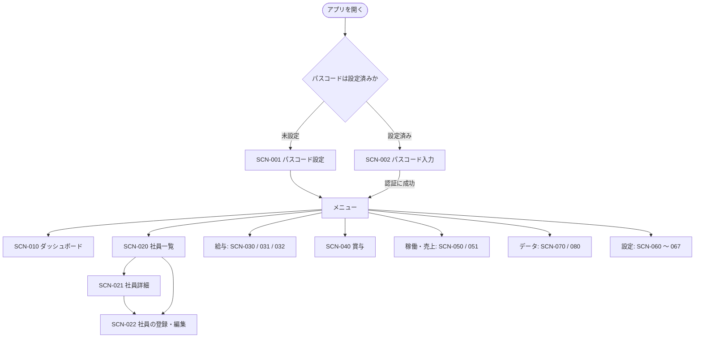

# グループG エンジニア管理CRM 画面設計書 v0.6

> バージョン：v0.6
> 更新日：2026-10-24
> 目的：要件定義書 7章（画面と機能）を、画面の構成・項目・入力検証・操作・表示形式に落とし込み、実装・テストの前提を定める
> 対象読者：本システムの設計・実装・テストに関わる担当者
> 対象範囲：フェーズ1の全画面、画面の共通仕様、CSV 出力の仕様。業務ルールと計算式は対象外（計算仕様書、データ設計書で定める）
> 前提：[要件定義書_v0.7.md](./要件定義書_v0.7.md)、[アーキテクチャ設計書_v0.8.md](./アーキテクチャ設計書_v0.8.md)、[データ設計書_v0.6.md](./データ設計書_v0.6.md)、[計算仕様書_v0.4.md](./計算仕様書_v0.4.md)、[権限・セキュリティ設計書_v0.7.md](./権限・セキュリティ設計書_v0.7.md)、[用語集_v0.6.md](./用語集_v0.6.md)、[実装計画書_v0.6.md](./実装計画書_v0.6.md)（PoC・フェーズ計画）

## 目次
1. 設計方針
2. 画面一覧と遷移
3. 共通仕様
4. 画面仕様（認証・ダッシュボード・社員）
5. 画面仕様（給与・賞与）
6. 画面仕様（稼働・売上）
7. 画面仕様（データ取込・出力）
8. 画面仕様（設定・操作ログ）
9. CSV 出力の仕様
10. 他の設計書の未決事項との対応
11. 試験の観点
12. 要件トレーサビリティ
13. 要件定義書との差異
14. 未決事項
15. 変更履歴

## 1. 設計方針
設計判断には ID を付ける。画面には `SCN-xxx`、画面に共通する判断には `UID-xxx` を使う。事実と未決事項を区別し、確認できていない内容は `TBD:` とする。

| ID | 方針 | 内容 | 根拠 |
|---|---|---|---|
| `UID-001` | 画面基盤 | 画面は Streamlit（確認した版は 1.66.0）で作る。ページの切り替えは `st.navigation` と `st.Page` で行う | `REQ-TEC-003`、`ARC-004` |
| `UID-002` | 業務ルールを持たない | 画面は、表示・入力の受け取り・メッセージの表示だけを行う。検証と計算は、アプリケーション層に任せる | `ARC-002` |
| `UID-003` | 単独利用の操作性 | 1人が1台のPCで使う前提で、確認の回数を抑える。ただし、取り消しにくい操作（締め・復元・取込）では必ず確認する | `SCD-001`、本書 |
| `UID-004` | 表示は事実だけ | 計算結果は、DB に保存した値か、アプリケーション層が返す値を表示する。画面で計算し直さない | `ARC-003` |

画面基盤の API は、PyPI の Streamlit 1.66.0 を一時環境に入れて実在を確認した（2026-10-21）。`st.info` と `st.segmented_control` は、Streamlit の公式ドキュメント（1.66.0 のソースへのリンクがある API の説明）で実在を確認した（2026-10-22）。使う主な API は次のとおり。

| 用途 | API |
|---|---|
| ページ構成・認証の関門 | `st.navigation`、`st.Page`、`st.set_page_config` |
| 入力 | `st.form`、`st.form_submit_button`、`st.text_input`、`st.date_input`、`st.selectbox`、`st.multiselect`、`st.segmented_control`、`st.checkbox`、`st.text_area`、`st.file_uploader` |
| 表示 | `st.dataframe`（`on_select`、`selection_mode` で行を選ぶ）、`st.data_editor`、`st.column_config.SelectboxColumn`、`st.metric`、`st.tabs`、`st.columns`、`st.bar_chart` |
| 確認・通知 | `st.dialog`、`st.toast`、`st.error`、`st.warning`、`st.success`、`st.info` |
| 出力 | `st.download_button`（`data` に作成済みの CSV を渡す。準備のボタンで先に作成する。7.2） |
| UI 状態 | `st.session_state` |

## 2. 画面一覧と遷移

### 2.1 画面一覧
| ID | 画面 | メニューの区分 | 対応する要件 |
|---|---|---|---|
| `SCN-001` | パスコード設定 | （認証前） | `REQ-SEC-005` |
| `SCN-002` | パスコード入力 | （認証前） | `REQ-SEC-005` |
| `SCN-010` | ダッシュボード | （区分なし） | `REQ-FUN-001` |
| `SCN-020` | 社員一覧 | 社員 | `REQ-FUN-002` |
| `SCN-021` | 社員詳細 | （メニューに出さない） | `REQ-FUN-002` |
| `SCN-022` | 社員の登録・編集 | （メニューに出さない） | `REQ-DAT-001`（設計判断 `UID-070`） |
| `SCN-030` | 給与履歴の登録 | 給与 | `REQ-FUN-003` |
| `SCN-031` | 昇給一覧 | 給与 | `REQ-FUN-004` |
| `SCN-032` | 月次給与計算 | 給与 | `REQ-FUN-005`、`REQ-FUN-013`、`REQ-FUN-014` |
| `SCN-040` | 賞与 | 賞与 | `REQ-FUN-006` |
| `SCN-050` | 稼働 | 稼働・売上 | `REQ-FUN-007` |
| `SCN-051` | 売上 | 稼働・売上 | `REQ-FUN-008` |
| `SCN-060` | 営業日カレンダー | 設定 | `REQ-FUN-009` |
| `SCN-061` | 稼働状態 | 設定 | `REQ-FUN-009` |
| `SCN-062` | 給与項目 | 設定 | `REQ-FUN-009` |
| `SCN-063` | 計算設定 | 設定 | `REQ-FUN-009` |
| `SCN-064` | 賞与ルール・掛け率 | 設定 | `REQ-FUN-009` |
| `SCN-065` | バックアップ・復元 | 設定 | `REQ-TEC-002`、`REQ-TEC-006`（関連設計 `ARC-021`） |
| `SCN-066` | パスコード変更 | 設定 | `REQ-SEC-005` |
| `SCN-067` | 操作ログ | 設定 | `REQ-SEC-002` |
| `SCN-070` | データ取込 | データ | `REQ-FUN-010` |
| `SCN-080` | 出力 | データ | `REQ-FUN-011`、`REQ-FUN-012` |

- `SCN-021` と `SCN-022` は、`SCN-020` から開く画面である。メニューには出さない（2.3 の「社員」のページは `SCN-020`）
- 要件定義書 7章 7 の「マスタ・設定」は、`SCN-060`〜`SCN-064` に分ける。1画面に詰めると、タブが多くなり、操作が分かりにくくなるため

### 2.2 メニューと遷移


### 2.3 サイドバーの構成 `UID-020`
`st.navigation` の辞書形式で、区分ごとにページを並べる。

| 区分 | ページ |
|---|---|
| （区分なし） | ダッシュボード |
| 社員 | 社員 |
| 給与 | 給与履歴の登録、昇給一覧、月次給与計算 |
| 賞与 | 賞与 |
| 稼働・売上 | 稼働、売上 |
| データ | データ取込、出力 |
| 設定 | 営業日カレンダー、稼働状態、給与項目、計算設定、賞与ルール・掛け率、バックアップ・復元、パスコード変更、操作ログ |

## 3. 共通仕様

### 3.1 認証の関門 `UID-030`
- アプリのエントリポイントが、ページの登録を決める。認証前は、`SCN-001` または `SCN-002` の1ページだけを `st.navigation` に渡す。認証後に、2.3 のページを渡す
- 認証前は、メニュー・データ・他のページのURLに対応する内容を出さない。公式ドキュメントでは、`st.navigation` に渡さなかったページは、新しいセッションでは存在しないものとして扱われる。実機での確認は、`TC-SCN-002` と `TC-SCD-007` で行う（権限・セキュリティ設計書 12章-8）
- 認証の通過状態は `st.session_state` に持つ。ブラウザのタブを新しく開くと、パスコードの入力が必要になる（`SCD-010`）
- 無操作時の自動ロックは設けない（2026-10-21 のユーザーの回答。権限・セキュリティ設計書 12章-3 に対応）。ブラウザのタブを閉じると、認証の通過状態は失われる

### 3.2 UI 状態と業務データ `UID-031`
アーキテクチャ設計書 `ARC-003` に従う。画面で保持してよいものと、いけないものを次に定める。

| 区分 | 内容 |
|---|---|
| 保持してよい（`st.session_state`） | 認証の通過状態、選択中の対象月・半期・社員、絞り込みの条件、未確定の入力、ダイアログの開閉、直前に記録した閲覧ログの対象（`UID-060`）、2段階の登録の途中状態（`UID-052`） |
| 保持してはいけない | 確定した業務データ、業務データのキャッシュ、計算結果。`st.cache_data` と `st.cache_resource` は、業務データに使わない |

- 画面は、再実行のたびに、アプリケーション層からデータを読み直す
- 取り込むファイル（`SCN-070`）の内容は、取込の確認が終わるまでの間だけ、UI 状態として持つ。取込を実行したとき、または画面を離れたときに破棄する
- 出力する CSV（`SCN-080`）は、準備からダウンロードまでの間だけ、UI 状態として持つ。出力の種類・条件を変えたとき、または画面を離れたときに破棄する（`st.download_button` の関数が失敗したときに、エラーが画面に出ないため。7.2）

### 3.3 画面の標準構成 `UID-040`
各画面は、上から次の順に並べる。

1. ページのタイトル
2. 対象の選択（対象月、半期、社員など）
3. 状態の表示（締め済み、警告、エラーの件数）
4. 一覧・集計
5. 操作（登録、再計算、出力など）
6. 結果のメッセージ

### 3.4 表示形式 `UID-041`
| 種類 | 表示形式 | 例 | 備考 |
|---|---|---|---|
| 金額 | 3桁区切りの整数。列見出しに「円」を付ける | `1,234,567` | 保存値は円の整数（`DBD-003`） |
| 負の金額 | 先頭に `-` を付ける | `-12,000` | 粗利が負になりうる（`CLC-015`） |
| 日付 | `YYYY/MM/DD` | `2026/11/10` | `st.date_input` の既定の形式と同じ |
| 年月 | `YYYY/MM` | `2026/11` | |
| 期・半期 | `20期 上期` | | 期は計算仕様書 `CLC-002` で求める |
| 日時 | `YYYY/MM/DD HH:MM`（OS のローカル時刻） | `2026/11/10 09:30` | 保存値は UTC（`DBD-005`）。画面に出すときに変換する |
| 稼働率・給与支給率 | `%`、小数第2位まで固定 | `70.00%` | 万分率の整数（`DBD-004`）と、小数第2位で完全に対応する |
| 掛け率・原価係数 | `倍`、小数第4位まで固定 | `1.2000倍` | 万分率の整数と、小数第4位で完全に対応する |
| 粗利率 | `%`、小数第1位まで。四捨五入（0.05 は切り上げ）。売上が 0 のときは `－` | `23.5%` | 計算仕様書 12章-10 への回答（設計判断 `UID-071`） |
| 真偽値 | `○`／`×` | | 売上計上・原価計上など |
| 値なし | `－` | | |
| 判定 | `OK`／`要確認` の文字で出す | | 色だけで区別しない |

### 3.5 入力と検証 `UID-050`
- 入力は、`st.form` にまとめて、送信ボタンで確定する。1項目ごとにスクリプトを再実行させない
- 検証は、アプリケーション層が行い、結果を画面が表示する。画面は、必須・範囲・形式などの検証を持たない（`UID-002`）。入力の補助（日付の選択欄など）は、画面で行ってよい
- 金額・率の入力は、`st.text_input` で文字列として受け取り、アプリケーション層が `Fraction` として検証する。浮動小数点で受け取らない（誤差を避けるため）。受け取った値の変換は、アプリケーション層とインフラ層が行う（`DBD-004`）
- 率の入力欄には、単位（`%` または `倍`）を欄の名称に書く。入力できる桁数を超えた値（稼働率・給与支給率の小数第3位以降、掛け率・原価係数の小数第5位以降）は、エラーとする。丸めない
- 文字列の入力は、前後の空白を除いて保存する。全角・半角の統一は、画面では行わない（メールアドレスの小文字化は、データ設計書 4.1 に従い、アプリケーション層が行う）
- 検証のエラーは、フォームの直下に一覧で出す。保存は行わない。入力した値は、フォームに残す

### 3.6 メッセージ `UID-051`
| 種類 | 使う API | 使いどころ |
|---|---|---|
| エラー | `st.error` | 検証の失敗、計算のエラー、保存に失敗したとき。保存はされていない |
| 警告 | `st.warning` | 続行できるが、確認が必要なとき（改定月の警告、締め済みの月への影響） |
| 成功 | `st.toast` | 保存・再計算・取込の完了。件数を添える |
| 情報 | `st.info` | 締め済み、未計算などの状態 |

- 例外の詳細（スタックトレース、SQL、ファイルパス）を画面に出さない。原因を特定できない一般的なメッセージにする（`ARC-018`、`SCD-042`）
- 認証のエラーは、パスコードの一部が一致したかなどの手がかりを出さない（`SCD-010`）
- メッセージに、金額・個人情報・認証情報を含めない。件数と項目名に限る（`SCD-023`）

### 3.7 2段階の登録（警告の確認） `UID-052`
警告があるが登録できる操作（改定月以外の給与履歴の登録、締め済みの月への影響）は、次の流れにする。

```text
1. 利用者が登録ボタンを押す
2. アプリケーション層が検証する。エラーがあれば、エラーを出して終了する
3. 警告があれば、警告を出して、「警告を確認して登録する」ボタンを出す。保存はしない
4. 利用者が「警告を確認して登録する」を押したとき、保存する
```
- 手順 3 の途中状態（どの入力に対する警告か）は、UI 状態として持つ。入力を変えたときは、途中状態を破棄して、手順 1 に戻る

### 3.8 確認ダイアログ `UID-053`
次の操作は、`st.dialog` の確認を挟む。ダイアログには、操作の対象と影響を書く。

| 操作 | 画面 | ダイアログに書く内容 |
|---|---|---|
| 月次締め | `SCN-032` | 対象月、対象の人数、要確認の件数、計算エラーの件数 |
| 締めの解除 | `SCN-032` | 対象月、解除すると再計算の対象に戻ること、操作ログに残ること |
| 賞与の確定 | `SCN-040` | 対象の半期、人数、賞与額の合計、支給月の原価に反映されること |
| バックアップからの復元 | `SCN-065` | 復元するファイル名と作成日時、現在のデータが置き換わること、復元前に自動でバックアップを作ること |
| 取込の実行 | `SCN-070` | 取込の種類、件数、エラーの件数 |
| 再計算の確認が必要な設定の変更 | `SCN-060`〜`SCN-064` | 再計算される月の範囲（締め前の月だけ。締め済みの月は変わらないこと） |

### 3.9 締め済みデータの扱い `UID-054`
- 締め済みの月は、画面に「締め済み」と、締めた日時を表示する（`monthly_payroll.closed_at`）
- 締め済みの月の計算結果は、編集のための部品を出さない（ボタンを出さない、または無効にする）。変えるには、締めを解除してから行う（`REQ-FUN-013`、`REQ-FUN-014`）
- 給与履歴・稼働期間・営業日カレンダーなどの変更が、締め済みの月に影響するとき、画面は警告を出す。「締め済みの月の計算結果は変わらない」と明示する。登録は拒否しない。`TBD:` 要件定義書に記載がなく、暫定の扱いである（14章-8）

### 3.10 再計算の通知 `UID-055`
- 再計算を伴う保存の後、「N か月分を再計算した」と件数を通知する（`ARC-009`）
- 計算のエラーがあったときは、件数を通知し、`SCN-032` のエラー一覧を見るよう案内する。保存したデータ自体は成功している（計算のエラーは、結果を保存せず一覧に出す。`CLC-022`）

### 3.11 一覧の操作 `UID-056`
- 一覧は `st.dataframe` で表示する。列の見出しで並び替えができる（`st.dataframe` の標準の機能）
- 行を選ぶ必要がある一覧は、`on_select="rerun"` と `selection_mode="single-row"` で、1行だけ選ぶ（1.66.0 のソースで確認）
- 画面が一度に表示する行数の上限は設けない。ただし、操作ログ（`SCN-067`）は、件数が増え続けるため上限を設ける

### 3.12 閲覧ログの粒度 `UID-060`
権限・セキュリティ設計書 12章-5 への回答である。

- Streamlit は、操作のたびにスクリプトを再実行する。再実行のたびに記録すると、大量の記録になる
- 「対象を新しく表示したとき」に1回だけ記録する。対象は、画面と、社員または年月・半期の組み合わせである（下表）
- 直前に記録した対象を `st.session_state` に持つ。同じ対象の再実行では、記録しない。対象を変えたとき、別の画面へ移ってから戻ったときに、記録する
- 記録は、アプリケーション層が行う。画面は、「新しく表示した」かどうかを、アプリケーション層に渡す
- 記録に失敗したときは、データを表示しない。エラーを出す（`SCD-021`、`SCD-005`）
- 1回の表示で複数のテーブルの給与・賞与を読むときは、テーブルごとに1行を記録する。`detail` には、画面の名称だけを入れる（金額を入れない。`SCD-023`）

| 画面 | 記録するタイミング | 対象テーブル | `target_key` |
|---|---|---|---|
| `SCN-021` 社員詳細 | 社員を新しく表示したとき | `salary_history`、`salary_history_item`、`bonus` | 社員の `id` |
| `SCN-030` 給与履歴の登録 | 社員を新しく選んだとき | `salary_history`、`salary_history_item` | 社員の `id` |
| `SCN-031` 昇給一覧 | 画面を新しく開いたとき、または期間を変えたとき | `salary_history`、`salary_history_item` | 期間 |
| `SCN-032` 月次給与計算 | 対象月を新しく表示したとき | `monthly_payroll`、`monthly_payroll_item` | 年月 |
| `SCN-040` 賞与 | 半期を新しく表示したとき | `bonus` | 半期 |
| `SCN-067` 操作ログ | 画面を新しく開いたとき | `operation_log`（暫定。14章-5） | なし |

- 次の画面は、給与・賞与のテーブルを読まないため、`閲覧` を記録しない：`SCN-010`、`SCN-020`、`SCN-050`、`SCN-051`、`SCN-060`〜`SCN-066`
- `SCN-010`・`SCN-051` は、`monthly_pl`（原価に給与を含む）を表示する。権限・セキュリティ設計書 `SCD-020` の対象テーブルに `monthly_pl` がないため、現状は記録しない。記録するかは `TBD:`（14章-5）

### 3.13 機微情報の表示 `UID-061`
権限・セキュリティ設計書 12章-10 への回答である。

| 画面 | 表示する文言（要旨） | 表示位置 |
|---|---|---|
| `SCN-065` バックアップ・復元 | バックアップのファイルには、給与・賞与・評価・個人情報・操作ログが含まれる。保管場所と取り扱いに注意する | 画面の上部 |
| `SCN-080` 出力 | 出力するファイルには、給与・賞与などの機微情報を含む場合がある。保管場所と取り扱いに注意する | 出力ボタンの直上 |

### 3.14 表示するときの時刻と日付 `UID-062`
- 今日の日付・現在の時刻は、画面（UI層）が OS から取得して、アプリケーション層に渡す。ドメイン層は時刻を持たない（`ARC-002`）
- 対象月の既定値は、今日が属する月とする

### 3.15 年月・半期の選択 `UID-063`
- 年月は、「年」と「月」の2つの `st.selectbox` で選ぶ。年の候補は、2025 年（19期の開始年）から、今日が属する年の翌年までとする
- 半期は、`st.selectbox` で選ぶ。候補は、2025年上期（`2025-H1`）から、今日が属する半期の次の半期までとし、「20期 上期」のように表示する
- 評価の入力（`SCN-040`）の候補は、20期上期（`2026-H1`）以降だけにする（`REQ-DAT-010`）

## 4. 画面仕様（認証・ダッシュボード・社員）

### 4.1 `SCN-001` パスコード設定
目的：パスコードが未設定のとき、最初に表示する。`SCD-009` に従う。

| 項目 | 種類 | 内容 |
|---|---|---|
| パスコード | 入力（`st.text_input`、`type="password"`） | 必須 |
| パスコード（確認） | 入力（同上） | 必須。上の欄と一致すること |
| 設定 | ボタン | 検証して、パスコードを設定する |

- 設定が成功したら、認証済みとして、ダッシュボードへ進む
- 検証：空のパスコードを拒否する。2つの欄が一致しなければ拒否する。文字種は、メールアドレス形式の文字列に限定する（権限・セキュリティ設計書 `SCD-009`、12章-1解決。ユーザー承認 2026-10-23）
- 操作ログに `パスコード設定` を記録する。値は残さない（`SCD-009`）
- 設定するまで、他のページを `st.navigation` に渡さない

### 4.2 `SCN-002` パスコード入力
目的：パスコードが設定済みのとき、最初に表示する。`SCD-010` に従う。

| 項目 | 種類 | 内容 |
|---|---|---|
| パスコード | 入力（`type="password"`） | 必須 |
| ログイン | ボタン | 検証して、認証する |

- 成功したら、ダッシュボードへ進む。`認証成功` を記録する
- 失敗したら、「パスコードが正しくありません」と出す。`認証失敗` を記録する
- ロック中は、「現在、入力を受け付けていません。時間をおいてやり直してください」と出す。ロックの解除時刻は出さない。`SCD-008` のロックの条件は、連続失敗回数`N`＝5回、ロック時間`T`＝5分に確定（12章-2解決。ユーザー承認 2026-10-23）

### 4.3 `SCN-010` ダッシュボード
目的：`REQ-FUN-001`。対象月の売上・原価・粗利・稼働人日率と、待機者を見る。

| 項目 | 種類 | 内容 |
|---|---|---|
| 対象月 | 選択（`UID-063`） | 既定は今日の月 |
| 当月・当半期・当期の売上 | 表示（`st.metric`） | 対象月、対象月を含む半期、対象月を含む期の売上の合計 |
| 同・原価、粗利、粗利率 | 表示 | 同上。粗利率は、売上の合計と粗利の合計から求める（`CLC-015`）。表示は `UID-041` |
| 稼働人日率 | 表示 | 対象月の稼働人日率（下記） |
| 待機者一覧 | 表（`st.dataframe`） | 対象月に待機の在籍営業日がある社員（下記） |

- 売上・原価・粗利は、`monthly_pl` の保存値の合計を表示する。締め前の月の値も含む。計算結果がない月は、「未計算」と表示する
- 期間の集計は、対象月を含む半期・期の、月ごとの値の合計とする。対象月より後の月も含めるか（期の累計か、期全体か）は、要件定義書に記載がない。暫定として、半期・期の開始月から対象月までの累計とする（`TBD:`）
- 稼働人日率の定義は、要件定義書・計算仕様書にない。暫定として、次のとおりとする（`TBD:` 14章-1）。稼働期間ごとの稼働の割合（`billing_ratio`。画面の項目名は「稼働率」）とは別の指標である

```text
稼働人日率 ＝ 売上計上が ○ の稼働期間にいる在籍営業日の人日 ÷ 在籍営業日の人日
  人日 ＝ 社員ごとの営業日の合計（対象月内）
  分母が 0 のときは「－」と表示する
```
- 待機者一覧の列：氏名、待機の稼働状態、待機の営業日数、期間。待機の稼働状態は、`WAIT_FULL` と `WAIT_CUT`（要件定義書 5.1）とする。`TBD:` 14章-1

### 4.4 `SCN-020` 社員一覧
目的：`REQ-FUN-002`。在籍ステータスで絞り込んで、社員を探す。

| 項目 | 種類 | 内容 |
|---|---|---|
| 在籍ステータス | 複数選択（`st.multiselect`） | 既定は `在籍`、`退職予定`。選択肢は5値（`DBD-008`） |
| 検索 | 入力 | 氏名・メールアドレスの部分一致 |
| 社員の一覧 | 表（行を1つ選べる） | 列：氏名、メールアドレス、社員番号、雇用形態、職種、在籍ステータス、入社日、退職日 |
| 詳細を開く | ボタン | 選んだ行の `SCN-021` を開く |
| 社員を登録 | ボタン | `SCN-022`（新規）を開く |

- 一覧には、生年月日・性別・居住エリアを出さない。詳細だけに出す（`DBD-014`）
- 並び順の既定は、氏名（カナがあればカナ）の昇順とする

### 4.5 `SCN-021` 社員詳細
目的：`REQ-FUN-002`。社員の基本情報と、給与・単価・稼働・賞与の履歴を時系列で見る。

| 区分 | 内容 |
|---|---|
| 基本情報 | `employee` の全項目（`TBL-001`） |
| タブ：給与履歴 | `salary_history` を適用開始日の昇順で表示する。列：適用開始日、適用終了日、給与体系、雇用形態、等級、改定区分、月給合計、備考。行を選ぶと、その履歴の内訳（給与項目ごとの金額）を表示する |
| タブ：単価履歴 | `rate_history` を適用開始日の昇順で表示する。列：適用開始日、案件（参画）、単価、改定の根拠、備考 |
| タブ：稼働 | `work_period` を開始日の昇順で表示する。列：開始日、終了日、稼働状態、案件（参画）、稼働率、備考 |
| タブ：賞与 | `bonus` を半期の昇順で表示する。列：半期、支給月、基準額の種類、基準額、評価ランク、掛け率、賞与額、確定済みか |
| 操作 | 「編集」ボタンで `SCN-022` を開く。「一覧へ戻る」ボタン |

- 月給合計は、内訳の合計をアプリケーション層が返す（保存しない。`REQ-DAT-009`）
- `閲覧` を記録する（`UID-060`）。`st.tabs` は、すべてのタブの内容を実行するため、社員を新しく表示したとき、給与履歴・賞与を、まとめて記録する
- 参画（`assignment`）は、単価履歴・稼働のタブで、顧客名と案件名として表示する

### 4.6 `SCN-022` 社員の登録・編集
目的：`REQ-DAT-001` の社員を、画面から登録・編集する。移行（`SCN-070`）で投入できない新入社員・項目の訂正に使う（設計判断 `UID-070`）。

| 項目 | 必須 | 入力 | 検証・備考 |
|---|---|---|---|
| メールアドレス | ○ | テキスト | 業務キー。小文字にして保存する。重複はエラー。編集では変更できない（業務キーのため）。`TBD:` 変更が必要な場合の手順（14章-2） |
| 氏名 | ○ | テキスト | |
| 氏名（カナ） | － | テキスト | |
| 社員番号 | － | テキスト | 入力したときは、他の社員と重複するとエラー（設計判断 `UID-072`） |
| 雇用形態 | － | 選択 | `正社員`、`契約社員`、または未選択 |
| 生年月日 | － | 日付 | 今日より前 |
| 性別 | － | 選択 | `男性`、`女性`、`その他`、または未選択（設計判断 `UID-073`） |
| 入社日 | ○ | 日付 | 設計判断 `UID-072` |
| 最寄駅 | － | テキスト | |
| 居住エリア | － | テキスト | |
| 職種 | － | テキスト | 自由入力。「PG」「SE」「PMO」などを欄の説明に書く（設計判断 `UID-073`） |
| 在籍ステータス | ○ | 選択 | 5値 |
| 退職日 | － | 日付 | 入社日と両方があるとき、退職日が入社日以後であること（`TBL-001`） |

- 登録・編集は、操作ログの対象外とする。給与・賞与の項目を含まないため（`SCD-020`）
- 編集のとき、在籍ステータス・入社日・退職日が変わると、在籍営業日が変わり、給与・売上が変わる。保存後に、影響する締め前の月を再計算する（`UID-055`）。締め済みの月への影響は、警告する（`UID-054`）
- 氏名・カナ以外の項目の必須の扱いは、データ設計書 13章-3 への回答である（`UID-072`）

## 5. 画面仕様（給与・賞与）

### 5.1 `SCN-030` 給与履歴の登録
目的：`REQ-FUN-003`。給与の改定・制度移行を、新しい給与履歴として登録する。月給・手当の内訳を登録する。

| 項目 | 必須 | 入力 | 検証・備考 |
|---|---|---|---|
| 社員 | ○ | 選択（`st.selectbox`、氏名で検索） | 選んだ社員の、現在の履歴（`effective_to` が空の行）と月給合計を表示する |
| 適用開始日 | ○ | 日付 | 現在の履歴の適用開始日より後であること（`CLC-017`） |
| 給与体系 | ○ | 選択 | `通常評価制度`、`年俸制`、`単価連動`（暫定。14章-9） |
| 雇用形態 | ○ | 選択 | `正社員`、`契約社員` |
| 等級 | － | テキスト | 例：P5-15（新制度のみ） |
| 年俸年収 | 条件付き | 金額 | 給与体系が `年俸制` のときだけ入力欄を出し、必須にする（`TBL-009`） |
| 改定区分 | ○ | 選択 | 6値（`TBL-009`） |
| 備考 | － | テキスト | |
| 内訳 | ○ | 給与項目ごとの金額（円） | 適用開始日に有効な給与項目だけを出す（`TBL-005`）。各金額は 0 以上の整数。未入力は 0 として扱う |
| 月給合計（登録時の確認用） | 表示 | 内訳の合計 | 送信後（登録時）に、アプリケーション層が返す内訳の合計を表示する。入力中には表示しない（`UID-004`。`st.form` は送信まで再実行されない。3.5）。保存値は内訳の合計から求める |
| 登録 | ボタン | | `UID-052` の流れで登録する |

- 登録すると、現在の履歴の適用終了日が、新しい履歴の適用開始日の前日に設定される（`CLC-017`）。送信後（登録時）に、設定した日付を表示する（`UID-004`。入力中には表示しない）
- 警告：`CLC-018` の組み合わせに当てはまらない改定月のとき、警告を出す。登録はできる（`UID-052`）
- 登録後、影響する締め前の月を再計算する（`ARC-009`）。`登録`（新しい履歴）と、`更新`（直前の履歴の適用終了日）を、操作ログに記録する
- 現在の履歴の一覧（時系列）を、画面の下に表示する。`閲覧` を記録する（`UID-060`）
- 既存の履歴の編集・削除は設けない。改定は、履歴の追加で行う（`REQ-CAL-015`）。入力の誤りの訂正の手段は `TBD:`（14章-3）

### 5.2 `SCN-031` 昇給一覧
目的：`REQ-FUN-004`。昇給（給与改定）を、差分を自動で計算して一覧にする。

| 項目 | 種類 | 内容 |
|---|---|---|
| 期間 | 選択 | 適用開始日の範囲（半期、または期）。既定は今日を含む半期 |
| 検索 | 入力 | 氏名の部分一致 |
| 一覧 | 表 | 列：氏名、適用開始日、改定区分、給与体系、直前の月給合計、新しい月給合計、昇給額 |

- 昇給額は、新しい月給合計 − 直前の月給合計（`CLC-016`）。直前の履歴がない行は、昇給額を `－` と表示する
- 並び順の既定は、適用開始日の降順とする
- `閲覧` を記録する（`UID-060`）

### 5.3 `SCN-032` 月次給与計算
目的：`REQ-FUN-005`、`REQ-FUN-013`、`REQ-FUN-014`。対象月の計算結果を見る。再計算する。要確認とエラーを確認する。月次締めをする。

| 項目 | 種類 | 内容 |
|---|---|---|
| 対象月 | 選択（`UID-063`） | |
| 状態 | 表示 | `締め前`／`締め済み（締めた日時）` |
| 件数 | 表示（`st.metric`） | 計算結果の人数、要確認の件数、計算エラーの件数 |
| 再計算 | ボタン | 締め前の月だけ。すべての社員を再計算する（`REQ-CAL-008`）。締め済みの月では、無効にする |
| 月次締め | ボタン | 締め前の月だけ。`UID-053` の確認の後、締める |
| 締めの解除 | ボタン | 締め済みの月だけ。`UID-053` の確認の後、解除する |
| 結果の一覧 | 表（行を1つ選べる） | 下記 |
| 要確認のみ | チェック | 一覧を `要確認` の行に絞る |
| 内訳 | 表 | 選んだ行の、給与項目ごとの支給額と減額（`TBL-013`） |
| 人事連携の設定 | フォーム | 選んだ行の、人事連携の対象／対象外、備考（下記） |
| 計算エラー一覧 | 表 | 下記 |

**結果の一覧の列**

| 列 | 内容 |
|---|---|
| 氏名 | |
| 月給（円） | `monthly_salary` |
| 基本給（円） | 内訳のうち、区分が `基本給` の項目の支給額 |
| 手当（円） | 内訳のうち、区分が `基本給` 以外の項目の支給額の合計 |
| 支払額（円） | `paid_amount` |
| 減額（円） | `deduction` |
| 単価（円） | 売上計上の最後の営業日の単価。売上計上の営業日がない月は `－` |
| 売上（円） | `monthly_pl.sales` |
| 原価（円） | `monthly_pl.cost_total` |
| 粗利（円） | `monthly_pl.gross_profit` |
| 稼働状態の要約 | `work_status_summary`（書式は `UID-074`） |
| 人事連携 | `hr_target` |
| 判定 | `check_result`（`OK`／`要確認`） |

- 一覧の列は、要件定義書 7章 3 の「月給・手当・支払額・減額・単価・売上・原価・粗利」に対応する。手当を基本給以外の合計として表示すること、単価を月の最後の売上計上の営業日の値とすることは、設計判断である（`TBD:` 14章-4）。単価は保存せず、アプリケーション層が、単価履歴から求めて返す
- 賞与が当月に支給される場合、原価に含まれる（`CLC-014`）

**人事連携の設定**

- 人事連携の対象／対象外（`hr_target`）と備考（`hr_note`）を、行ごとに変更できる。既定値は `対象`（2026-10-21 のユーザーの回答。データ設計書 13章-7、計算仕様書 12章-15 に対応）
- 再計算しても、利用者が変更した `hr_target` と `hr_note` は上書きしない（設計判断 `UID-075`）。新しい計算結果の行の既定値だけが `対象` になる
- 締め済みの月の行は、変更できない。解除してから変更する（`UID-054`）
- 変更は、`更新` として操作ログに記録する（`monthly_payroll`）

**計算エラー一覧**

- 計算のエラー（`CLC-003`、`CLC-005`、`CLC-011`、`CLC-013`）が出た社員・月は、結果を保存せず、一覧に出す（`CLC-022`）
- 列：氏名、原因。原因は次の5つ

| 原因 | 根拠 |
|---|---|
| 営業日カレンダーが未登録（営業日数が 0） | `CLC-003` |
| 在籍営業日がない | `CLC-005` |
| 有効な給与履歴がない | `CLC-005` |
| 稼働期間が重なっている | `CLC-011` |
| 売上計上の営業日に単価がない | `CLC-013` |

- エラーの原因は、結果と別には保存されない（データ設計書にエラーの保存先がない）。画面を開くたびに、アプリケーション層が、計算のエラーを判定し直して返す。アプリケーション層に、この判定のユースケースが必要である。アーキテクチャ設計書には記載がない（`TBD:` 14章-6）

**月次締めの確認**

- 確認ダイアログに、要確認の件数と、計算エラーの件数を出す
- 計算エラーがある月は、結果のない社員がいる。確認のチェック「結果のない社員がいることを理解した」を付けないと、締められない。要確認があるだけの月は、チェックなしで締められる（設計判断 `UID-076`）
- 締めると、その月の `monthly_payroll` と `monthly_pl` が確定する。`月次締め` を記録する。解除すると、`月次締め解除` を記録する（`REQ-FUN-014`）
- `閲覧` を記録する（`UID-060`）

### 5.4 `SCN-040` 賞与
目的：`REQ-FUN-006`。半期を選び、対象者を自動で抽出し、評価ランクを入力して賞与を計算し、確定する。

| 項目 | 種類 | 内容 |
|---|---|---|
| 半期 | 選択（`UID-063`） | 既定は、今日が属する半期の1つ前の半期 |
| 支給月・基準月 | 表示 | `CLC-019` で決まる支給月と基準月 |
| 対象者の一覧 | 表（`st.data_editor`） | 下記 |
| 評価を保存 | ボタン | 入力した評価ランク・評価者・コメントを保存する |
| 賞与を計算 | ボタン | 評価ランクと掛け率がそろった社員の賞与を計算して保存する |
| 賞与を確定 | ボタン | `UID-053` の確認の後、確定する |
| 未入力一覧 | 表 | 評価が未入力、または掛け率が未登録の社員（`CLC-021`） |
| 支給済みの賞与の手入力 | フォーム | 下記 |

**対象者の一覧の列**

| 列 | 編集 | 内容 |
|---|---|---|
| 氏名 | × | `CLC-020` で抽出した対象者 |
| 基準額の種類 | × | 賞与ルール（`base_type`） |
| 基準額（円） | × | |
| 評価ランク | ○ | `S`／`A`／`B`／`C`／`D`（`st.column_config.SelectboxColumn`）。未入力を許す |
| 掛け率 | × | 評価ランクから決まる値（`bonus_rate`）。未登録は `－` |
| 賞与額（円） | × | 計算した値。未計算は `－` |
| 評価者 | ○ | テキスト（設計判断 `UID-077`） |
| コメント | ○ | テキスト |
| 確定 | × | `○`／`×` |

- 確定済みの賞与の行は、編集できない（`bonus.is_closed`）
- 評価の保存は、`登録` または `更新`（対象テーブル `evaluation`）として操作ログに記録する。権限・セキュリティ設計書 12章-6 の確認が済むまでの暫定の扱いである（`TBD:` 14章-5）
- 賞与の計算は、`bonus` に、掛け率を複写して保存する（`CLC-021`）。確定すると、支給月の原価に反映される。反映のために、その月（締め前）を再計算する（`CLC-022`）
- 賞与の確定を取り消す操作は、要件定義書にない。設けない（`TBD:` 14章-7）
- `閲覧` を記録する（`UID-060`）

**支給済みの賞与の手入力**

要件定義書 8.2 のとおり、20期の支給済みの賞与（2026/04 など）は、運用開始後に手入力する。

| 項目 | 必須 | 検証・備考 |
|---|---|---|
| 社員 | ○ | |
| 半期 | ○ | `UID-063` |
| 支給月 | ○ | 半期と対応する月に固定して表示する（`CLC-019`） |
| 基準額の種類 | ○ | `基本給`／`月給合計` |
| 基準額（円） | ○ | 0 以上の整数 |
| 評価ランク | ○ | `TBL-014` の検査（`source` が `取込` でないとき、評価ランクと掛け率が必要） |
| 掛け率（倍） | ○ | 小数第4位まで。0 以上 |
| 賞与額（円） | ○ | 0 以上の整数。基準額 × 掛け率との一致は検査しない（支給済みの実績を、そのまま登録するため） |
| 登録 | ボタン | 同じ社員・半期の賞与がすでにあるときはエラー |

- `source` は `手入力` として登録する。確定済みとして登録する（支給済みのため。設計判断 `UID-078`）
- `登録` を操作ログに記録する（対象テーブル `bonus`）

## 6. 画面仕様（稼働・売上）

### 6.1 `SCN-050` 稼働
目的：`REQ-FUN-007`。稼働状況を、社員×月の表で見る。期間（開始日〜終了日）で、状態・参画・稼働率を入力する。

画面は、3つのタブで構成する。

| タブ | 内容 |
|---|---|
| 稼働期間 | 社員×月の表と、期間の入力 |
| 参画 | 参画（顧客・案件）の登録・編集 |
| 単価 | 単価履歴の登録 |

**タブ：稼働期間**

| 項目 | 種類 | 内容 |
|---|---|---|
| 半期 | 選択（`UID-063`） | 既定は、今日が属する半期。表示する6か月を決める |
| 絞り込み | 入力・選択 | 氏名の部分一致、在籍ステータス（既定は `在籍`、`退職予定`） |
| 社員×月の表 | 表（行を1つ選べる） | 行は社員。列は、半期の6か月。セルは、その月に含まれる稼働状態の名称を、日付順に `→` でつないだもの（例：`待機（減額あり）→開発稼働`）。稼働期間がない在籍営業日があるときは、末尾に `（未設定あり）` を付ける |
| 稼働期間の一覧 | 表（行を1つ選べる） | 選んだ社員の `work_period` を、開始日の昇順で表示する |
| 稼働期間の入力 | フォーム | 下記 |
| 状態の切り替え | フォーム | 下記 |

稼働期間の入力（追加・編集）

| 項目 | 必須 | 入力 | 検証・備考 |
|---|---|---|---|
| 開始日 | ○ | 日付 | |
| 終了日 | － | 日付 | 未入力は継続中。終了日があるとき、開始日以後（`TBL-016`） |
| 稼働状態 | ○ | 選択 | 9値。名称を表示する（`TBL-003`） |
| 参画 | 条件付き | 選択 | 売上計上が `○` の稼働状態のときだけ必須。それ以外の状態では、入力欄を出さない（`TBL-016`、データ設計書 10章 No.3） |
| 稼働率（%） | ○ | 数値 | 0〜100、小数第2位まで。既定は 100.00。稼働状態が売上計上 `×` のときも入力できるが、売上は計算しない（`CLC-012`） |
| 備考 | － | テキスト | 例：「11/10入場」 |

- 検証：同じ社員の他の稼働期間と、期間が重ならないこと（データ設計書 10章 No.2）
- 保存後、影響する締め前の月を再計算する（`UID-055`）。締め済みの月への影響は警告する（`UID-054`、`UID-052`）
- 稼働期間の削除は設けない。誤りは、編集で訂正する。`TBD:` 削除の要否（14章-3）

状態の切り替え（設計判断 `UID-079`）

月の途中で状態を切り替える操作（要件定義書 6.2）を、1回の入力でできるようにする。

| 項目 | 必須 | 内容 |
|---|---|---|
| 切り替え日 | ○ | 新しい状態の開始日 |
| 新しい稼働状態 | ○ | 9値 |
| 参画、稼働率、備考 | 稼働期間の入力と同じ | |

- 継続中（終了日が空）の稼働期間の終了日を、切り替え日の前日に設定し、新しい稼働期間を追加する。1つのトランザクションで行う
- 継続中の稼働期間がないとき、または切り替え日が継続中の期間の開始日以前のときは、エラーとする

**タブ：参画**

| 項目 | 必須 | 入力 | 検証・備考 |
|---|---|---|---|
| 社員 | ○ | 選択 | |
| 顧客名 | ○ | テキスト | |
| 案件名 | － | テキスト | |
| 区分 | ○ | 選択 | `SES`、`受託`、`既存アカプラ`、`教育原価` |
| 開始日 | ○ | 日付 | |
| 終了日 | － | 日付 | 開始日以後 |

- 社員を選ぶと、その社員の参画の一覧を、開始日の昇順で表示する。行を選ぶと、編集できる
- 参画の削除は設けない（`DBD-010`）

**タブ：単価**

| 項目 | 必須 | 入力 | 検証・備考 |
|---|---|---|---|
| 社員 | ○ | 選択 | |
| 参画 | － | 選択 | 案件単位の単価のときだけ選ぶ（`DBD-018`） |
| 適用開始日 | ○ | 日付 | 同じ社員・参画・適用開始日の組み合わせは登録できない（`TBL-017`） |
| 単価（円） | ○ | 金額 | 0 以上の整数 |
| 改定の根拠 | － | テキスト | |
| 備考 | － | テキスト | |

- 社員を選ぶと、その社員の単価履歴を、適用開始日の昇順で表示する
- 保存後、影響する締め前の月を再計算する（`UID-055`）。単価は売上に影響する（`CLC-013`）

### 6.2 `SCN-051` 売上
目的：`REQ-FUN-008`。月別・半期・期別、カテゴリ別、社員別の集計と、見込みを見る。

画面は、2つのタブで構成する。

**タブ：実績の集計**

| 項目 | 種類 | 内容 |
|---|---|---|
| 集計の期間 | 選択 | `月別`／`半期別`／`期別`（`st.segmented_control`）。既定は `月別` |
| 対象の期・半期 | 選択 | 月別と半期別は、期を選ぶ。期別は、全期を対象にする |
| 集計の軸 | 選択 | `合計`／`カテゴリ別`／`社員別` |
| 集計表 | 表 | 列：行の名称（期間、カテゴリ、社員）、売上、原価、粗利、粗利率 |
| グラフ | `st.bar_chart` | 売上と粗利。集計表と同じ値 |

- 月別・半期別・期別は、期間ごとの、売上と原価と粗利の合計である。粗利率は、期間の売上の合計と粗利の合計から求める（`CLC-015`）
- カテゴリ別は、`monthly_pl.category` で分ける。カテゴリがない行は `未分類` として集計する。1か月に複数の区分の参画がある社員の扱いは、データ設計書 13章-10 で未決である
- 締め前の月の値も含める。画面に「締め前の月を含む」と表示する
- 売上・原価は、`monthly_pl` の保存値を使う。計算結果がない月は、集計に含めない。含めていない月数を表示する

**タブ：見込み**

| 項目 | 種類 | 内容 |
|---|---|---|
| 対象月の範囲 | 選択 | 開始月、終了月 |
| 確度別の表 | 表 | 確度（`確定`／`高`／`低`／`待機`）ごとの、人数、見込み売上の合計 |
| 見込みの一覧 | 表（行を1つ選べる） | 列：氏名、年月、確度、見込み単価、見込み稼働率、見込み売上 |
| 見込みの入力 | フォーム | 下記 |

- 見込み売上は、見込み単価 × 見込み稼働率とし、円未満を切り上げる（`CLC-001`）。計算仕様書に定義がない。暫定の扱いである（`TBD:` 14章-1）。見込み単価または見込み稼働率が空の行は、見込み売上を `－` と表示し、合計に含めない

| 項目 | 必須 | 入力 | 検証・備考 |
|---|---|---|---|
| 社員 | ○ | 選択 | |
| 年月 | ○ | 選択 | |
| 確度 | ○ | 選択 | `確定`／`高`／`低`／`待機` |
| 見込み単価（円） | － | 金額 | 0 以上の整数 |
| 見込み稼働率（%） | － | 数値 | 0〜100、小数第2位まで |

- 同じ社員・年月の見込みがすでにあるときは、更新として扱う（主キーが社員と年月。`TBL-018`）
- 見込みは、アプリで新しく入力する（要件定義書 8.3）。見込みの変更は、給与・賞与を含まないため、操作ログの対象外とする（`SCD-020`）

## 7. 画面仕様（データ取込・出力）

### 7.1 `SCN-070` データ取込
目的：`REQ-FUN-010`。移行元の CSV を取り込み、名寄せの結果とエラーを一覧で出す。

本書では、画面の骨格だけを定める。取込の種類、CSV の列、名寄せの処理は、移行設計書で定める。

| 項目 | 種類 | 内容 |
|---|---|---|
| 取込の種類 | 選択 | 移行設計書で定める（`REQ-MIG-003` の移行先ごと） |
| CSV ファイル | 入力（`st.file_uploader`） | 文字コード・形式は移行設計書で定める |
| 確認の実行 | ボタン | 取り込む前に、読み込み・名寄せ・整形・検証をして、結果を表示する。DB は変更しない |
| 名寄せの結果 | 表 | 一致した件数、一致しなかった人の一覧（`REQ-MIG-002`） |
| エラー一覧 | 表 | 行番号、項目、原因。値そのもの（金額・個人情報）を原因に含めない（`SCD-023`、`SCD-042`） |
| 取込の実行 | ボタン | `UID-053` の確認の後、1回の取り込みを1トランザクションで実行する（`ARC-013`）。エラーがあるときは、無効にする |

- 取込の実行は、アプリケーション層を通す。移行コマンドと同じユースケースを使う（`ARC-013`）
- `取込` を操作ログに記録する。対象は取り込んだテーブル、`detail` は件数である（`SCD-020`）
- 取り込まないもの（支払額、パスワード列など）は、読み込み時に除外する。画面には、除外した列の名称だけを表示する（`REQ-MIG-004`〜`REQ-MIG-006`）

### 7.2 `SCN-080` 出力
目的：`REQ-FUN-011`、`REQ-FUN-012`。人事連携用の出力と、各一覧を CSV で出す。形式は、9章で定める。

| 項目 | 種類 | 内容 |
|---|---|---|
| 出力の種類 | 選択 | 9.1 の一覧から選ぶ |
| 条件 | 選択 | 種類ごとの条件（対象月、半期、期など） |
| 注意書き | 表示 | `UID-061` の文言 |
| 状態 | 表示 | 人事連携用の出力で、対象月が締め前のときは、「締め前の月（未確定の値）」と表示する |
| 出力の準備 | ボタン | 押すと、アプリケーション層が CSV を作成する。成功したら、ダウンロードのボタンを出す。失敗したら、ダウンロードのボタンを出さず、エラーを表示する |
| ダウンロード | ボタン（`st.download_button`） | 準備が成功したときだけ出す。作成済みの CSV を、ブラウザへ渡す |

- `st.download_button` には、作成済みの CSV（`bytes`）を渡す。関数は渡さない。PoC（実装計画書 `POC-04`）で、関数が失敗すると、サーバーのログに例外が出て、画面ではボタンが無効になり、エラーが画面に表示されないことを確認したため。CSV は、準備の時点で作成して検証する（実装計画書 4.5。ユーザー承認 2026-10-22）
- 給与・賞与を含む出力は、準備の時点で、`出力` を記録してから、CSV を返す（`SCD-021`）。記録に失敗したときは、ダウンロードのボタンを出さず、エラーを表示する。`出力` は、準備の時点の記録であり、ブラウザへのダウンロードの完了は記録しない
- 作成済みの CSV は、準備からダウンロードまでの間だけ、UI 状態（`st.session_state`）として持つ（`UID-031` の例外）。出力の種類・条件を変えたとき、または画面を離れたときに破棄する
- 出力するファイル名は、`種類_条件.csv`（例：`人事連携_2026-11.csv`）とする。ファイル名に、氏名・金額を含めない

## 8. 画面仕様（設定・操作ログ）

### 8.1 `SCN-060` 営業日カレンダー
目的：`REQ-FUN-009`。営業日カレンダーを見て、会社休日を登録する。

| 項目 | 種類 | 内容 |
|---|---|---|
| 年 | 選択 | 2025 年から、今日が属する年の翌年まで |
| カレンダーの作成 | ボタン | その年の行が未作成のときだけ出す。土日と、jpholiday の祝日を、非営業日として作る（`source` は `自動取込`）。それ以外の日は営業日にする（`DBD-016`、`ARC-012`） |
| 祝日の再取込 | ボタン | jpholiday の祝日を、`自動取込` の日だけ更新する。`手動登録` の日は、上書きしない（`DBD-016`） |
| 月ごとの一覧 | 表 | 列：日付、曜日、営業日か（`○`／`×`）、区分（`自動取込`／`手動登録`）、メモ |
| 日の登録 | フォーム | 下記 |
| 月ごとの営業日数 | 表示 | 月ごとの営業日数 |

日の登録

| 項目 | 必須 | 内容 |
|---|---|---|
| 日付 | ○ | 日付 |
| 営業日か | ○ | `営業日`／`非営業日`。会社休日は `非営業日`。土曜の出勤などは `営業日` |
| メモ | － | 例：年末年始 |

- 登録した日は、`手動登録` になる
- 変更の前に、`UID-053` の確認を出す。影響する締め前の月の範囲を表示する。保存後、影響する締め前の月を再計算する（`UID-055`）
- 営業日カレンダーの変更は、給与・賞与を含まないため、操作ログの対象外とする（`SCD-020`）
- 要件定義書 12章-4（会社休日の決め方）は未決である。本画面は、決まった会社休日を登録する手段を提供する

### 8.2 `SCN-061` 稼働状態
目的：`REQ-FUN-009`。稼働状態の給与支給率を変更する。

| 項目 | 種類 | 内容 |
|---|---|---|
| 一覧 | 表 | 列：コード、名称、売上計上、原価計上、現在の給与支給率、旧名称。表示順は `sort_order` |
| 支給率の履歴 | 表 | 一覧で選んだ状態の、支給率の履歴（有効期間付き。`TBL-004`） |
| 支給率の変更 | フォーム | 下記 |

支給率の変更

| 項目 | 必須 | 検証・備考 |
|---|---|---|
| 稼働状態 | ○ | 一覧で選んだ状態 |
| 給与支給率（%） | ○ | 0〜100、小数第2位まで。100 を超える値は登録できない（`CLC-008`の前提。計算仕様書 3.3） |
| 適用開始日 | ○ | 現在の支給率の適用開始日より後であること |

- 変更すると、直前の支給率の有効期間の終了日が、適用開始日の前日に設定される。新しい行が追加される（`TBL-004`）
- 稼働状態の追加・名称の変更・売上計上や原価計上の変更は、設けない。要件定義書は、支給率だけを画面から変更できるとしている（5.1）
- 保存後、影響する締め前の月を再計算する（`UID-055`）。確認ダイアログを出す（`UID-053`）
- 支給率の変更は、給与の支払額に影響する。給与・賞与のテーブルの変更ではないため、操作ログの対象外とする（`SCD-020`）。`TBD:` 記録の要否（14章-5）

### 8.3 `SCN-062` 給与項目
目的：`REQ-FUN-009`。給与項目・手当を、追加・変更する。

| 項目 | 種類 | 内容 |
|---|---|---|
| 一覧 | 表（行を1つ選べる） | 列：コード、名称、区分、月給に含む、原価に直接加算、減額順、表示順、有効期間（開始日・終了日） |
| 項目の入力 | フォーム | 下記 |

| 項目 | 必須 | 入力 | 検証・備考 |
|---|---|---|---|
| コード | ○（追加のみ） | テキスト | 英大文字・数字・`_`。一意。追加後は変更できない（主キーのため） |
| 名称 | ○ | テキスト | |
| 区分 | ○ | 選択 | `基本給`、`固定支給`、`一時手当` |
| 月給に含む | ○ | 選択（`○`／`×`） | 原価係数の対象 |
| 原価に直接加算 | ○ | 選択（`○`／`×`） | 月給に含むと同時に `○` にできない（`TBL-005`） |
| 減額順 | － | 数値 | 1 以上の整数。他の項目と重複しない。空は、減額の対象外 |
| 表示順 | ○ | 数値 | 整数 |
| 有効期間の開始日 | ○ | 日付 | |
| 有効期間の終了日 | － | 日付 | 開始日以後 |

- 給与項目の削除は設けない。使わなくなった項目は、終了日を設定して無効にする（`DBD-010`）
- 変更の前に、`UID-053` の確認を出す。保存後、影響する締め前の月を再計算する（`CLC-022` の補足）
- `TBD:` 「月給に含む」と「原価に直接加算」の同時指定を禁止する検査は、要件定義書の解釈である（データ設計書 13章-5）。画面は、検査の結果のメッセージを表示する

### 8.4 `SCN-063` 計算設定
目的：`REQ-FUN-009`。原価係数を変更する。端数処理を確認する。

| 項目 | 種類 | 内容 |
|---|---|---|
| 原価係数の履歴 | 表 | 列：適用開始日、適用終了日、原価係数（倍） |
| 原価係数の変更 | フォーム | 原価係数（倍。小数第4位まで。0 より大きい）、適用開始日（現在の適用開始日より後） |
| 端数処理 | 表示のみ | 現在の値（`切り上げ`）。変更できない（`CLC-001`。値は `切り上げ` だけを定義している） |

- 変更すると、直前の原価係数の適用終了日が、適用開始日の前日に設定される
- 変更の前に、`UID-053` の確認を出す。保存後、影響する締め前の月を再計算する（`CLC-022` の補足）
- 月の途中で適用開始日を指定したときの扱いは、月の初日の値を月全体に使う（`CLC-014`）。画面は、その旨の注意書きを出す

### 8.5 `SCN-064` 賞与ルール・掛け率
目的：`REQ-FUN-009`。賞与ルールと、評価ランクの掛け率を登録する。

賞与ルール

| 項目 | 種類 | 内容 |
|---|---|---|
| 一覧 | 表 | 列：適用開始日、適用終了日、基準額の種類、対象の給与体系 |
| ルールの追加 | フォーム | 適用開始日、基準額の種類（`基本給`／`月給合計`）。対象の給与体系は `通常評価制度` で固定して表示する |

- 追加すると、直前のルールの適用終了日が、適用開始日の前日に設定される
- 初期データの基準額（〜2026/03＝基本給、2026/04〜＝月給合計）は、実装時に再確認する（要件定義書 5.1。`TBD:` 要件定義書 12章-1）

掛け率

| 項目 | 種類 | 内容 |
|---|---|---|
| 半期 | 選択（`UID-063`） | |
| 掛け率の表 | 表（`st.data_editor`） | 行は `S`、`A`、`B`、`C`、`D` の5ランク。列は、評価ランク、掛け率（倍、小数第4位まで）。空欄は未登録 |
| 保存 | ボタン | 半期ごとに保存する |

- 掛け率は、0 以上（`TBL-008`）。上限は設けない
- 掛け率を変えても、計算済みの賞与は変わらない（`CLC-021`。計算時に複写して保存するため）。画面に、その旨の注意書きを出す
- 掛け率の値は未決である（要件定義書 12章-1）。画面から登録する

### 8.6 `SCN-065` バックアップ・復元
目的：`ARC-021`。利用者が手動で、バックアップを作成し、一覧を見て、復元する。ユーザーの回答（2026-10-21）で、設定の区分に置く。

| 項目 | 種類 | 内容 |
|---|---|---|
| 注意書き | 表示 | `UID-061` の文言 |
| 保存場所 | 表示 | アプリのバックアップのフォルダのパス（データ領域内。`ARC-006`） |
| 作成先の指定 | `TBD:` 14章-16 | 利用者が指定できる（`SCD-040`）。指定の方法と検証は、定めがない |
| バックアップの作成 | ボタン | 標準 `sqlite3` の `Connection.backup` で作る（`ARC-021`）。ファイル名は `crm-g_YYYYMMDD_HHMMSS.db` |
| バックアップの一覧 | 表（行を1つ選べる） | 列：ファイル名、作成日時、サイズ |
| 復元 | ボタン | 選んだバックアップから復元する。`UID-053` の確認を出す |

- 手動バックアップの作成先は、利用者が指定できる（権限・セキュリティ設計書 6.1 の `SCD-040`：「利用者が指定した場所に作られうる」）。指定の方法（入力欄、ファイル選択など）と、存在しない場所・書き込めない場所を指定したときのエラーは、`SCD-040` に定めがない（`TBD:` 14章-16）。復元は、一覧に表示されたファイルからだけ選ぶ。任意のパスを受け取らない（パスの操作による不正を避けるため）。指定した場所に作ったバックアップを、一覧に表示するか、復元できるようにするかは、定めがない（`TBD:` 14章-16）
- 復元の手順：①現在の DB のバックアップを自動で作る（`ARC-021`）、②選んだファイルの整合性を検査する（`PRAGMA integrity_check`。`schema_migration` の最新の版が、アプリの対応する版以下であること）、③DB を置き換える。検査に失敗したときは、置き換えない
- 操作ログは、DB の一部であり、復元すると、復元したバックアップの時点の内容に置き換わる。復元の記録は、復元後の DB に追記する。`operation` の検査値に、復元に対応する値がない（データ設計書 8.1）。値の追加が必要である（`TBD:` 14章-11）
- 更新後の初回起動の自動バックアップ（`ARC-021`）は、画面の操作ではない。一覧には、自動のバックアップも表示する

### 8.7 `SCN-066` パスコード変更
目的：`SCD-011`。

| 項目 | 種類 | 内容 |
|---|---|---|
| 現在のパスコード | 入力（`type="password"`） | 必須 |
| 新しいパスコード | 入力（同上） | 必須 |
| 新しいパスコード（確認） | 入力（同上） | 必須。一致すること |
| 変更 | ボタン | 検証して、変更する |

- 現在のパスコードの検証に失敗したときは、`認証失敗` を記録する（`SCD-008`）
- 変更したら、`パスコード設定` を記録する。値は残さない（`SCD-011`）

### 8.8 `SCN-067` 操作ログ
目的：権限・セキュリティ設計書 12章-7 への回答として、操作ログを見る画面を設ける（2026-10-21 のユーザーの回答）。

| 項目 | 種類 | 内容 |
|---|---|---|
| 期間 | 選択 | 開始日、終了日。既定は、今日を含む月の1日から今日まで |
| 操作の種類 | 複数選択 | 11値（`TBL-020` の `operation`）。既定は、すべて |
| 一覧 | 表 | 列：日時、操作、対象テーブル、対象キー、詳細、変更前、変更後。新しい順 |

- 1回の表示は、最大1,000件とする。該当が1,000件を超えるときは、「絞り込んでください」と表示する（設計判断 `UID-080`）
- 変更前・変更後は、JSON の文字列のまま表示する（`SCD-022`）
- 絞り込みの条件を変えても、`閲覧` は記録しない（`UID-060`）
- 操作ログの CSV 出力は設けない（ユーザーの回答）
- 操作ログの編集・削除は設けない。追記専用である（`SCD-024`）
- 保持期間は定めない（暫定）。肥大化したときの扱いは `TBD:`（権限・セキュリティ設計書 12章-7。14章-12）
- 操作ログは、機微情報である。`UID-061` に準じた注意書きを、画面の上部に出す

## 9. CSV 出力の仕様

### 9.1 出力の種類
| 種類 | 条件 | 対応する要件 | `出力` の記録 |
|---|---|---|---|
| 人事連携用 | 対象月 | `REQ-FUN-011` | 対象（`monthly_payroll`、`monthly_payroll_item`） |
| 社員一覧 | 在籍ステータス | `REQ-FUN-012` | 対象外（給与・賞与を含まない） |
| 昇給一覧 | 期間 | `REQ-FUN-012` | 対象（`salary_history`、`salary_history_item`） |
| 月次給与計算の一覧 | 対象月 | `REQ-FUN-012` | 対象（`monthly_payroll`、`monthly_payroll_item`） |
| 賞与の一覧 | 半期 | `REQ-FUN-012` | 対象（`bonus`） |
| 稼働の一覧 | 半期 | `REQ-FUN-012` | 対象外（給与・賞与を含まない） |
| 売上の集計 | 期間・集計の軸 | `REQ-FUN-012` | 暫定で対象外（原価に給与を含む。14章-5） |

- 各一覧の列は、対応する画面の一覧の列と同じにする。画面に表示している値を、そのまま出す
- `出力` の記録は、`target_table` ごとに1行とする。`detail` に、出力の種類と条件（対象月など）を入れる。金額・氏名を入れない（`SCD-023`）

### 9.2 人事連携用の CSV
要件定義書 7章 9 の項目に従う。

| 列 | 内容 | 備考 |
|---|---|---|
| 氏名 | `employee.name` | |
| 対象ステータス | `monthly_payroll.hr_target`（`対象`／`対象外`） | 設計判断 `UID-081` |
| 稼働ステータス | `work_status_summary` | |
| 月給 | `monthly_salary` | 円の整数 |
| 支払額 | `paid_amount` | 円の整数 |
| 差額（減額） | `deduction` | 円の整数 |
| 給与項目の内訳 | 給与項目ごとに2列（`<項目名> 支給額`、`<項目名> 減額`） | 項目は、`pay_item` の全項目を、表示順に並べる。対象月に有効でない項目は、0 を出す |
| 正誤判定 | `check_result` | `OK`／`要確認` |
| 備考 | `hr_note` | |

- 行は、対象月の `monthly_payroll` の全行とする。対象外の社員も、`対象ステータス` の列で区別して出す
- 備考の列は、要件定義書にない。人事連携の備考（`hr_note`）を出すために追加する（設計判断 `UID-081`）
- 行の並びは、氏名（カナがあればカナ）の昇順とする
- `TBD:` 受け取り側（人事）の要件（列の名称、順番、文字コード、対象外の行を出すか）は、要件定義書にない。確認が必要である（14章-13）

### 9.3 ファイルの形式 `UID-090`
アーキテクチャ設計書 12章-10 への回答である。

| 項目 | 内容 | 根拠 |
|---|---|---|
| 文字コード | UTF-8（BOM 付き） | 2026-10-21 のユーザーの回答。Excel で開いたときに、文字化けしにくい |
| 改行コード | CRLF | Python の標準 `csv` の既定。リポジトリルールの改行コードと同じ（設計判断。14章-13） |
| 区切り文字 | `,` | |
| 引用符 | `"`。値に `,`、`"`、改行を含むときに囲む（`csv.QUOTE_MINIMAL`） | |
| 先頭行 | 列の見出し（日本語） | |
| 日付 | `YYYY/MM/DD`。年月は `YYYY/MM` | 画面の表示形式と同じ |
| 金額 | 円の整数。3桁区切りなし。負の値は `-` を付ける | 表計算で数値として扱えるようにする |
| 率 | 画面の表示形式から単位を除いた数値。見出しに単位（`(%)`、`(倍)`）を付ける | 例：`70.00` |
| 値なし | 空欄 | 画面の `－` は、CSV では空欄にする |

### 9.4 数式インジェクションの対策 `UID-091`
権限・セキュリティ設計書 12章-11 への回答である。

- 対象は、利用者が入力した文字列の列（氏名、備考、顧客名、案件名、稼働状態の要約など）。金額・率・日付の列は、アプリが生成した値のため、対象外とする
- 対象の列のセルが、次の文字で始まるとき、先頭に単一引用符 `'` を付ける

| 文字 |
|---|
| `=`、`+`、`-`、`@` |
| タブ（`0x09`）、キャリッジリターン（`0x0D`）、ラインフィード（`0x0A`） |
| 全角の `＝`、`＋`、`－`、`＠` |

- 根拠：OWASP の「CSV Injection」。この文書は、上の文字で始まるセルを避けること、全角の同じ文字が日本語の環境で数式として解釈されうること、単一引用符を前に付ける方式を示している。同じ文書は、この方式が Excel で保存して開き直したとき効かない場合があると注意している（確認日 2026-10-21）
- この方式は、人の目で見る用途に向く。値が変わるため、受け取り側がプログラムで読む場合は、`'` を除く処理が必要である。人事連携の受け取り方法が決まったら、見直す（`TBD:` 14章-13）

## 10. 他の設計書の未決事項との対応
他の設計書が「画面設計書で定める」とした未決事項への回答である。他の設計書（アーキテクチャ設計書 v0.7、データ設計書 v0.5、計算仕様書 v0.4、権限・セキュリティ設計書 v0.6）へ反映済み。ユーザー回答済みの 3 件（データ設計書 13章-7、権限・セキュリティ設計書 12章-3、12章-7）以外は暫定で、ユーザーの確認待ち。ただし、CSV の文字コード（UTF-8（BOM 付き））と、バックアップ画面を設定の区分に置くこと（`SCN-065`）は、2026-10-21 のユーザーの回答に基づく。

| 文書 | 未決事項 | 回答 | 本書の箇所 |
|---|---|---|---|
| アーキテクチャ設計書 12章-10 | CSV の文字コード・改行コード | UTF-8（BOM 付き）、CRLF | `UID-090` |
| アーキテクチャ設計書 9.3 | バックアップ・復元の画面 | 設定の区分に置く | `SCN-065` |
| データ設計書 13章-3 | `employee_no` の一意性、必須項目 | 入力時は一意。入社日を必須にする | `UID-072` |
| データ設計書 13章-4 | 性別・職種の値の区分 | 性別は3値の選択。職種は自由入力 | `UID-073` |
| データ設計書 13章-6 | 評価者の紐づけ | 紐づけない。自由入力のテキスト | `UID-077` |
| データ設計書 13章-7 | `hr_target` の既定値 | `対象`（ユーザーの回答） | 5.3 |
| 計算仕様書 12章-10 | 粗利率の表示の桁数 | 小数第1位、四捨五入、売上が 0 のときは `－` | `UID-041`、`UID-071` |
| 計算仕様書 12章-15 | `hr_target` の決め方、`work_status_summary` の書式 | 既定 `対象`、書式は `UID-074` | 5.3、`UID-074` |
| 計算仕様書 3.3 | 支給率が 1 を超える設定 | 画面で登録できない（0〜100%） | `SCN-061` |
| 権限・セキュリティ設計書 12章-3 | 無操作時の自動ロック | 設けない（ユーザーの回答） | `UID-030` |
| 権限・セキュリティ設計書 12章-5 | `閲覧` を記録する粒度 | 対象を新しく表示したとき1回 | `UID-060` |
| 権限・セキュリティ設計書 12章-7 | 操作ログの閲覧画面 | 設ける（ユーザーの回答）。保持期間・削除は未決 | `SCN-067` |
| 権限・セキュリティ設計書 12章-10 | 機微情報を含む旨の表示 | バックアップ・出力の画面に表示する | `UID-061` |
| 権限・セキュリティ設計書 12章-11 | 数式インジェクションの対策 | 先頭に単一引用符を付ける | `UID-091` |

### 10.1 稼働状態の要約の書式 `UID-074`
計算仕様書 12章-15 への回答である。要件定義書 5.2 の例は「11/10入場｜4営業日待機」である。この例の書式の定義は、要件定義書にない。次のとおり、暫定の書式を定める（`TBD:` 14章-13）。

```text
要約 ＝ 要素を、日付の昇順に、全角の縦線「｜」でつないだもの
要素 ＝ 月内の稼働期間ごとに、次の形式
  <稼働状態の名称><在籍営業日数>営業日
  稼働期間の備考があるときは、要素の先頭に「<備考>｜」を付ける
稼働期間がない在籍営業日があるときは、末尾に「｜未設定<営業日数>営業日」を付ける
```
- 例：`11/10入場｜待機（減額あり）4営業日｜開発稼働6営業日`（備考が `11/10入場` の稼働期間が、待機4営業日の期間のとき）
- 営業日数は、月内の在籍営業日のうち、その稼働期間に含まれる日数である（`CLC-004`）
- この書式は、アプリケーション層が作って、`monthly_payroll.work_status_summary` に保存する

## 11. 試験の観点
テスト計画書で、具体的な試験ケースに展開する。

| ID | 観点 | 期待する結果 | 設計 ID |
|---|---|---|---|
| `TC-SCN-001` | 未認証で起動する | `SCN-001` または `SCN-002` だけが表示され、メニューは出ない | `UID-030` |
| `TC-SCN-002` | 認証前に、別のページのURLへ直接アクセスする | 機微情報が表示されない（`TC-SCD-007` と同じ） | `UID-030` |
| `TC-SCN-003` | 新しいタブで開く | パスコードの入力が必要になる | `UID-030` |
| `TC-SCN-004` | 画面の再実行（選択の変更など）を繰り返す | 同じ対象の `閲覧` は、1回だけ記録される | `UID-060` |
| `TC-SCN-005` | 対象月を変えて、元の月に戻る | 戻ったとき、`閲覧` が新しく記録される | `UID-060` |
| `TC-SCN-006` | 検証エラーのあるフォームを送信する | 保存されない。エラーがフォームの下に出る。入力値が残る | `UID-050` |
| `TC-SCN-007` | 稼働率に小数第3位の値（`70.001`）を入力する | エラーになる。丸めない | `UID-050` |
| `TC-SCN-008` | 改定月以外の適用開始日で給与履歴を登録する | 警告が出て、保存されない。「警告を確認して登録する」を押すと保存される | `UID-052`、`SCN-030` |
| `TC-SCN-009` | 給与履歴を登録する | 直前の履歴の適用終了日が前日になる。影響する締め前の月が再計算される | `SCN-030` |
| `TC-SCN-010` | 締め済みの月を表示する | 再計算・編集の部品が出ない。締めた日時が表示される | `UID-054` |
| `TC-SCN-011` | 計算エラーのある月を締める | 確認のチェックを付けないと、締められない | `UID-076` |
| `TC-SCN-012` | 再計算する | 利用者が変えた `hr_target`、`hr_note` が保持される | `UID-075` |
| `TC-SCN-013` | 稼働期間が重なる入力をする | エラーになる | `SCN-050` |
| `TC-SCN-014` | 売上計上の稼働状態で、参画を選ばずに保存する | エラーになる | `SCN-050` |
| `TC-SCN-015` | 状態の切り替えを登録する | 継続中の期間の終了日が前日になり、新しい期間が追加される | `UID-079` |
| `TC-SCN-016` | 給与支給率に 100.01 を入力する | エラーになる | `SCN-061` |
| `TC-SCN-017` | 賞与を確定する | 確定済みの行が編集できなくなる。支給月の原価に反映される | `SCN-040` |
| `TC-SCN-018` | 先頭が `=` の氏名で、CSV を出力する | セルの先頭に `'` が付く | `UID-091` |
| `TC-SCN-019` | CSV を出力して、Excel で開く | 文字化けしない（UTF-8 BOM 付き）。金額が数値として扱われる | `UID-090` |
| `TC-SCN-020` | 給与を含む CSV を出力する | `出力` が、対象テーブルごとに記録される | `SCN-080`、9.1 |
| `TC-SCN-021` | バックアップを作成して、復元する | 一覧に表示される。復元の前に自動のバックアップが作られる。整合性の検査に失敗したファイルでは復元されない | `SCN-065` |
| `TC-SCN-022` | 操作ログを絞り込む | 期間と操作の種類で絞り込まれる。1,000件を超えるときは、案内が出る | `SCN-067` |
| `TC-SCN-023` | 画面にエラーを起こす | スタックトレース・SQL・パスが表示されない | `UID-051` |
| `TC-SCN-024` | 日付を `YYYY/MM/DD` で表示する | 画面と CSV で同じ形式になる | `UID-041`、`UID-090` |
| `TC-SCN-025` | 粗利率を表示する | 小数第1位に四捨五入される。売上が 0 のときは `－` | `UID-041` |

## 12. 要件トレーサビリティ
| 要件 | 設計 ID |
|---|---|
| `REQ-FUN-001` | `SCN-010` |
| `REQ-FUN-002` | `SCN-020`、`SCN-021` |
| `REQ-FUN-003` | `SCN-030` |
| `REQ-FUN-004` | `SCN-031` |
| `REQ-FUN-005` | `SCN-032` |
| `REQ-FUN-006` | `SCN-040` |
| `REQ-FUN-007` | `SCN-050` |
| `REQ-FUN-008` | `SCN-051` |
| `REQ-FUN-009` | `SCN-060`〜`SCN-064` |
| `REQ-FUN-010` | `SCN-070` |
| `REQ-FUN-011` | `SCN-080`、9.2 |
| `REQ-FUN-012` | `SCN-080`、9.1、9.3 |
| `REQ-FUN-013` | `SCN-032`、`UID-054` |
| `REQ-FUN-014` | `SCN-032` |
| `REQ-SEC-002` | `UID-060`、`SCN-067` |
| `REQ-SEC-005` | `SCN-001`、`SCN-002`、`SCN-066`、`UID-030` |
| `REQ-DAT-001` | `SCN-022` |
| `REQ-CAL-016` | `SCN-030`、`UID-052` |
| `REQ-TEC-003` | `UID-001` |

## 13. 要件定義書との差異
要件定義書 7章からの追加・解釈を、すべて明示する。ユーザーの確認待ちである。不要なものは削除する。

| ID | 内容 | 理由 |
|---|---|---|
| `UID-070` | 社員の登録・編集の画面（`SCN-022`）を追加した | 要件定義書 7章に明記がないが、社員は移行で投入するため、新入社員の追加と項目の訂正の手段がなくなる |
| `UID-071` | 粗利率を小数第1位、四捨五入で表示する | 計算仕様書 12章-10 の回答 |
| `UID-072` | 社員番号を、入力時は一意にする。入社日を必須にする | データ設計書 13章-3 の回答。入社日が空だと、在籍の判定で、入社前の営業日も在籍として扱う（`CLC-004`）ため |
| `UID-073` | 性別を3値の選択、職種を自由入力にする | データ設計書 13章-4 の回答。値の区分が要件定義書にないため、固定を最小にした |
| `UID-074` | 稼働状態の要約の書式を定めた | 計算仕様書 12章-15 の回答 |
| `UID-075` | 再計算で、`hr_target` と `hr_note` を上書きしない | 利用者の入力を、再計算で失わないため |
| `UID-076` | 計算エラーのある月は、確認のチェックを付けないと締められない | エラーの社員は結果がなく、確定値から欠落するため |
| `UID-077` | 評価者を、社員に紐づけない自由入力にする | データ設計書 13章-6 の回答。評価者が社員とは限らないため |
| `UID-078` | 手入力の賞与を、確定済みで登録する | 支給済みの実績であり、支給月の原価に反映する必要があるため |
| `UID-079` | 稼働の「状態の切り替え」の入力を追加した | 月の途中の切り替え（要件定義書 6.2）を、1回の入力でできるようにするため |
| `UID-080` | 操作ログの1回の表示を、最大1,000件にする | 件数が増え続けるため。値は設計での案 |
| `UID-081` | 人事連携の出力に、備考の列を追加し、対象外の行も出す | `hr_note` を出すため。対象ステータスの列が意味を持つため |
| `UID-090` | CSV の改行コードを CRLF にする | 標準 `csv` の既定。文字コードはユーザーの回答 |
| `UID-091` | 数式インジェクションの対策に、単一引用符を使う | OWASP の方式。権限・セキュリティ設計書 12章-11 の回答 |

## 14. 未決事項
| # | 未決事項 | 関連する箇所 | 暫定の扱い・決める文書 |
|---|---|---|---|
| 1 | 稼働人日率・待機者・期間の累計・見込み売上の定義（要件定義書・計算仕様書にない） | `SCN-010`、`SCN-051` | 暫定の定義を本書に書いた。確認後、計算仕様書に追加する |
| 2 | メールアドレスを変更する必要が出たときの手順（業務キー） | `SCN-022` | 編集では変更できない。確認が必要 |
| 3 | 給与履歴・稼働期間の入力の誤りの訂正と削除の手段 | `SCN-030`、`SCN-050` | 給与履歴は、追加のみ（編集・削除を設けない）。稼働期間は、追加と編集（削除は設けない）。確認が必要 |
| 4 | 月次の一覧の「手当」「単価」の定義 | `SCN-032` | 暫定の定義を本書に書いた。確認が必要 |
| 5 | 操作ログの対象の拡張（`monthly_pl` の閲覧・出力、評価の変更、支給率の変更、操作ログ画面の閲覧） | `UID-060`、`SCN-040`、`SCN-061`、`SCN-067`、9.1 | 権限・セキュリティ設計書 12章-6 の確認と合わせて決める |
| 6 | 計算エラーを判定するユースケース（保存先がないため、画面を開くたびに判定する） | `SCN-032` | アーキテクチャ設計書に追加する |
| 7 | 賞与の確定の取り消し | `SCN-040` | 設けない。確認が必要 |
| 8 | 締め済みの月に影響する変更の扱い（登録を拒否するか、警告だけにするか） | `UID-054` | 警告だけにする。確認が必要 |
| 9 | 給与体系 `単価連動`（19期のみ）の新規登録の可否 | `SCN-030` | 選べるようにした。確認が必要 |
| 10 | （一部解決）`st.download_button` に関数を渡したとき、関数が失敗した場合の挙動。PoC（Windows、Streamlit 1.66.0）では、サーバーのログに例外（`MediaFileStorageError`）が出て、画面ではボタンが無効になり、エラー表示は確認できなかった。他のボタンは使えた。解決済み：失敗時の設計。準備のボタンで CSV を先に作成して検証し、失敗したときは、ダウンロードのボタンを出さず、エラーを表示する（7.2。ユーザー承認 2026-10-22）。未確認：ダウンロード自体の挙動 | `SCN-080` | 実装計画書 4.5（`POC-04`。`PH-13`） |
| 11 | 復元の記録のための `operation` の値の追加 | `SCN-065` | データ設計書 8.1 を改版する |
| 12 | 操作ログの保持期間と、肥大化したときの扱い | `SCN-067` | 保持期間を設けず、削除しない案（実装計画書 `IPD-013`。承認済み 2026-10-22）。肥大化は実装後に測定する（`PH-16`） |
| 13 | 人事連携の受け取り側の要件（列、文字コード、対象外の行、備考、稼働状態の要約の書式、CSV の `'` の扱い） | 9.2、`UID-074`、`UID-090`、`UID-091` | ユーザーの確認 |
| 14 | （一部解決）未入力の日付（`st.date_input` の `value=None`）の画面での扱いの確認。PoC では、`AppTest` で操作できることを確認した。ブラウザの画面での表示・操作は未確認 | `SCN-022` など | 実機で確認する（実装計画書 4.4 の `POC-05` の結果。`PH-07`） |
| 15 | （解決済み）パスコードの文字種（メールアドレス形式）、ロックの条件（`N`＝5回・`T`＝5分） | `SCN-001`、`SCN-002` | — |
| 16 | 手動バックアップの作成先を利用者が指定するときの、指定の方法、存在しない場所・書き込めない場所のエラー、指定した場所に作ったバックアップの一覧への表示と復元（`SCD-040` は、「利用者が指定した場所に作られうる」とだけ定めている） | `SCN-065`（8.6） | 権限・セキュリティ設計書 6.1（`SCD-040`）と合わせて、ユーザーに確認する |

## 15. 変更履歴
| 版 | 日付 | 変更内容 |
|---|---|---|
| v0.1 | 2026-10-21 | 新規作成 |
| v0.2 | 2026-10-22 | 実装計画書 v0.1 に合わせて、14章-10・12・14 を更新（確認方法・時期の紐づけ、操作ログの保持期間の案）。案は、実装計画書 9章の差異としてユーザーの確認待ち |
| v0.3 | 2026-10-22 | 実装計画書 v0.3 の PoC の結果（Windows）に合わせて更新。`SCN-080` の `st.download_button` の失敗時の挙動（7.2、14章-10）。14章-14 の `AppTest` での確認結果 |
| v0.4 | 2026-10-22 | 実装計画書 v0.4 の確定事項（4.5）を反映。7.2 の `SCN-080`：準備のボタンで CSV を先に作成して検証し、成功したときだけダウンロードのボタンを出す。3.2 の `UID-031` に、出力する CSV の例外を追加。14章-10 を解決済みに |
| v0.5 | 2026-10-22 | 整合性の点検に基づく修正。ダッシュボードの「稼働率」を「稼働人日率」に改称（4.3、14章-1）。5.1 の月給合計の表示を登録時に変更。8.6 の手動バックアップの作成先を利用者が指定できるように変更（`SCD-040`。14章-16 を追加）。3.5 の `Decimal` を `Fraction` に修正。10章冒頭の反映状況、14章-3・14章-10 の記述、`TC-SCN-020` の設計 ID、2.1 の画面一覧、1章の API 一覧を修正 |
| v0.6 | 2026-10-24 | PH-05着手前のドキュメント点検に基づく修正。権限・セキュリティ設計書 v0.7 の確定事項を反映し、4.1・4.2 に残っていた `TBD:`（パスコードの文字種、ロックの条件）を解消（14章-15解決） |