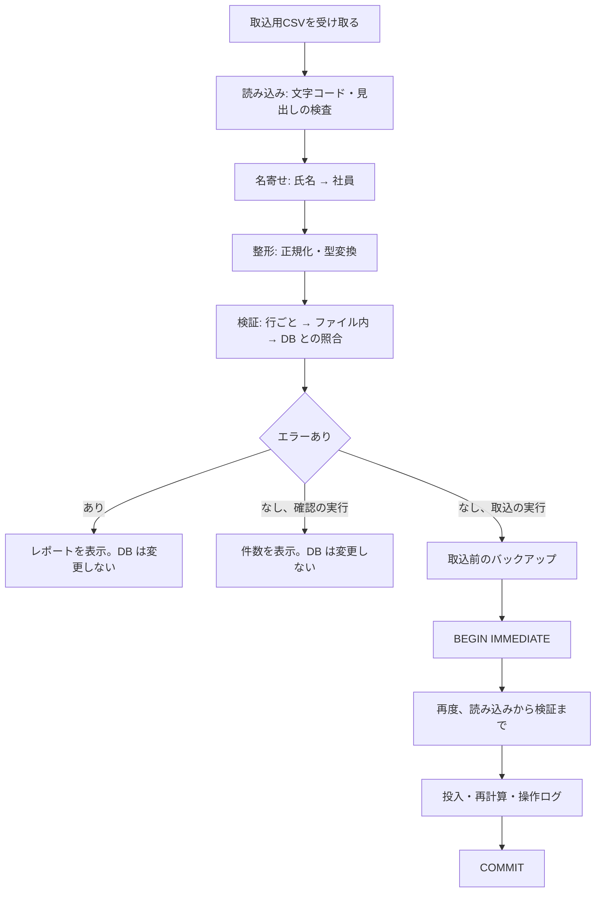

# グループG エンジニア管理CRM 移行設計書 v0.2

> バージョン：v0.2
> 更新日：2026-10-22
> 目的：要件定義書 8章（移行方針）を、取込の種類・取込用 CSV の列・名寄せ・検証・投入・エラー報告・手順に落とし込み、実装・テストの前提を定める
> 対象読者：本システムの設計・実装・テスト・移行作業に関わる担当者
> 対象範囲：19期・20期の移行元（①②③）からアプリへの取込。移行元シートの実際の列構成は入手できていないため、本書は「アプリが指定する取込用 CSV」を定義する（`MIG-001`）
> 前提：[要件定義書_v0.6.md](./要件定義書_v0.6.md)、[アーキテクチャ設計書_v0.4.md](./アーキテクチャ設計書_v0.4.md)、[データ設計書_v0.4.md](./データ設計書_v0.4.md)、[計算仕様書_v0.3.md](./計算仕様書_v0.3.md)、[権限・セキュリティ設計書_v0.2.md](./権限・セキュリティ設計書_v0.2.md)、[画面設計書_v0.2.md](./画面設計書_v0.2.md)、[用語集_v0.5.md](./用語集_v0.5.md)、[実装計画書_v0.1.md](./実装計画書_v0.1.md)（移行コマンドの名称・配布方式の案）

## 目次
1. 設計方針
2. 取込の全体像
3. 取込用 CSV の共通仕様
4. 名寄せ
5. 取込の種類ごとの仕様
6. 取込の処理
7. エラーとレポート
8. 移行コマンド
9. 移行の手順
10. 試験の観点
11. 要件トレーサビリティ
12. 要件定義書との差異
13. 他の設計書への影響
14. 未決事項
15. 変更履歴

## 1. 設計方針
設計方針には `MIG-xxx` を付ける。要件定義書にない設計判断は、12章に `MGD-xxx` として一覧にする。確認できていない内容は `TBD:` とする。

| ID | 方針 | 内容 | 根拠 |
|---|---|---|---|
| `MIG-001` | 取込用 CSV | 移行元シートの列構成（見出し・列順）が、要件定義書・設計書にない。このため、アプリが指定する形式の「取込用 CSV」を定義する。シートから取込用 CSV への転記は、利用者が行う。シートの列との対応表は、見出しの入手後に追記する（`TBD:` 14章-1） | ユーザーの回答（2026-10-21） |
| `MIG-002` | 全件ロールバック | 1回の取り込みを1トランザクションとし、エラーが1件でもあれば何も取り込まない | `ARC-013`、`ARC-005` |
| `MIG-003` | 再取込 | すでに同じ主キーのデータがあるとき、その行はエラーにし、その CSV 全体を取り込まない。業務データを物理削除しないため、入れ直しはできない。取り込みの取り消しは、取込前のバックアップからの復元で行う（`MIG-053`） | ユーザーの回答（2026-10-21）、`DBD-010` |
| `MIG-004` | 確認と実行の分離 | 「確認の実行」は、読み込み・名寄せ・整形・検証だけを行い、DB を変更しない。「取込の実行」は、確認と同じ処理を再度行ってから投入する | `SCN-070` |
| `MIG-005` | エラーに値を出さない | エラーの一覧・ログ・レポートに、金額・個人情報の値を出さない。行番号・項目名・原因の種類だけを出す。名寄せで一致しなかった人の氏名は、`REQ-MIG-002` が求める一覧として画面にだけ出し、ログには出さない | `SCD-023`、`SCD-042`、`SCN-070` |
| `MIG-006` | 同じユースケース | 画面と移行コマンドは、同じアプリケーション層のユースケースを呼ぶ。取込の処理は UI 層・コマンドに書かない | `ARC-013`、`UID-002` |
| `MIG-007` | 依存の最小化 | CSV の読み込みは標準 `csv`、文字コードの変換と正規化は標準の `codecs`・`unicodedata` で行う。新しい依存を足さない | `REQ-TEC-005`、`ARC-004` |

用語は次のとおり。名寄せ（`GLS-083`）と取込（`GLS-084`）は、用語集で定義済みである。

| 用語 | 意味 |
|---|---|
| 取込用 CSV | 本書 5章が列を定めた、アプリが読み込む CSV |
| 取込の種類 | 取込用 CSV の種類。移行先のテーブルの組ごとに、6種類ある（2.1） |
| 確認の実行 | DB を変更せずに、取込用 CSV を検証すること |
| 取込の実行 | 検証を通った取込用 CSV を、DB に投入すること |

## 2. 取込の全体像

### 2.1 取込の種類 `MIG-010`
要件定義書 8.2（`REQ-MIG-003`）の移行先ごとに、取込の種類を定める。種類の識別子は、移行先のテーブル名に合わせる（画面の名称は日本語、移行コマンドの引数は識別子）。

| 順 | ID | 画面の名称 | 識別子 | 移行先 | 19期の移行元 | 20期の移行元 |
|---|---|---|---|---|---|---|
| 1 | `IMP-01` | 社員 | `employee` | `employee`（`TBL-001`） | ②基本情報（退職者を含む） | 同左 |
| 2 | `IMP-02` | 給与履歴 | `salary-history` | `salary_history`、`salary_history_item`（`TBL-009`、`TBL-010`） | ③月給データ（19期通年の1件） | ③移行時給与、①20期上期給与情報、①20期下期給与情報 |
| 3 | `IMP-03` | 稼働期間 | `work-period` | `assignment`、`work_period`（`TBL-015`、`TBL-016`） | ③新稼働管理 | ①稼働状況 |
| 4 | `IMP-04` | 単価履歴 | `rate-history` | `rate_history`（`TBL-017`） | ③移行時給与の単価、②単価情報 | ①稼働状況、②単価情報 |
| 5 | `IMP-05` | 月次売上原価 | `monthly-pl` | `monthly_pl`（`TBL-019`） | 取り込まない（アプリで再計算） | ①売上管理 |
| 6 | `IMP-06` | 賞与 | `bonus` | `bonus`（`TBL-014`） | ③賞与計算202509（2025年9月の査定分。支給は2025年10月） | 取り込まない（運用開始後に手入力） |

- 順は、依存の順である。`IMP-02`〜`IMP-06` は、`IMP-01` で取り込んだ社員に、名寄せで紐づける（4章）。`IMP-04` は、`IMP-03` で取り込んだ参画に紐づけることができる（5.4）
- 1つの移行元シートが、複数の種類にまたがる場合がある（例：①稼働状況は、`IMP-03` と `IMP-04` と `IMP-05` の元になる）。利用者は、種類ごとに、必要な列だけの取込用 CSV を作る。1つの CSV に複数の種類の列を混ぜると、定義にない列としてエラーになる（`MIG-021`）
- 要件定義書 8.2 の「①稼働状況」からの `rate_history` の取り込みは、`IMP-04` で行う。「①売上管理（確定値）＋①稼働状況」からの `monthly_pl` は、①売上管理の分を `IMP-05` で取り込み、稼働の分は `IMP-03` で取り込む

### 2.2 取り込まないもの `MIG-011`
| 対象 | 扱い | 要件 |
|---|---|---|
| 給与テーブル、単価連動の計算ルール、旧制度の等級、売上目標 | 取込用 CSV に列を設けない | `REQ-MIG-004` |
| 見込み（`forecast`） | 取り込まない。アプリで新しく入力する | `REQ-MIG-004`、`REQ-DAT-017` |
| 評価（`evaluation`） | 取り込まない。20期上期からアプリで入力する | 要件定義書 8.2 |
| `monthly_payroll`、`monthly_payroll_item` | 取り込まない。取込後に、アプリが再計算する（`MIG-044`） | `REQ-MIG-005` |
| ③給与支払額連携、①給与管理の支払額 | 取り込まない。計算結果のため | `REQ-MIG-005` |
| ②個別状況のパスワード列 | 取り込まない。保存しない | `REQ-MIG-006`、`REQ-SEC-004` |
| 20期に支給済みの賞与 | 取り込まない。運用開始後に、`SCN-040` で手入力する | 要件定義書 8.2、12章-2 |

取込用 CSV に、取り込まない列の見出しがあるとき、その列を読み捨てて、列の名称を画面に出す（`MIG-021`）。

## 3. 取込用 CSV の共通仕様

### 3.1 ファイル形式 `MIG-020`
| 項目 | 仕様 |
|---|---|
| 形式 | CSV。区切りは `,`、引用符は `"`。標準 `csv` の既定の方言で読む |
| 文字コード | UTF-8。BOM 付き・なしの両方を受け付ける（ユーザーの回答）。それ以外の文字コードは、エラー（`E001`）にする |
| 改行 | CRLF・LF の両方を受け付ける |
| 見出し行 | 1行目。必須 |
| 空行 | すべてのセルが空の行は、読み飛ばす |
| 行番号 | 見出し行を 1 として数えたレコードの順番（空行も数える）。引用符で囲んだセルに改行があると、表計算ソフトの行番号とずれる |
| 1ファイル | 取込の種類 1 つにつき、1ファイル。1回の取り込みで、複数のファイルは受け取らない |

- 読み込みは、`utf-8-sig` で復号する。復号に失敗したときは、ファイル全体をエラーにする
- ファイルの大きさと行数の上限は、設けない。`TBD:` 想定のデータ量が要件定義書にない（14章-8）

### 3.2 見出し `MIG-021`
- 見出しは、NFKC 正規化と前後の空白の除去をしてから、5章で定める列名（および給与項目マスタの名称）を、同じ正規化をした値と完全一致で照合する。列の順は、問わない
- 見出しの重複は、エラー（`E005`）にする
- 必須の列がないときは、エラー（`E003`）にする
- 5章に定義のない列は、次のとおり扱う

| 見出し | 扱い |
|---|---|
| 5章に定義がある | 読み込む |
| 除外列の一覧（下表）にある | 読み捨てる。列の名称を、画面に「取り込まなかった列」として出す |
| 上記のどちらでもない | エラー（`E004`）。取り込み忘れ・誤りを防ぐため |

除外列の一覧（暫定。移行元シートの見出しを入手後に確定する。`TBD:` 14章-5）

| 見出し | 理由 | 要件 |
|---|---|---|
| `パスワード` | 保存しない | `REQ-MIG-006` |
| `支払額` | アプリで再計算する | `REQ-MIG-005` |
| `差額（減額）` | アプリで再計算する | `REQ-MIG-005` |
| `正誤判定` | アプリで再計算する | `REQ-MIG-005` |
| `旧制度の等級` | 取り込まない | `REQ-MIG-004` |
| `売上目標` | 取り込まない | `REQ-MIG-004` |

- 除外列の値は、行の処理に使わず、メモリに保持しない。パスワード列を含むファイルは、作らないことを手順（9章）で求める

### 3.3 セルの値 `MIG-022`
- すべてのセルは、NFKC 正規化（全角英数字・記号を半角に、半角カナを全角カナに）と、前後の空白（全角空白を含む）の除去をしてから解釈する。ただし、備考・顧客名・案件名・氏名・改定の根拠・コメントなど、自由記述の文字列は、前後の空白の除去だけを行い、NFKC 正規化はしない（利用者が入力した文字列を、そのまま保存するため）
- 空のセルは、未入力（`NULL`）とする。必須の列が空のときは、エラー（`E006`）にする
- 区分値（雇用形態・在籍ステータス・稼働状態・区分など）は、5章の表の日本語表記（照合先のマスタの値も、同じ NFKC 正規化をしてから比較する。例：全角の括弧は、半角の括弧になる）と、完全一致で照合する。一致しないときは、エラー（`E008`）にする。大文字小文字・表記揺れは、これ以上吸収しない

### 3.4 日付・年月 `MIG-023`
| 型 | 受け付ける形式 | 保存 |
|---|---|---|
| 日付 | `YYYY-MM-DD`、`YYYY/MM/DD`（月・日は 1 桁でもよい。例：`2026/4/1`） | `YYYY-MM-DD`（`DBD-005`） |
| 年月 | `YYYY-MM`、`YYYY/MM`（月は 1 桁でもよい） | `YYYY-MM` |
| 半期 | `YYYY-H1`、`YYYY-H2`、`NN期上期`、`NN期下期`（`NN期` の年度は `NN + 2006`） | `YYYY-H1`／`YYYY-H2`（`DBD-006`、`CLC-002`） |

- 存在しない日付は、エラー（`E007`）にする。上記以外の形式も、エラー（`E007`）にする

### 3.5 金額 `MIG-024`
- 円単位の整数。桁区切りの `,` は、受け付ける
- 小数点以下がある値、通貨記号・単位（`¥`、`円`）が付いた値は、エラー（`E007`）にする。丸めない（`UID-050` と同じ方針）
- 列ごとの下限（0 以上など）は、5章で定める。範囲外は、エラー（`E009`）にする

### 3.6 率 `MIG-025`
稼働率の列だけが、率を持つ。

| 入力 | 意味 | 保存（万分率） |
|---|---|---|
| `70%`、`70.00%` | 70 % | 7000 |
| `0.7`、`1`、`1.0` | 70 %、100 % | 7000、10000 |

- `%` が付いた値は、小数第2位まで。付かない値は、小数第4位まで（万分率に過不足なく対応する）。超える桁は、エラー（`E009`）にする。丸めない
- `%` が付かず、1 を超える値は、エラー（`E009`）にする（`70` が 70 % か 7000 % か判断できないため）
- 範囲は、0 以上 1 以下（0 %〜100 %）。要件定義書 5.4 の例（0.7、1.0）に合わせた（`TBL-016` の検査）
- 変換は `Decimal` で行う。浮動小数点を使わない（`DBD-004`）

## 4. 名寄せ

### 4.1 氏名の正規化 `MIG-030`
`REQ-MIG-001`（空白・全角半角を揃える）の具体化である。氏名を、次の順で正規化した文字列（正規化名）にして、照合する。

```text
正規化名(s) = casefold( 取り除く( NFKC(s) ) )
取り除く    = 空白類（str.isspace() が真の文字）と、書式文字（Unicode の一般カテゴリ Cf。例：ゼロ幅スペース）をすべて取り除く
```

実機（Python 3.13、Unicode 15.1）で、次を確認した（2026-10-21）。

| 入力 | 結果 |
|---|---|
| 姓と名の間が全角空白・半角空白・ノーブレークスペース・タブ | 空白が取り除かれ、同じ文字列になる |
| 半角カナ | 全角カナになる |
| 全角英字 | 半角小文字になる |
| ゼロ幅スペース（U+200B） | `NFKC` と `\s` では残る。書式文字として取り除く必要がある |
| 異体字（`髙` と `高`） | 別の文字のまま。一致しない |

- 異体字・旧字体の違いは、吸収しない。一致しないときは、一致しなかった人の一覧に出る（`MIG-032`）。手で対応する（`REQ-MIG-002`）

### 4.2 照合 `MIG-031`
```text
辞書 = { 正規化名(employee.name) : [employee.id, ...] }    … DB の全社員（退職者を含む）

行にメールアドレスの列があり、値がある場合:
    employee.email と、小文字化・前後の空白除去した値で、完全一致する社員
    （一致しなければ E010。氏名の列は、使わない）
行にメールアドレスの値がない場合（氏名の列を使う）:
    辞書[正規化名(氏名)] の件数が 1  → 一致
    件数が 0                           → E010（社員が見つからない）
    件数が 2 以上                      → E011（社員が複数見つかる）
```
- 名寄せの対象は、DB の `employee` である。`IMP-01` の取込より前の種類は、社員がいないため、すべての行が E010 になる（取込の順は 2.1）
- 取込用 CSV には、「氏名」と「メールアドレス」の少なくとも一方の列が必要である。両方の列がある行は、メールアドレスを優先する。同姓同名の社員がいるときの解消手段である（設計判断 `MGD-001`）
- 名寄せの結果は、メールアドレス（業務キー）に変換されたものとして扱い、内部では `employee.id` で紐づける（`REQ-MIG-001`、要件定義書 4章 #1）

### 4.3 一致しなかった人の一覧 `MIG-032`
- `E010`・`E011` の行を、氏名ごとにまとめて表示する。列は、氏名（CSV の値）、行番号、原因（見つからない／複数見つかる）
- 一覧は、画面（`SCN-070` の「名寄せの結果」）と、移行コマンドの標準出力にだけ出す。アプリケーションのログには出さない（`MIG-005`）
- 手での対応は、次のいずれかである。対応後、同じ CSV で、確認からやり直す
  - 取込用 CSV の氏名を、社員の氏名に合わせる
  - 社員の氏名を、`SCN-022` で訂正する
  - 取込用 CSV に、メールアドレスの列を追加する
- エラーが1件でもあれば、その CSV は何も取り込まれない（`MIG-002`）。一部の行だけを取り込む手段は設けない

## 5. 取込の種類ごとの仕様
各表の「必須」は、取込用 CSV で値が必要かを示す。「社員の特定」の列（氏名・メールアドレス）は、`IMP-02`〜`IMP-06` に共通である（4.2）。サンプルの値は、すべて架空である。

**社員の特定の列（`IMP-02`〜`IMP-06` 共通）**

| 列 | 必須 | 内容 |
|---|---|---|
| `氏名` | 条件付き | 名寄せに使う。`メールアドレス` の列がないときは、必須 |
| `メールアドレス` | 条件付き | 値がある行は、氏名より優先する。`氏名` の列がないときは、必須 |

### 5.1 `IMP-01` 社員 `MIG-040`
移行先：`employee`。画面設計書 4.6（`SCN-022`）の入力項目と、同じ必須の扱いにする（`UID-072`、`UID-073`）。

| 列 | 必須 | 移行先の列 | 検証 |
|---|---|---|---|
| `メールアドレス` | ○ | `email` | 小文字化して保存する（`TBL-001`）。`@` を1つ含み、空白を含まない。形式の検査は、これだけとする。DB にすでに同じ値があるとき `E013` |
| `社員番号` | － | `employee_no` | 値があるとき、CSV 内・DB 内で重複すると、`E012`・`E013`（`UID-072`） |
| `氏名` | ○ | `name` | 自由記述（`MIG-022`） |
| `氏名カナ` | － | `name_kana` | 自由記述 |
| `雇用形態` | － | `employment_type` | `正社員`、`契約社員` |
| `生年月日` | － | `birth_date` | 日付 |
| `性別` | － | `gender` | `男性`、`女性`、`その他` |
| `入社日` | ○ | `join_date` | 日付。在籍の判定に使う（`CLC-004`、`UID-072`） |
| `最寄駅` | － | `nearest_station` | 自由記述 |
| `居住エリア` | － | `residence_area` | 自由記述 |
| `職種` | － | `job_type` | 自由記述 |
| `在籍ステータス` | ○ | `enrollment_status` | `在籍`、`退職予定`、`退職`、`契約満了`、`移管` |
| `退職日` | － | `retire_date` | 日付。入社日以後（`TBL-001`）。違反は `E016` |

- この種類は、名寄せをしない。メールアドレスが主キーに当たる（`REQ-DAT-001`）
- 主キーの重複（メールアドレス）は、CSV 内で `E012`、DB 内で `E013`

例（架空）
```csv
メールアドレス,社員番号,氏名,氏名カナ,雇用形態,生年月日,性別,入社日,最寄駅,居住エリア,職種,在籍ステータス,退職日
taro.yamada@example.com,E0001,山田 太郎,ヤマダ タロウ,正社員,1990/04/01,男性,2020/04/01,東京駅,東京都,SE,在籍,
```

### 5.2 `IMP-02` 給与履歴 `MIG-041`
移行先：`salary_history`、`salary_history_item`。1行が、1件の給与履歴（改定）である。

| 列 | 必須 | 移行先の列 | 検証 |
|---|---|---|---|
| `適用開始日` | ○ | `effective_from` | 日付 |
| `給与体系` | ○ | `pay_system` | `通常評価制度`、`年俸制`、`単価連動` |
| `雇用形態` | ○ | `employment_type` | `正社員`、`契約社員` |
| `等級` | － | `grade` | 自由記述（例：`P5-15`）。新制度のみ（19期は空欄） |
| `年俸年収` | 条件付き | `annual_salary` | 金額（0 以上）。`給与体系` が `年俸制` のときだけ値を入れる。違反は `E016` |
| `改定区分` | ○ | `revision_type` | `定期（4月）`、`定期（10月）`、`年俸改定（4月）`、`制度移行`、`入社`、`その他` |
| `備考` | － | `note` | 自由記述 |
| 給与項目の列 | 条件付き | `salary_history_item` | 下記 |

給与項目の列
- 見出しが、給与項目マスタ（`pay_item`）の名称と一致する列は、その項目の金額として読む。初期データは、基本給・勤務手当（職務給）・固定残業手当・住宅手当・役職手当・一時手当（毎月）・リーダー手当・資格手当・その他手当の9項目である（`REQ-DAT-004`）
- 金額は、0 以上の整数。空のセルは、その項目の行を作らない。`0` は、金額 0 の行を作る
- 内訳の列がすべて空の行は、エラー（`E006`）にする（月給合計が 0 になり、計算できないため）
- マスタにない名称の列は、定義にない列として `E004` にする（項目を追加するときは、先に画面で給与項目を登録する）

適用終了日と履歴の順序
- 取込用 CSV に、適用終了日の列はない。適用終了日は、取込処理が設定する（設計判断 `MGD-002`）

```text
同じ社員の行を、適用開始日の昇順に並べる（同じ日付が2行あるとき E012）
各行の effective_to = 次の行の適用開始日 − 1日（最後の行は NULL）
DB にすでにその社員の履歴があるとき:
    新しい最初の行の適用開始日は、DB の最新の履歴の適用開始日より後でなければならない（違反は E017）
    最新の履歴の effective_to が NULL なら、新しい最初の行の適用開始日 − 1日 を設定する
    最新の履歴の effective_to が日付で、新しい最初の行の適用開始日がそれ以前なら E017
```
- 取込は、履歴の追記だけを受け付ける。既存の履歴より前の日付を差し込む取り込みは、できない。19期（③月給データ）→ 20期（③移行時給与、①上期、①下期）の順に取り込む
- 改定月の警告（`REQ-CAL-016`、`CLC-018`）は、取込では出さない（設計判断 `MGD-003`）
- 要件定義書 8.2 では、③移行時給与（2026/04 の制度移行：等級・給与形態・年俸）と ①20期上期給与情報（2026/04〜09）が、同じ 2026/04 を指す。適用開始日が同じ2行は、同じ社員で `E012` になる。1行にまとめる（暫定。`TBD:` 14章-2）

例（架空）
```csv
氏名,適用開始日,給与体系,雇用形態,等級,年俸年収,改定区分,備考,基本給,勤務手当（職務給）,住宅手当
山田 太郎,2025/04/01,通常評価制度,正社員,,,入社,,250000,30000,20000
```

### 5.3 `IMP-03` 稼働期間 `MIG-042`
移行先：`work_period`、`assignment`。1行が、1件の稼働期間である。

| 列 | 必須 | 移行先の列 | 検証 |
|---|---|---|---|
| `開始日` | ○ | `work_period.start_date` | 日付 |
| `終了日` | － | `work_period.end_date` | 日付。空は継続中。開始日以後（違反は `E016`） |
| `稼働状態` | ○ | `work_status_code` | 下記の名称または旧名称 |
| `顧客名` | 条件付き | `assignment.customer_name` | 売上計上が ○ の稼働状態のとき必須。× のとき、値を入れない（違反は `E016`）。自由記述 |
| `案件名` | － | `assignment.project_name` | 売上計上が × のとき、値を入れない。自由記述 |
| `区分` | 条件付き | `assignment.category` | 売上計上が ○ のとき必須。`SES`、`受託`、`既存アカプラ`、`教育原価`。× のとき、値を入れない |
| `稼働率` | － | `billing_ratio_bp` | 3.6。空は 100 % |
| `備考` | － | `note` | 自由記述。③のセルにある自由記述・数値は、利用者が、備考に移す（12章-3） |

稼働状態の読み替え（`REQ-DAT-003` の稼働状態マスタ。`work_status.name` と `work_status.legacy_name`）

| 取込用 CSV の値 | コード | 売上計上 |
|---|---|---|
| `開発稼働`、`現場稼働`（③の旧名称） | `DEV` | ○ |
| `教育稼働` | `EDU` | ○ |
| `その他稼働` | `OTH` | ○ |
| `待機（減額無し）` | `WAIT_FULL` | × |
| `待機（減額あり）`、`待機`（③の旧名称） | `WAIT_CUT` | × |
| `社内研修（減額なし）` | `TRN_FULL` | × |
| `社内研修（減額あり）`、`研修`（③の旧名称） | `TRN_CUT` | × |
| `休職` | `LEAVE` | × |
| `育休` | `CHILD` | × |

- 照合は、稼働状態マスタの名称と旧名称に対して行う。マスタの値を画面で変更したときは、変更後の値で照合する。上表は、初期データ（要件定義書 5.1）の値である
- 要件定義書は、`待機（減額無し）` と `社内研修（減額なし）` で、「無し」「なし」の表記が異なる。表は要件定義書の表記のとおりに書いた。NFKC 正規化は、この差を吸収しない（`MIG-022`）
- 稼働状態の判定は、アプリケーション層が、稼働状態マスタの売上計上の値で行う（データ設計書 10章 No.3）

稼働期間の検証
- 同じ社員の稼働期間が、CSV 内、または DB の既存の稼働期間と重なるとき、`E014`。終了日が空（継続中）の行は、その社員の最後の期間でなければ、後の期間と重なる。取込処理は、終了日を補わない（`UID-079` の入力画面と異なり、移行元は期間の終わりを持つ前提のため）
- 同じ社員・同じ開始日の行が CSV 内にあるとき、`E012`

参画（`assignment`）の作成（設計判断 `MGD-004`）
```text
キー = （社員、顧客名、案件名、区分）  … 顧客名・案件名は、4.1 の正規化名で比較する。案件名が空なら、空どうしを同じとみなす
売上計上が ○ の行を、キーでまとめる
DB にキーが同じ参画がある場合:
    その参画を使う。start_date は、既存の開始日と CSV の最も早い開始日の小さいほう。
    end_date は、どちらかが NULL なら NULL、それ以外は大きいほう
DB にない場合:
    新しい参画を作る。start_date は CSV の最も早い開始日。end_date は、NULL の行があれば NULL、なければ最も遅い終了日
work_period.assignment_id に、この参画を設定する
```

例（架空）
```csv
氏名,開始日,終了日,稼働状態,顧客名,案件名,区分,稼働率,備考
山田 太郎,2025/04/01,2025/05/31,待機,,,,,
山田 太郎,2025/06/01,,現場稼働,サンプル商事,基幹システム開発,SES,100%,6/1入場
```

### 5.4 `IMP-04` 単価履歴 `MIG-043`
移行先：`rate_history`。1行が、1件の単価の適用開始である。

| 列 | 必須 | 移行先の列 | 検証 |
|---|---|---|---|
| `適用開始日` | ○ | `effective_from` | 日付 |
| `単価` | ○ | `unit_price` | 金額（0 以上） |
| `顧客名` | － | `assignment_id` | 案件単位の単価のときだけ入れる。下記の照合 |
| `案件名` | － | `assignment_id` | 顧客名があるときだけ入れられる。顧客名なしで案件名があるとき `E016` |
| `改定の根拠` | － | `revision_basis` | 自由記述 |
| `備考` | － | `note` | 自由記述 |

- 顧客名が空の行は、社員単位の単価（`assignment_id` が `NULL`）として取り込む（`DBD-018`、`CLC-013` の（2））
- 顧客名がある行は、その社員の DB の参画から、顧客名（と案件名）が、4.1 の正規化名で一致するものを探す。1件に決まらないとき（なし・複数）は `E015`。参画は、`IMP-03` の取り込みの後に、探せる
- 主キーに当たる組（社員、参画、適用開始日）が、CSV 内で重複すると `E012`、DB に既にあると `E013`（`TBL-017`）

例（架空）
```csv
氏名,適用開始日,単価,顧客名,案件名,改定の根拠,備考
山田 太郎,2025/06/01,700000,サンプル商事,基幹システム開発,入場時の契約,
```

### 5.5 `IMP-05` 月次売上原価 `MIG-044`
移行先：`monthly_pl`。対象は、20期（①売上管理）だけである。取込用 CSV は、売上・原価・賞与を持ち、粗利は取込処理が計算する（ユーザーの回答）。

| 列 | 必須 | 移行先の列 | 検証 |
|---|---|---|---|
| `年月` | ○ | `year_month` | 年月。20期（`2026-04`〜`2027-03`）だけ。範囲外は `E018` |
| `区分` | － | `category` | `SES`、`受託`、`既存アカプラ`、`教育原価` |
| `売上` | ○ | `sales` | 金額（0 以上） |
| `月給部分の原価` | ○ | `cost_salary` | 金額（0 以上） |
| `月給の外の手当` | － | `cost_allowance` | 金額（0 以上）。空は 0（暫定。`TBD:` 14章-3） |
| `賞与` | － | `cost_bonus` | 金額（0 以上）。空は 0（暫定） |

計算して保存する列
```text
cost_total   = cost_salary + cost_allowance + cost_bonus
gross_profit = sales − cost_total          … 負の値を取り得る
source       = 取込
is_closed    = 1（締め済み。ユーザーの回答。確定値として扱う）
```
- 主キー（社員、年月）が、CSV 内で重複すると `E012`
- DB に同じ主キーの行があるときの扱いは、次のとおり（設計判断 `MGD-005`）

| DB の既存の行 | 扱い |
|---|---|
| なし | 追加する |
| `source` が `再計算`、`is_closed` が 0 | 置き換える。再計算で作られた締め前の行は、取込より先に作られうる（`IMP-02`・`IMP-03` の取り込み後の再計算。`MIG-054`）ため |
| `is_closed` が 1、または `source` が `取込` | `E019`（締め済み、または取込済み。`MIG-003`） |

- ①売上管理の原価の列が、月給部分・月給の外の手当・賞与に分かれているかは、確認できていない（`TBD:` 14章-3）

例（架空）
```csv
氏名,年月,区分,売上,月給部分の原価,月給の外の手当,賞与
山田 太郎,2026/04,SES,700000,420000,0,0
```

### 5.6 `IMP-06` 賞与 `MIG-045`
移行先：`bonus`。対象は、③賞与計算202509（2025年9月の査定分。支給は2025年10月）である。

| 列 | 必須 | 移行先の列 | 検証 |
|---|---|---|---|
| `査定対象の半期` | ○ | `eval_half` | 半期（3.4） |
| `支給月` | ○ | `pay_month` | 年月。4月または10月。半期と対応すること（上期は同年10月、下期は翌年4月。`CLC-019`）。違反は `E016` |
| `基準額の種類` | ○ | `base_type` | `基本給`、`月給合計` |
| `基準額` | ○ | `base_amount` | 金額（0 以上） |
| `賞与額` | ○ | `bonus_amount` | 金額（0 以上） |

固定で保存する列
```text
source    = 取込
is_closed = 1（支給済みの実績。支給月の原価に反映する。CLC-014）
eval_rank = NULL、rate_bp = NULL（19期の評価は取り込まない。DBD-020）
```
- 主キー（社員、査定対象の半期）が、CSV 内で重複すると `E012`、DB に既にあると `E013`
- 賞与額が、基準額×掛け率と一致するかは、検査しない。評価ランクと掛け率を持たないため
- 対象者の条件（通常評価制度の在籍者。`CLC-020`）は、検査しない。支給済みの実績を、そのまま取り込むため
- ③賞与計算202509に、基準額の列があるかは、確認できていない（`TBD:` 14章-4）。基準額は、`base_amount` が必須（`TBL-014`）のため、必須にした

例（架空）
```csv
氏名,査定対象の半期,支給月,基準額の種類,基準額,賞与額
山田 太郎,19期上期,2025/10,基本給,250000,250000
```

## 6. 取込の処理

### 6.1 処理の流れ `MIG-050`
アーキテクチャ設計書 `ARC-013` の処理順（名寄せ → 整形 → 検証 → 一括投入）に従う。



- 検証は、最初の1件で止めずに、すべてのエラーを集める。行ごとの検証（形式・必須・値の範囲）、ファイル内の検証（重複・期間の重なり）、DB との照合（既存・参照先）の順に行う
- 「取込の実行」は、確認で使った入力を、`BEGIN IMMEDIATE` の後で、もう一度検証する。確認から実行までの間に DB が変わっても、不整合な取り込みにならないため（`ARC-007` の更新の方針）
- 取込用 CSV の内容は、確認から取込の実行（または画面を離れるとき）までの間だけ、UI 状態として持つ（`UID-031`）。DB と、アプリのログには残さない

### 6.2 取込の順序と依存 `MIG-051`
- 取込の順は、2.1 の順とする。社員（`IMP-01`）より前に、他の種類は取り込めない（名寄せができないため。すべて `E010`）
- `IMP-04` の参画への紐づけが必要なときは、`IMP-03` の取込の後に行う
- `IMP-05`・`IMP-06` は、`IMP-01` の後なら、順序を問わない

### 6.3 トランザクション `MIG-052`
- 1回の取り込みを、1トランザクションとする（`MIG-002`）。トランザクションには、投入、再計算（`MIG-054`）、操作ログの記録を含める
- 途中で例外が出たら、ロールバックする。画面と移行コマンドには、原因を特定できない一般的なメッセージを出す（`ARC-018`）。詳細は、アプリケーションのログに、値を含めずに出す（`MIG-056`）
- 再計算で、計算のエラー（`CLC-022`）が出た社員・月があっても、取り込みはロールバックしない。計算のエラーは、取り込みのエラーではない。件数を通知し、`SCN-032` のエラー一覧へ案内する（`UID-055`）

### 6.4 取込前のバックアップ `MIG-053`
- 取込の実行の前に、DB のバックアップを自動で作成する（`Connection.backup`。`ARC-021`）。作成に失敗したときは、取り込まない
- 作成先は、アプリのバックアップフォルダである（`SCN-065` の一覧に出る）。取り込みを取り消したいときは、このバックアップから復元する（`SCN-065`）
- 確認の実行では、作成しない
- バックアップは、機微情報を含む（`SCD-040`）。保持する数と、古いバックアップの扱いは、`TBD:`（14章-9）
- 設計判断 `MGD-006`

### 6.5 再計算 `MIG-054`
`REQ-MIG-005` のとおり、支払額は取り込まず、取込後にアプリが再計算する（`ARC-009`、`CLC-022`）。

| 取込の種類 | 再計算 | 対象の社員・月 |
|---|---|---|
| `employee` | しない | 給与履歴がないため、計算できない |
| `salary-history`、`work-period`、`rate-history` | する | 取り込んだ行の社員について、取り込んだ行の最も早い開始日（適用開始日）の月から、今月まで（OS の現在日時の月）の、締め前の月 |
| `monthly-pl` | しない | 取り込んだ行は、締め済み（`MIG-044`）のため、再計算しない |
| `bonus` | する | 取り込んだ行の支給月の、同じ社員の月。賞与は原価に反映する（`CLC-014`）。支給月が今月より後なら、しない |

- 再計算は、同じトランザクションで行う。取り込んだ行から今月までの範囲に制限するのは、開始日が未来の行や、終了日のない行によって、際限なく先の月を計算しないためである（設計判断 `MGD-007`）
- 再計算が、`source` が `取込` の `monthly_pl` の行（締め済み）を、上書きしてはならない。`monthly_payroll` は計算して保存し、`monthly_pl` の締め済みの行は変えない。計算仕様書 `CLC-022` の改版が必要（13章、`TBD:` 14章-14）
- 営業日カレンダー（`REQ-DAT-002`）が未作成の月は、計算のエラーになる（`CLC-003`）。取込の前に、カレンダーを作成する（9章）

### 6.6 操作ログ `MIG-055`
- 取り込みごとに、`取込` を1件、同じトランザクションで記録する（`SCD-020`、`SCD-021`）
- `target_table` は、取込の種類の主なテーブルとする（下表）。`detail` は、取込の種類・取り込んだ行数・再計算した月数を、件数だけで書く。金額・氏名を含めない（`SCD-023`）
- 確認の実行は、記録しない（DB を変更しないため）

| 取込の種類 | `target_table` |
|---|---|
| `employee` | `employee` |
| `salary-history` | `salary_history` |
| `work-period` | `work_period` |
| `rate-history` | `rate_history` |
| `monthly-pl` | `monthly_pl` |
| `bonus` | `bonus` |

### 6.7 アプリケーションのログ `MIG-056`
- 取り込みの開始・終了・取り込んだ件数・エラーの件数を、INFO で出す（`ARC-013`、`ARC-018`）
- 氏名・メールアドレス・金額・CSV のセルの値は、ログに出さない（`SCD-042`）。エラーは、行番号・項目名・エラーの種類だけを出す
- 例外は、握りつぶさずに、原因を保持して再送出する（`ARC-018`）

## 7. エラーとレポート

### 7.1 エラーの種類 `MIG-060`
エラーの一覧には、行番号、項目（列名）、エラーの種類を出す。値は出さない（`MIG-005`）。ファイル全体のエラーは、行番号を出さない。

| コード | 種類 | 主な発生箇所 |
|---|---|---|
| `E001` | 文字コードが UTF-8 ではない | ファイル |
| `E002` | 見出し行がない（空のファイル） | ファイル |
| `E003` | 必須の列がない | 見出し |
| `E004` | 定義にない列がある | 見出し |
| `E005` | 見出しが重複している | 見出し |
| `E006` | 必須の値が空 | 行 |
| `E007` | 形式が正しくない（日付・年月・半期・金額・率・メールアドレス） | 行 |
| `E008` | 値が選択肢にない（区分値・稼働状態・給与項目の名称など） | 行 |
| `E009` | 値の範囲・桁数が正しくない（負の値、率の範囲・桁数など） | 行 |
| `E010` | 社員が見つからない | 名寄せ |
| `E011` | 社員が複数見つかる | 名寄せ |
| `E012` | ファイル内で、キーが重複している | 行 |
| `E013` | DB に、すでに同じキーのデータがある | DB との照合 |
| `E014` | 期間が重なる（稼働期間） | ファイル内・DB との照合 |
| `E015` | 参照先が見つからない、または1件に決まらない（参画） | DB との照合 |
| `E016` | 項目の組み合わせが正しくない（稼働状態と参画、年俸制と年俸年収、日付の前後、半期と支給月） | 行 |
| `E017` | 履歴の順序が正しくない（給与履歴は追記のみ） | DB との照合 |
| `E018` | 取込の対象期間の外（`monthly-pl` は20期だけ） | 行 |
| `E019` | 締め済み、または取込済みの行がある（`monthly-pl`） | DB との照合 |

### 7.2 レポート `MIG-061`
画面（`SCN-070`）と移行コマンドは、次の内容を出す。

| 項目 | 内容 |
|---|---|
| 取込の種類 | `MIG-010` の名称 |
| 読み込んだ行数 | 空行を除く |
| 取り込まなかった列 | 除外列の名称（`MIG-021`） |
| 名寄せの結果 | 一致した行数、一致しなかった人の一覧（`MIG-032`） |
| エラー | 件数、一覧（行番号、項目、種類）。表示は先頭の1,000件までとし、総数を併記する（設計判断 `MGD-008`） |
| 取り込み結果 | 取り込んだ行数、再計算した月数、計算のエラーの件数（取込の実行の後） |

- エラーの一覧は、エラーの種類で絞り込めなくてもよい。`st.dataframe` の並び替えで足りる（`UID-056`）

## 8. 移行コマンド

### 8.1 仕様 `MIG-070`
アーキテクチャ設計書 `ARC-013` が、アプリとは別の移行コマンドを求めている。コマンドの名称・配布の方式は、実装計画書 `IPD-008` の案とする。実行ファイルを 1 つにし、引数なしの `crm-g` が画面を起動し、`crm-g import` が移行コマンドになる（ユーザーの確認待ち。ビルドを 1 つにできるかは、実装計画書 `POC-01` で確認する）。

| 項目 | 仕様 |
|---|---|
| 呼び出し | `crm-g import <取込の種類> <CSV のパス> [--check]` |
| 引数 | 取込の種類（2.1 の識別子）、取込用 CSV のパス |
| オプション | `--check`：確認の実行だけを行う（DB を変更しない）。指定がなければ、確認の後に、取込を実行する |
| 処理 | 6章と同じ。アプリケーション層のユースケースを呼ぶ（`MIG-006`） |
| 出力 | 標準出力に、7.2 のレポートを出す。名寄せで一致しなかった人の氏名は、標準出力にだけ出す |
| 終了コード | `0`：エラーなし（確認だけ、または取り込み成功）。`1`：検証のエラーがある（取り込んでいない）。`2`：実行できない（ファイルが開けない、DB のスキーマ版が合わない、取り込み中の例外、ほか） |
| 多重起動 | アプリと同じ排他ロックを取得する（`ARC-007`。方式は OS の排他ロックの案で、実装計画書 `IPD-007`）。アプリが起動中のときは、実行せずに、終了コード `2` で終了する |

- 終了コードの割り当ては、設計での案である（設計判断 `MGD-009`）
- パスコードの認証をコマンドに求めるかは、`TBD:`（14章-6）。画面は、認証の関門を通らないと、取込を実行できない（`UID-030`）。コマンドは、DB ファイルを直接開けるため、関門がない。DB ファイルは、OS のアクセス権で保護する前提（`REQ-SEC-003`）である

## 9. 移行の手順

### 9.1 事前の準備 `MIG-080`
1. アプリを起動し、パスコードを設定する（`SCN-001`）
2. マスタの初期データがあることを確認する。稼働状態（9値）、給与項目（9項目）、計算設定（原価係数・端数処理）、賞与ルール（`TBL-003`〜`TBL-007`）
3. 営業日カレンダーを、2025年から2027年まで作成する（`SCN-060`）。19期の開始（2025/04）から、20期の終了（2027/03）までを含める。会社休日を登録する（`TBD:` 要件定義書 12章-4）
4. 移行元シートから、取込用 CSV を作る。取り込まない列（パスワード、支払額など）を含めない。ファイルは UTF-8 で保存する
5. 取込用 CSV は、機微情報（給与・個人情報）を含む。保管場所を、DB と同じ扱いにし、取り込み後は削除する（`SCD-041`）

### 9.2 取り込み `MIG-081`
1. `IMP-01` 社員 → `IMP-02` 給与履歴（19期の分、20期の分の順）→ `IMP-03` 稼働期間 → `IMP-04` 単価履歴 → `IMP-05` 月次売上原価（20期）→ `IMP-06` 賞与、の順に、種類ごとに、確認の実行 → エラーの修正 → 取込の実行を行う
2. 名寄せで一致しなかった人は、`MIG-032` の手順で対応する
3. 1回の取り込みでエラーがあれば、何も取り込まれない。修正して、確認からやり直す
4. 取り込みを取り消したいときは、取込前のバックアップから復元する（`MIG-053`）

### 9.3 取り込み後の確認 `MIG-082`
次の確認は、利用者が行う。推奨の手順であり、アプリの機能としては、件数の表示までを提供する。

| 確認 | 方法 |
|---|---|
| 件数 | 取込用 CSV の行数（空行を除く）と、レポートの取り込んだ行数が一致する |
| 社員 | 在籍ステータスごとの人数が、②基本情報と一致する（`SCN-020`） |
| 給与 | 数名の社員で、月給の内訳の合計が、移行元の月給合計と一致する（`SCN-021`） |
| 再計算 | `SCN-032` で、19期・20期の各月の要確認・計算エラーの一覧を確認する。計算エラーの原因（カレンダー未作成、稼働状態の未設定、単価なし）を解消する |
| 売上（20期） | 月ごとの売上の合計が、①売上管理と一致する（取り込んだ値のため） |
| 支払額 | 再計算の支払額を、①給与管理・③給与支払額連携の支払額と見比べる（参考）。端数処理など、計算方法の違いによる差が出うる。差は、移行の不具合とは限らない |

- 月次締め（19期・20期の過去の月を締める時期と手順）は、`TBD:`（14章-10）

## 10. 試験の観点
テスト計画書で、具体的な試験ケースに展開する。試験データは、架空のデータだけを使う。

| ID | 観点 | 期待する結果 | 設計 ID |
|---|---|---|---|
| `TC-MIG-001` | UTF-8（BOM 付き）の CSV を確認する | 読み込める | `MIG-020` |
| `TC-MIG-002` | UTF-8（BOM なし）の CSV を確認する | 読み込める | `MIG-020` |
| `TC-MIG-003` | Shift_JIS の CSV を確認する | `E001`。何も取り込まれない | `MIG-020` |
| `TC-MIG-004` | 必須の列がない CSV を確認する | `E003`。列名が表示される | `MIG-021` |
| `TC-MIG-005` | 定義にない列がある CSV を確認する | `E004` | `MIG-021` |
| `TC-MIG-006` | 除外列（`パスワード`）がある CSV を確認する | 読み捨てられ、列名が「取り込まなかった列」に表示される。値は DB・ログに残らない | `MIG-021`、`REQ-MIG-006` |
| `TC-MIG-007` | 見出しが重複する CSV を確認する | `E005` | `MIG-021` |
| `TC-MIG-008` | 日付を `2026/4/1`、`2026-04-01`、`2026/13/01` で入力する | 前2つは読める。最後は `E007` | `MIG-023` |
| `TC-MIG-009` | 半期を `2025-H1`、`19期上期`、`19期中期` で入力する | 前2つは同じ半期（`2025-H1`）になる。最後は `E007` | `MIG-023` |
| `TC-MIG-010` | 金額に `1,000`、`1000.5`、`¥1000`、`-1` を入力する | 最初だけ読める。2〜3つ目は `E007`、最後は `E009` | `MIG-024` |
| `TC-MIG-011` | 稼働率に `70%`、`0.7`、`70`、`70.001%`、`1.00001` を入力する | 最初の2つは 7000。残りは `E009` | `MIG-025` |
| `TC-MIG-012` | 姓名の間が全角空白・半角空白・タブの氏名で名寄せする | すべて同じ社員に一致する | `MIG-030` |
| `TC-MIG-013` | 半角カナ・全角英字の氏名で名寄せする | 全角カナ・半角英字の氏名に一致する | `MIG-030` |
| `TC-MIG-014` | 異体字（`髙`）の氏名で名寄せする | `E010`。一覧に氏名が出る | `MIG-030`、`MIG-032` |
| `TC-MIG-015` | 同姓同名の社員が2人いて、氏名だけの行を取り込む | `E011` | `MIG-031` |
| `TC-MIG-016` | 同姓同名の社員がいて、メールアドレスの列がある行を取り込む | メールアドレスの社員に紐づく | `MIG-031` |
| `TC-MIG-017` | 名寄せで一致しない行がある CSV を実行する | 何も取り込まれない。一覧の氏名が、ログに出ない | `MIG-002`、`MIG-005`、`MIG-032` |
| `TC-MIG-018` | エラーの一覧を確認する | 行番号・項目・種類だけが出る。金額・氏名の値が出ない | `MIG-005`、`MIG-060` |
| `TC-MIG-019` | 社員（`IMP-01`）で、入社日が空の行を取り込む | `E006` | `MIG-040` |
| `TC-MIG-020` | 社員で、同じメールアドレスの行が2行ある | `E012` | `MIG-040` |
| `TC-MIG-021` | 取り込み済みの社員を、同じ CSV でもう一度取り込む | `E013`。何も追加されない | `MIG-003`、`MIG-040` |
| `TC-MIG-022` | 給与履歴で、給与項目の列が、すべて空の行を取り込む | `E006` | `MIG-041` |
| `TC-MIG-023` | 給与履歴で、`年俸制` でないのに年俸年収がある | `E016` | `MIG-041` |
| `TC-MIG-024` | 給与履歴を、19期・20期の順に取り込む | 19期の履歴の適用終了日が、20期の最初の適用開始日の前日になる | `MIG-041` |
| `TC-MIG-025` | 給与履歴で、既存の最新の履歴より前の適用開始日を取り込む | `E017` | `MIG-041` |
| `TC-MIG-026` | 稼働期間で、売上計上の稼働状態に、顧客名・区分がない | `E016` | `MIG-042` |
| `TC-MIG-027` | 稼働期間で、`待機` と `現場稼働` の旧名称を取り込む | `WAIT_CUT`、`DEV` として取り込まれる | `MIG-042` |
| `TC-MIG-028` | 稼働期間で、同じ社員の期間が重なる行がある | `E014` | `MIG-042` |
| `TC-MIG-029` | 同じ顧客・案件の稼働期間を、19期・20期の2回に分けて取り込む | 参画が1件にまとまり、開始日・終了日が更新される | `MIG-042`（`MGD-004`） |
| `TC-MIG-030` | 単価履歴で、顧客名が一致する参画が複数ある | `E015` | `MIG-043` |
| `TC-MIG-031` | 単価履歴で、顧客名の列が空の行を取り込む | `assignment_id` が `NULL` で取り込まれる | `MIG-043` |
| `TC-MIG-032` | 月次売上原価を取り込む | 原価合計・粗利が計算されて保存される。`source` が `取込`、`is_closed` が 1 になる | `MIG-044` |
| `TC-MIG-033` | 月次売上原価で、19期の年月を取り込む | `E018` | `MIG-044` |
| `TC-MIG-034` | 再計算で作られた締め前の `monthly_pl` がある月を、取り込む | 置き換えられる | `MIG-044`（`MGD-005`） |
| `TC-MIG-035` | 取込済みの `monthly_pl` の月を、もう一度取り込む | `E019` | `MIG-044` |
| `TC-MIG-036` | 取込済みの `monthly_pl` の月が、再計算の対象になる | 取り込んだ `monthly_pl` が変わらない | `MIG-054` |
| `TC-MIG-037` | 賞与で、半期と支給月が対応しない行を取り込む | `E016` | `MIG-045` |
| `TC-MIG-038` | 賞与を取り込む | `source` が `取込`、`is_closed` が 1、評価ランクと掛け率が `NULL` で保存される。支給月の原価に反映される | `MIG-045`、`MIG-054` |
| `TC-MIG-039` | 確認の実行をする | DB が変わらない。操作ログも増えない | `MIG-004`、`MIG-055` |
| `TC-MIG-040` | 取込の実行の途中で例外を起こす | 業務データも操作ログも、ロールバックされる | `MIG-052` |
| `TC-MIG-041` | 取込の実行の前にバックアップを作れない状態にする | 取り込まれない | `MIG-053` |
| `TC-MIG-042` | 取り込みの後に、バックアップから復元する | 取り込み前の状態に戻る | `MIG-053` |
| `TC-MIG-043` | 取り込みで、再計算の計算エラーが出る | 取り込みはコミットされる。計算エラーの件数が通知される | `MIG-052` |
| `TC-MIG-044` | 取り込み後の操作ログを確認する | `取込` が1件。`detail` が件数だけ。金額・氏名がない | `MIG-055` |
| `TC-MIG-045` | 確認から取込の実行までの間に、DB を変える（別の取り込み） | 実行時の再検証で、`E013` などのエラーになる | `MIG-050` |
| `TC-MIG-046` | 移行コマンドを、`--check` で実行する | DB が変わらない。終了コード 0（エラーなし）、1（エラーあり） | `MIG-070` |
| `TC-MIG-047` | アプリの起動中に、移行コマンドを実行する | 実行されず、終了コード 2 になる | `MIG-070` |
| `TC-MIG-048` | 画面と移行コマンドで、同じ CSV を取り込む | 同じ結果になる（別々の DB で比較する） | `MIG-006` |
| `TC-MIG-049` | 取込用 CSV に、`=` で始まる氏名がある | 数式として扱われず、そのまま保存される（取込では `'` を付けない） | `MIG-022` |

## 11. 要件トレーサビリティ
| 要件 | 設計 ID |
|---|---|
| `REQ-MIG-001` | `MIG-030`、`MIG-031` |
| `REQ-MIG-002` | `MIG-032`、`MIG-060`、`MIG-061` |
| `REQ-MIG-003` | `MIG-010`、`MIG-040`〜`MIG-045` |
| `REQ-MIG-004` | `MIG-011`、`MIG-021` |
| `REQ-MIG-005` | `MIG-011`、`MIG-021`、`MIG-054` |
| `REQ-MIG-006` | `MIG-011`、`MIG-021` |
| `REQ-FUN-010` | `MIG-004`、`MIG-050`、`MIG-061` |
| `REQ-TEC-005` | `MIG-007`、`MIG-020`、`MIG-050` |
| `REQ-SEC-002` | `MIG-055` |
| `ARC-013` | `MIG-002`、`MIG-006`、`MIG-050`、`MIG-052`、`MIG-056`、`MIG-070` |

## 12. 要件定義書との差異
要件定義書 8章・設計書からの追加・解釈を、すべて明示する。ユーザーの確認待ちである。不要なものは削除する。

| ID | 内容 | 理由 |
|---|---|---|
| `MGD-001` | 取込用 CSV に、氏名のほかに、メールアドレスの列を任意で設けた。値がある行は、メールアドレスを優先する | 同姓同名の社員がいるとき、名寄せで一意に決められないため（`REQ-MIG-002` の手での対応の手段） |
| `MGD-002` | 給与履歴の適用終了日を、取込処理が設定する。追記だけを受け付ける | データ設計書 10章 No.1（新しい履歴の追加時に、前の履歴の終了日を自動で設定する）に合わせるため |
| `MGD-003` | 取込では、改定月の警告を出さない | 取込は過去の実績であり、`入社`・`制度移行` など、定期以外の改定が含まれるため。警告は、画面の登録（`UID-052`）の機能とした |
| `MGD-004` | 稼働期間の取込で、参画を、（社員、顧客名、案件名、区分）で、まとめる・再利用する。参画の開始日・終了日は、稼働期間の範囲から決める | 要件定義書にも移行元にも、参画の期間の情報がないため。19期・20期の2回に分けて取り込んでも、同じ参画が1件になるようにするため |
| `MGD-005` | `monthly_pl` の取込で、再計算で作られた締め前の行は、置き換える | 再計算（取込後に自動で実行される）が先に行を作るため、主キーの重複で、取り込めなくなるのを防ぐ |
| `MGD-006` | 取込の実行の前に、DB のバックアップを自動で作る | 業務データを物理削除しない方針（`DBD-010`）のため、取り込みを取り消す手段が、バックアップからの復元しかないため |
| `MGD-007` | 再計算の範囲を、取り込んだ行の最も早い月から今月までにする | 終了日のない稼働期間・履歴があり、範囲を決めないと、際限なく先の月を計算するため |
| `MGD-008` | エラーの表示を、先頭の1,000件までにする | 画面の応答のため。値は、設計での案（`UID-080` に合わせた） |
| `MGD-009` | 移行コマンドの終了コードを、0・1・2 とした | スクリプトから成否を判定できるようにするため。値は、設計での案 |
| `MGD-010` | 取込の対象が、移行元のシートそのものではなく、アプリ指定の取込用 CSV である | 移行元シートの列構成が、入手できていないため（`MIG-001`） |
| `MGD-011` | 自由記述の文字列は、NFKC 正規化をしない。氏名の正規化は、照合のためだけに行い、保存する値は変えない | 利用者が入力した文字列を、そのまま保存するため |
| `MGD-012` | `monthly_pl` の取込で、月給の外の手当・賞与の空を 0 として扱う | 原価の列構成が、確認できていないため（暫定） |

## 13. 他の設計書への影響
本書の確定後に、次の改版が必要になる。この PR では、改版しない（ユーザーの確認後に、同期用の PR で行う）。

| 文書 | 内容 |
|---|---|
| 画面設計書 `SCN-070` | 取込の種類の選択肢（6種類、順序）、取込用 CSV の列の案内、除外した列の表示、取込前のバックアップの案内、エラー表示の上限（`MGD-008`）、確認ダイアログの内容 |
| 計算仕様書 `CLC-022` | 取込済み（締め済み）の `monthly_pl` がある月の再計算の扱い。`monthly_payroll` だけを計算し、`monthly_pl` は変えない（`MIG-054`） |
| データ設計書 | `monthly_pl` の `source` の `取込` と、締め済みの行に、対応する `monthly_payroll` がない場合の整合性（5.4、7.5、10章 No.5） |
| アーキテクチャ設計書 `ARC-013` | 取込前のバックアップ、移行コマンドの認証・終了コード、再計算の範囲 |
| 権限・セキュリティ設計書 | 移行コマンドの認証の要否（12章に追加）。`取込` の `detail` の書式（5.1） |
| 用語集 | 取込用 CSV、取込の種類、確認の実行、取込の実行、正規化名 |

## 14. 未決事項
| # | 未決事項 | 関連する箇所 | 暫定の扱い・決める文書 |
|---|---|---|---|
| 1 | 移行元シート（①②③）の見出し・列順。取込用 CSV の列との対応表 | `MIG-001` | 見出しの入手後に、本書へ追記する。入手前は、利用者が転記する |
| 2 | ③移行時給与と、①20期上期給与情報が、同じ 2026/04 を指すときの扱い | 5.2 | 利用者が、1行にまとめる（給与体系・等級・年俸は③、内訳は①）。移行元を確認後に確定する |
| 3 | ①売上管理の原価の列が、月給部分・月給の外の手当・賞与に分かれているか。分かれていない場合の取り込み方 | 5.5、`MGD-012` | 月給部分の原価を必須、他は空を 0 とする |
| 4 | ③賞与計算202509に、基準額の列があるか | 5.6 | 基準額を必須とする（`TBL-014` が必須のため） |
| 5 | 除外列の見出しの一覧 | 3.2 | 要件定義書の語から作った暫定の一覧。見出しの入手後に確定する |
| 6 | 移行コマンドで、パスコードの認証を求めるか | 8.1 | 認証は求めない（DB ファイルの保護は OS のアクセス権）。ユーザーの確認と、権限・セキュリティ設計書の改版で決める（実装計画書 11章-11） |
| 7 | （案あり）移行コマンドの名称・配布の方式。`crm-g import <取込の種類> <CSV のパス> [--check]`、実行ファイルは 1 つ（実装計画書 `IPD-008`。ユーザーの確認待ち） | 8.1 | 実装計画書 9章 |
| 8 | 取込用 CSV の大きさ・行数の上限。想定の社員数・月数と、取り込みの所要時間 | 3.1、`ARC-022` | 上限を設けない。実装後に測定する |
| 9 | 取込前のバックアップを、保持する数と、古いものの扱い | 6.4 | 保持の制限を設けない |
| 10 | 19期・20期の過去の月を、月次締めする時期と手順 | 9.3 | 本書の範囲外。移行後の運用で決める |
| 11 | 異体字・旧字体の氏名の表記揺れ（`髙` と `高` など）の扱い | `MIG-030` | 吸収しない。一覧に出して、手で対応する |
| 12 | 20期に支給済みの賞与の金額データの入手方法 | 2.2 | 要件定義書 12章-2。取り込まず、手入力する |
| 13 | ③新稼働管理のセルにある数値・自由記述（例：「2024/2末退職」）の扱い | 5.3 | 利用者が、備考へ移す。要件定義書 12章-3（取り込むときに一覧にして確認する）は、利用者の転記作業の中で行う |
| 14 | 取込済み（締め済み）の `monthly_pl` がある月の、`monthly_payroll` の計算と月次締めの扱い（月次締めの単位が、`monthly_payroll` と `monthly_pl` で食い違う） | `MIG-054`、`MIG-044` | `monthly_payroll` だけを計算し、`monthly_pl` は変えない。計算仕様書・データ設計書の改版で決める |

## 15. 変更履歴
| 版 | 日付 | 変更内容 |
|---|---|---|
| v0.1 | 2026-10-21 | 新規作成 |
| v0.2 | 2026-10-22 | 実装計画書 v0.1 に合わせて更新。8.1 の移行コマンドの名称（`crm-g import ...`、`IPD-008`）と、多重起動の方式（`IPD-007`）。14章-6・7 の更新。案は、実装計画書 9章の差異としてユーザーの確認待ち |
